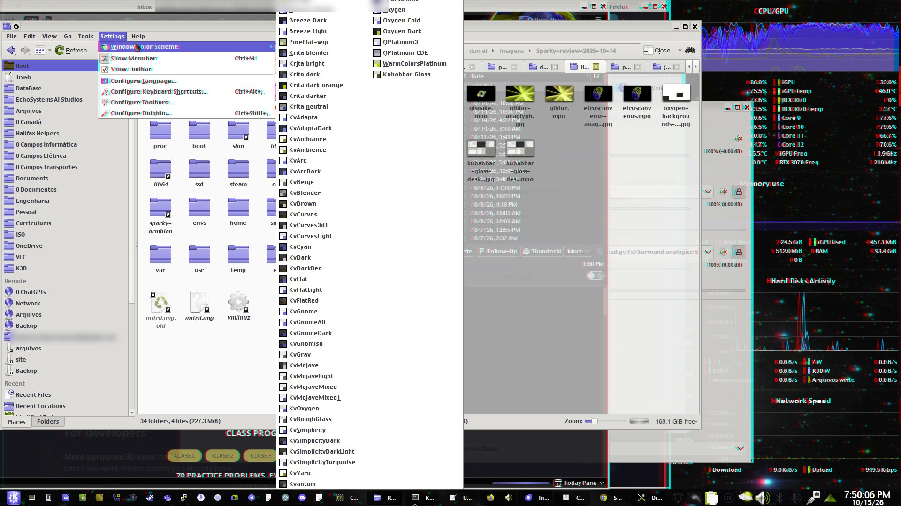
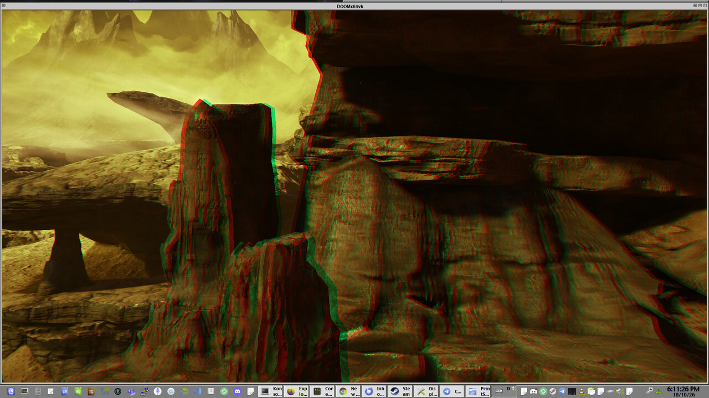
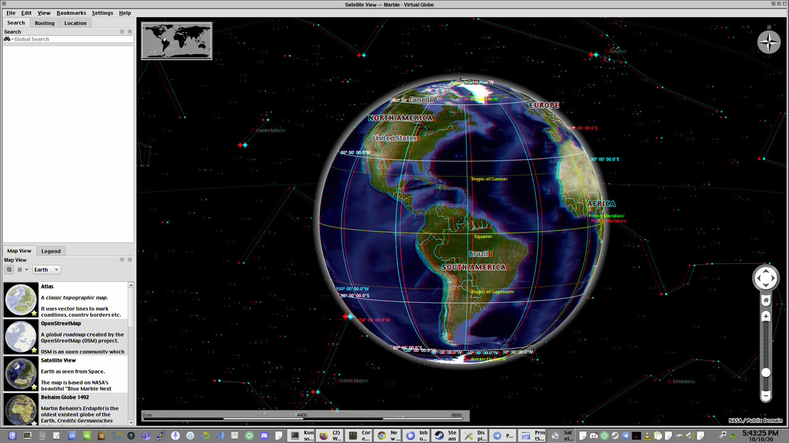
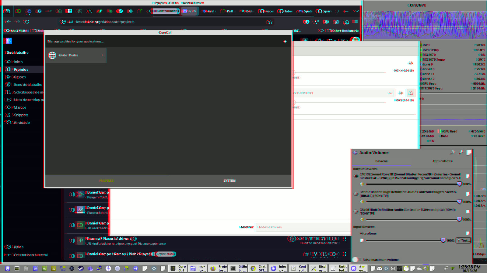

# Sparky Stereo OS

🇨🇦 [English](README.md) · 🇫🇷 [Français](README.fr.md)

**Créez et explorez en 3D sur l'écran que vous avez déjà : peinture, retouche de photos et de vidéos, étude de molécules et de globes, puis films et jeux.**
Un téléviseur 3D fonctionne, tout comme n'importe quel écran ordinaire avec de simples lunettes rouge-cyan, et désormais un téléphone Android compatible dans une visionneuse peu coûteuse : un [bureau stéréo utilisable via USB](https://github.com/Sparky-OS/flat-headset/blob/main/docs/usb-desktop-2026-10-19.md), testé sur du matériel plus ancien.
Sparky Stereo OS, l'édition de Daniel Ramos de SparkyLinux (par Paweł « pavroo » Pijanowski), est un système Linux doté d'un nouveau bureau KDE Plasma stéréo.

**Lisez l'architecture :** [guide illustré et carte du dépôt](docs/architectural-synthesis.md), avec une [infographie pleine grandeur et sa version texte](docs/architecture-infographic.md), adaptée et vérifiée à partir des recherches Gemini / NotebookLM de Daniel.

**Bureau stéréo :** le bureau lui-même a de la profondeur.
Ce que vous utilisez se trouve à l'écran et ses menus viennent vers vous, comme le menu et le sous-menu de Marble ici, tandis que les fenêtres derrière reculent les unes après les autres, comme des papiers dans une pile, avec le fond d'écran au plus profond.
Un programme 3D garde sa propre profondeur dans sa fenêtre, comme le globe de Marble.
Quelques pixels chacun, dans les limites que vous choisissez.

  

*Des lunettes rouge-cyan les montrent en 3D ([plus](#seen-in-3d)).*

**En cours de développement :** l'[APK de développement de Flat Headset et les instructions de mise à jour du PC correspondantes](https://github.com/Sparky-OS/flat-headset/tree/main/apk) sont disponibles ; l'ISO finale de l'édition stéréo est encore en préparation ([où cela va](#where-it-is-going)).

- **[Créer](#create) :** peindre en 3D et en couleurs profondes (16 bits par couleur au lieu de 8), et retoucher des photos et des vidéos 3D.
- **[Science et ingénierie](#science-and-engineering) :** le globe de Marble, les tracés de KAlgebra et les molécules de Kalzium en 3D ; les modèles 3D et les circuits imprimés sont en cours.
- **[Regarder et jouer](#watch-and-play) :** des films, des photos et des jeux 3D, dans une fenêtre ou en plein écran.
- **[Développer](#for-developers) :** rendez votre programme 3D une seule fois ; le bureau l'adapte à chaque écran.
- **[Une autre distribution ?](docs/other-distributions.md)** Pourquoi nous n'empaqueterons pas pour elle, et comment ses mainteneurs peuvent adopter nos corrections.

**Prochaine étape : parlez-nous de votre matériel 3D** et soyez informé au premier signal.
 Signez-vous dans votre langue : [🇨🇦](https://github.com/Sparky-OS/sparky-stereo-os/issues/26) [🇧🇷](https://github.com/Sparky-OS/sparky-stereo-os/issues/25) [🇵🇱](https://github.com/Sparky-OS/sparky-stereo-os/issues/27) [🇫🇷](https://github.com/Sparky-OS/sparky-stereo-os/issues/80) [🇩🇪](https://github.com/Sparky-OS/sparky-stereo-os/issues/153) [🇯🇵](https://github.com/Sparky-OS/sparky-stereo-os/issues/81) [🇰🇷](https://github.com/Sparky-OS/sparky-stereo-os/issues/83) [🇨🇳](https://github.com/Sparky-OS/sparky-stereo-os/issues/84) [🇭🇰](https://github.com/Sparky-OS/sparky-stereo-os/issues/85)

### La VR est aussi un écran stéréo

La plupart des casques sont une paire de petits écrans, un pour chaque œil, et les autres coupent un écran en deux, comme le fait un téléviseur 3D ; ainsi ce bureau unique sert aux deux.
- **L'écran 3D déjà dans votre poche :** une visionneuse économique de type Cardboard transforme un téléphone Android compatible en écran pour le bureau stéréo, en couleurs pleines, avec une vue séparée pour chaque œil. Le 19 octobre, Daniel a jugé utilisable l'installation par USB "demi-haut et demi-bas" sur un Redmi Note 7 et un ordinateur portable A10 de 2016 : le bureau fonctionne et la souris réagit. La vidéo est nettement améliorée, mais encore un peu hachée ; le premier essai Wi-Fi domestique est plus proche de l'USB, tandis que le Wi-Fi direct connaît des interruptions plus longues. La pleine résolution et davantage d'appareils restent à tester ([mesures et limites](https://github.com/Sparky-OS/flat-headset/blob/main/docs/usb-desktop-2026-10-19.md)). Le PC fait le dessin, ce qui donne une seconde vie à un téléphone plus ancien. L'[APK de développement, la source et les instructions de mise à jour du PC correspondantes](https://github.com/Sparky-OS/flat-headset/tree/main/apk) sont disponibles ensemble ; mettez d'abord à jour la clé USB de développement ou le PC installé. La visionneuse Android reste une version de test. Photos de [le premier test](https://github.com/Sparky-OS/flat-headset#the-first-test-12-october-2026) et [le bureau sur le téléphone](https://github.com/Sparky-OS/flat-headset#the-desktop-on-the-phone-14-october-2026).
- **Films en VR :** Bino joue les films à 360° et 180°, plats ou en 3D, sur n'importe quel écran 3D, et la souris fait tourner la vue.
- **Jeux en VR :** Half-Life 2 et DOOM (2016) atteignent un écran 3D via leurs modes VR.

## Qui le construit

Daniel, depuis une favela de Brasília, avec pour l'instant deux contributeurs humains : Jeromy Streets, dont le fond d'écran vidéo pour Plasma ([org.kde.video](https://github.com/Sparky-OS/org.kde.video)) vit maintenant chez Sparky-OS avec lui comme mainteneur, et Eff (effcol), qui entretient vivant le code d'iZ3D sous le nom de [wiz3D](https://github.com/Sparky-OS/wiz3D) et qui le maintient ici.
La stéréo sur Linux a attendu des années des bénévoles : les tentatives précédentes se sont bloquées parce que les relecteurs n'avaient pas d'écran 3D, et le travail touche le noyau, Mesa, KWin, FFmpeg, les lecteurs et les normes web.
Aucun autre développeur ne s'est présenté pour la porter, donc les autres partenaires présents ici sont IA, dirigés et vérifiés par Daniel et nommés dans [la traçabilité IA](docs/ai-provenance.md).
Si vous préférez voir cela construit par des mains humaines, vous êtes plus que bienvenu : chaque fork est public, et chaque tâche est ouverte.
Tout est construit et testé sur deux machines ordinaires, un PC familial et un ordinateur portable de 2016 : [le matériel](docs/hardware.md).
Sur ce portable, chaque cas du bureau tient 24 images par seconde en 2D et en 3D : [ce que la stéréo coûte à KWin, mesuré](docs/measurements/kwin-stereo-cost-a10-2026-10-23.md) (en anglais).

## Où cela va

L'édition est la preuve fonctionnelle, et ce qu'elle découvre retourne aux normes ouvertes.
Daniel préside le [Groupe communautaire Procedural Memory Knowledge Representation (PM-KR) du W3C](https://www.w3.org/community/pm-kr/) avec Milton Ponson.
Notre rapport [La 3D stéréo sur Linux et le Web](https://www.w3.org/publications/spec-generator/?type=respec&url=https://raw.githubusercontent.com/w3c-cg/pm-kr/main/reports/source/stereo-3d-adoption-report.html) est là comme une proposition individuelle, entrée de discussion pour le groupe : quelles spécifications établies portent déjà la 3D, ce que Linux et le web n'ont jamais adopté, et ce qu'un navigateur devrait avoir.
C'est aussi le sujet de notre exposé dans l'Interest Group Médias et Divertissement du W3C le 13 octobre 2026 ([les diapositives](docs/talks/2026-10-13-w3c-me-ig.md)).
L'inscription au groupe est gratuite avec un compte W3C, et l'aide est bienvenue : testez sur votre écran, relisez le rapport, ou apportez votre cas d'usage.

## Créer

**Peindre, retoucher des photos et des vidéos en 3D, et peindre en couleurs profondes : 16 bits par couleur au lieu de 8.**
- **Peinture :** Krita peint sur une toile 16 bits, et sur une toile 3D avec 16 bits dans chaque œil.
- **Photos :** digiKam et Showfoto montrent des photos 3D dans l'album, la table lumineuse, le diaporama et l'éditeur ; KolourPaint retouche une image 3D et l'enregistre avec sa marque 3D.
- **Vidéo :** dans Kdenlive un clip connaît sa mise en page 3D, les moniteurs peuvent l'afficher en 3D, et le rendu garde la marque 3D.
- **Tours interactifs :** [StorySplat](https://storysplat.com) ("Transformez vos scans 3D en visites interactives") construit des visites à l'intérieur de scans 3D de lieux réels, directement dans le navigateur, et sa vue 3D les montre en 3D sur toute sortie enregistrée, d'abord testée côte à côte sur un téléviseur Sony 3D.

Chaque programme en détail : [Programmes](#programs-the-edition-changes-for-stereo-3d-and-deep-colour).

### Pour les concepteurs et les personnalisateurs de thèmes

**Sur ce bureau, un thème décide de ce qui ressort et de ce qui plonge :** [de nouvelles frontières pour la conception des thèmes](#depth-on-the-desktop).

## Science et ingénierie

**Étudier et concevoir en 3D : un globe, des tracés et des molécules fonctionnent en 3D dès aujourd'hui, et les modèles 3D et les circuits imprimés sont en cours.**
- **Apprentissage et science :** le globe de Marble, les tracés de KAlgebra, les molécules de Kalzium et le cube de Kubrick, en 3D par défaut sur un bureau 3D.
- **Modèles 3D et circuits imprimés :** des aperçus 3D dans OpenSCAD, KiCad et F3D sont en cours.
- **Du bureau au client, en couleurs pleines :** le même modèle en profondeur sur un écran 3D sans lunettes au bureau de l'ingénieur (avec [DisplayXR](https://displayxr.org), en cours), sur un téléviseur 3D ou un projecteur pour une équipe ou une formation, et sur le téléphone de chaque employé et client dans une visionneuse de type Cardboard ([Flat Headset](https://github.com/Sparky-OS/flat-headset)). C'est ouvert de bout en bout, donc personne n'est captif d'un seul fabricant d'écrans.

Chaque programme en détail : [Programmes](#programs-the-edition-changes-for-stereo-3d-and-deep-colour).

## Regarder et jouer

**Des films, des photos et des jeux 3D s'affichent en 3D dans leur propre fenêtre ou plein écran, et le reste du bureau reste tel quel.**
- **Écrans :** un téléviseur 3D, un moniteur ou un projecteur, y compris les ensembles HDMI 3D de 2010 à 2013, ou n'importe quel écran ordinaire avec des lunettes rouge-cyan ; chaque écran peut afficher un genre de 3D différent en même temps, et les écrans 3D sans lunettes sont en cours avec l'équipe DisplayXR.
- **Films :** les vidéos 3D se lisent en 3D dans Haruna, VLC, mpv, Bino, PlasmaTube et d'autres.
- **Photos :** Gwenview, digiKam et KolourPaint montrent des photos 3D (MPO, JPS et PNG stéréo) en 3D.
- **Jeux :** DOOM (2016) dans une fenêtre et Half-Life 2, tous deux via un mode VR ([la formule](docs/formula.md)).

Chaque programme, ce qu'il gagne et sa preuve : [Programmes](#programs-the-edition-changes-for-stereo-3d-and-deep-colour).

### Vus en 3D

Les images de cette page sont des captures d'écran faites avec le Spectacle de l'édition, qui conserve chacun des deux yeux.
Des lunettes rouge-cyan les montrent en 3D ici ; les fichiers MPO s'ouvrent en 3D dans les programmes de photos de l'édition, sur toute sortie enregistrée. Le tout, avec sa version rouge-cyan et un téléchargement MPO direct : [la galerie de captures](docs/screenshots/README.md). Les propres photos 3D de Daniel prises avec un téléphone LG Optimus 3D, 2014 à 2016, avec les originaux : [la galerie de photos](docs/photos/README.md).

- **Bureau stéréo, translucide** ([MPO](https://raw.githubusercontent.com/Sparky-OS/sparky-stereo-os/main/docs/screenshots/translucent-stereo-desktop.mpo)), sur le téléviseur 3D, 15 octobre 2026. Les fenêtres sont vitrées, donc la pile se voit à travers. Mesuré entre les yeux : Dolphin, la fenêtre au premier plan, 0 px, et son menu Réglages +5 px (devant, à la limite d'avancée choisie par l'utilisateur) ; la longue liste de jeux de couleurs 0 px, parce qu'elle touche le haut de l'écran et que ce qui s'avance et touche le bord reste à l'écran ; Thunderbird derrière -3 px ; le widget du moniteur système et le fond d'écran -10 px ; le panneau 0 px. Les deux adresses e-mail sont floutées dans les deux yeux.
- **Bureau stéréo, un menu au-dessus d'un menu** ([MPO](docs/screenshots/stereo-desktop-dialogs.mpo)), sur un téléviseur 3D en frame packing, 13 octobre 2026. Mesuré entre les yeux : la fenêtre Marble au premier plan 0 px, son menu Réglages +2 px et le sous-menu Panneaux +4 px, les quatre fenêtres derrière -3, -5, -8 et -10 px, les widgets et le fond d'écran -10 px ; dans la fenêtre, la 3D propre de Marble : les étiquettes de la Terre +12 px, celles des étoiles -13 px. Les messages du salon Diolinux derrière sont flous.
- **DOOM (2016) dans une fenêtre ordinaire** ([MPO](docs/screenshots/doom-2016-in-a-window.mpo)), à partir de [KHARVOX](https://github.com/CactusVRStudios/KHARVOX), la mod de conversion en VR de DOOM (2016) de CactusVRStudios (MIT) : le jeu a de la profondeur tandis que le panneau et le cadre de la fenêtre restent plats dans les deux yeux. Mesuré entre les yeux : le rocher le plus proche à 23 px, les montagnes lointaines 1 px, le panneau 0 px.
- **Le globe de Marble** ([MPO](docs/screenshots/marble-globe.mpo)) : la Terre devant l'écran (+11 px) et les étoiles derrière (-12 px), le panneau latéral plat. Cette capture date d'avant les corrections apportées depuis ; l'image menu-au-dessus-de-menu montre Marble aujourd'hui.
- **Bureau stéréo, un pop-up** ([MPO](docs/screenshots/stereo-desktop.mpo)), le même jour. Mesuré entre les yeux : le panneau 0 px (à l'écran), le pop-up du son +4 px (en avant), les trois fenêtres derrière -3, -7 et -10 px, et le widget du moniteur système -10 px, au fond avec le fond d'écran.

## Le bureau stéréo : de nouvelles frontières pour la conception des thèmes

**Pour la première fois, un thème décide de ce qui ressort et de ce qui plonge, et pas seulement de la manière dont les choses sont rendues.**
Depuis des décennies, les ombres, les biseaux et les boutons en relief ne faisaient qu'en avoir l'air ; sur le bureau stéréo c'est réel, et doux : quelques pixels, dans les limites que vous choisissez (Configuration du système, "Profondeur 3D").

- **Ce que vous utilisez ressort :** les menus, les info-bulles, les notifications et les dialogues avancent vers vous, et la fenêtre dans laquelle vous travaillez reste à l'écran. *Construit, et vu sur un téléviseur 3D le 13 octobre 2026 ([l'image en haut](#seen-in-3d)).*
- **Le reste s'enfonce :** les fenêtres derrière reculent les unes après les autres, comme des papiers dans une pile, et le fond d'écran plonge le plus profond. *Construit.*
- **Les petits objets gardent leur place :** le pointeur prend le niveau de ce qui est dessous, une ombre se pose là où elle tombe, et une fenêtre épinglée, comme une webcam au-dessus de vos diapositives, continue de s'avancer au-dessus de tout. *Construit.*
- **Des fonds d'écran en 3D :** une photo 3D en fond d'écran garde son avance et son recul, loin derrière chaque fenêtre. *Construit.* Les fonds d'écran en vidéo 3D arrivent ensuite, avec le fond d'écran vidéo de Jeromy Streets. *À venir.*
- **Des écrans de veille en 3D :** le champ d'étoiles classique et les écrans de veille stéréo, en vraie 3D. *Construit.*
- **Des images et des icônes en 3D :** les photos 3D s'affichent en 3D dans les aperçus de Dolphin et dans les visionneuses d'images. *Construit.* Les icônes dessinées par paire, une pour chaque œil, font partie de Stereo Oxygen, l'apparence propre de l'édition. *À venir.*
- **Des effets qui ressortent et plongent vraiment :** une fenêtre en fermeture peut voler vers vous en morceaux, ou plonger derrière l'écran et rebondir sur un sol. *Construit sur notre branche de KWin, arrivant dans le prochain paquet.* Des sélecteurs de fenêtres en éventail en 3D, et le bureau cube en vraie 3D. *À venir.*
- **La 3D dès l'allumage :** l'écran de démarrage et l'écran de connexion en 3D sur les écrans 3D. *À venir.*

**Et c'est toujours un bureau 2D normal.**
Sur un écran ordinaire, rien ne change : le même thème, la même disposition, les mêmes effets, dessinés une seule fois.
La 3D n'apparaît que là où un écran peut l'afficher, ou à travers des lunettes rouge-cyan, et un thème conçu pour la 3D est aussi un thème 2D complet.

Les détails : [Profondeur sur le bureau](docs/depth-on-the-desktop.md) et [Pour les concepteurs et les personnalisateurs de thèmes](docs/for-theme-designers.md) ; les idées, croquis et maquettes 3D sont bienvenus dans [la demande sur les thèmes](https://github.com/Sparky-OS/sparky-stereo-os/issues/78).

## Pour les développeurs

**Rendez un programme 3D une seule fois : donnez les deux yeux au bureau, et il s'occupe de chaque écran.**
Vous pouvez écrire et vérifier le travail sur l'écran que vous avez déjà.
- [Développer la 3D et la XR sur un moniteur ordinaire](docs/develop-3d-on-an-ordinary-monitor.md) : commencez ici.
- [Votre scène 3D en stéréo, depuis une page web](docs/web-3d-in-stereo.md) : three.js, WebGL et WebXR, des lunettes rouge et cyan dans n'importe quel navigateur à tous les écrans 3D.
- [Formats maison](docs/house-formats.md) et [Découpage du travail stéréo](docs/stereo-labor-division.md) : les règles, liées aux spécifications.
- [Tester la stéréo sans téléviseur 3D](docs/test-stereo-without-a-3d-tv.md) et [Une machine virtuelle avec un affichage 3D](docs/stereo-vm.md) : tester la sortie 3D sur un affichage virtuel ou dans une machine virtuelle ; un système de fichiers racine prêt avec KWin stéréo est sur [notre serveur de dépôt](https://repo.sparkyos.org/bench/kwin-root/).
- [Compétences](skills/README.md) : instructions pour les personnes et les assistants IA qui travaillent sur l'édition.

## Comment cela fonctionne

**Les programmes décrivent chaque image ; le bureau l'adapte à chaque écran.** En stéréo, les deux vues voyagent ensemble dans un seul tampon côte à côte complet. L'extension HDR proposée préserve la description des couleurs de l'image et les informations de reconstruction à travers ce même partage du travail.

**Le contrat stéréo en trois lignes.**
- **KWin stéréo** (le compositeur de KDE Plasma, avec nos modifications stéréo) parle côte à côte complet, à toute résolution.
- **Les programmes** décodent ou génèrent la stéréo selon n'importe quelle norme, et livrent du côte à côte complet, à toute résolution, à KWin stéréo.
- **Les sorties** (les filtres de KWin stéréo à la fin, un par genre d'écran) convertissent cela selon ce dont chaque écran a besoin.

Pourquoi côte à côte complet, un bureau sur deux téléviseurs 3D à partir de deux GPU, et comment ce même principe s'étend à la HDR : [Comment cela fonctionne](docs/how-it-works.md). La [déclaration HDR](docs/stereo-hdr-content.md) est une conception en attente d'implémentation et de tests d'appareils inter-formats ; la représentation d'échange HDR reste un choix d'ingénierie à valider. Les tests de stéréo existants et de couleurs profondes ne valident pas ce chemin HDR.

## La stéréo dans la pile ouverte, pas dans un seul produit

Ailleurs, la stéréo est liée à un seul produit : un casque, un injecteur d'un fournisseur, un noyau d'un fournisseur.
Ici, c'est une propriété des couches ouvertes (KDE, le noyau, les formats de fichiers), donc elle atteint l'écran que vous possédez déjà : [La stéréo dans la pile ouverte](docs/open-stack.md).

## Programmes que l'édition modifie pour la 3D stéréo et les couleurs profondes

Ce que la 3D apporte à chaque programme, des films et des photos aux globes et molécules : [Programmes](docs/programs.md).
Comment chaque programme a été modifié et prouvé, par domaine (le chemin d'affichage, la vidéo, la science et l'ingénierie, les images, les simulateurs, le système, et ce qui n'est pas fait) : [Programmes en détail](docs/programs-in-detail.md).

## Nos branches sur le GitLab de KDE

Chaque modification KDE est une branche de notre fork sur [invent.kde.org](https://invent.kde.org/danielcamposramos), testée par la CI de KDE avant d'être proposée en amont : [les branches et leurs résultats de CI](docs/kde-branches.md).

## Contributions fusionnées hors de Sparky Stereo

**20 octobre 2026 : l'IANA a enregistré trois types de plans de profondeur Matroska**, en référence à notre spécification de couche stéréo. Les pistes de profondeur séparées ont maintenant des identifiants attribués pour le plan de l'œil gauche, celui de l'œil droit et celui d'arrière-plan. Les six modes proposés de trames groupées restent en revue d'expert. [Jalon d'enregistrement et fusions amont](docs/upstream-merges.md#registered-identifiers).

Là où un programme casse la stéréo ou les couleurs profondes en chemin vers l'écran, la correction va au projet du programme lui-même.
Des projets comme HandBrake, mpv, Qt Multimedia et PeerTube ont fusionné des corrections issues de notre travail ; chacune, avec le mainteneur qui l'a fusionnée, et ce qui est en revue, est dans [Contributions fusionnées hors de Sparky Stereo](docs/upstream-merges.md).
Chaque morceau est montré en fonctionnement avant d'être appelé terminé, avec les chiffres et une image anaglyphe et MPO : [Preuves](docs/proofs/README.md).
Ce que les personnes qui travaillent avec la stéréo en ont dit, en public et avec des liens : [Ce que les gens ont dit](docs/what-people-said.md).

## Documents

[La formule du moteur VR vers écran 3D](docs/formula.md), [les premières exécutions de KWin sur de vrais téléviseurs](docs/first-runs/kwin-2026-10-01/README.md) et [les diapositives de l'exposé du W3C](docs/talks/2026-10-13-w3c-me-ig.md) du 13 octobre 2026 ; chaque page est dans [docs](docs/).

## Outils

[vkms-stereo-bench](tools/vkms-stereo-bench/README.md) vérifie les modes 3D sur un affichage virtuel, et [hibernate-bench](tools/hibernate-bench/README.md) vérifie l'hibernation sous Secure Boot, tous deux dans une machine virtuelle.

## La base : trois listes ouvertes

Les recherches derrière cette édition sont publiques, dans trois listes sélectionnées que chacun peut copier (CC0) : [awesome-stereoscopy](https://github.com/danielcamposramos/awesome-stereoscopy) pour la 3D stéréo, [awesome-linux-hdr](https://github.com/danielcamposramos/awesome-linux-hdr) pour la HDR et les couleurs profondes, et [awesome-vr](https://github.com/danielcamposramos/awesome-vr) pour la réalité virtuelle.

## Crédits

Sparky Stereo OS, l'édition de Daniel Ramos (Capitain Jack) de SparkyLinux (par Paweł « pavroo » Pijanowski).

**Mainteneurs de paquets**, chacun avec les pleins droits sur son propre dépôt dans [Sparky-OS](https://github.com/Sparky-OS) :

| | |
| --- | --- |
|  | **Eff (effcol)** Entretient [wiz3D](https://github.com/effcol/wiz3D), l'enrobage universel de 3D stéréoscopique pour DirectX, OpenGL, AMD HD3D et NVIDIA 3D Vision, basé sur iZ3D, pour tout système, et son paquet ici, [Sparky-OS/wiz3D](https://github.com/Sparky-OS/wiz3D).  |
|  | **Jeromy Streets (halverneus)** Créé et maintient [org.kde.video](https://github.com/Sparky-OS/org.kde.video), le fond d'écran vidéo et l'écran de verrouillage pour KDE Plasma.  |

**Version :** Sparky Stereo OS 9 "Mashtabba", basé sur Debian 14 "Forky", KDE Plasma uniquement.

Tout ce sur quoi s'appuie cette édition, par nom : [ATTRIBUTIONS.md](ATTRIBUTIONS.md).

**Remerciements particuliers :**
- **David Fattal**, cofondateur de Leia et mainteneur de DisplayXR, pour ses encouragements, son temps et son effort, et pour avoir testé notre bureau sur les écrans 3D qu'il construit.
- **Milton Ponson** et **Christoph Dorn**, les relais de Daniel dans le groupe PM-KR du W3C, chaque membre de ce groupe, et **Dave Raggett**, **Ian Jacobs** et **Chris Needham** du W3C, qui lui a ouvert ses portes à ce travail.
- **Tim Berners-Lee** et tout le monde qui a construit Internet, couche par couche, et l'a rendu disponible.

- L'équipe **Foottroller**, pour avoir ouvert la porte à la marche en VR avec ses propres pieds sous Linux.
- **Eric Allard**, l'ingénieur qui a donné vie à Johnny 5 dans *Short Circuit* ; les scénaristes du film, **S. S. Wilson** et **Brent Maddock** ; et sa musique, par **El DeBarge**, **Peter Wolf**, **Ina Wolf** et **David Shire**, jouée de nombreuses fois pendant la construction de cette édition.

**Citez le :** 

**Étoilez le :**  ⭐ Si Sparky Stereo OS vous est utile, une étoile aide d'autres personnes à le trouver.

**Sponsor Daniel :**   Sponsoriser Daniel finance cette édition, et un don à SparkyLinux soutient la distribution de Paweł, la base sur laquelle elle est construite.

<a href="https://sourceforge.net/p/sparkyos/"><picture><source media="(prefers-color-scheme: dark)" srcset="https://sourceforge.net/sflogo.php?type=18&amp;group_id=3189517"></picture></a>

## Licence

Les documents sont sous licence [Creative Commons Attribution 4.0 International](https://creativecommons.org/licenses/by/4.0/) (CC BY 4.0) : partagez-les et adaptez-les, en donnant le crédit à Sparky Stereo OS.

> "L'information, c'est le pouvoir. Mais comme tout pouvoir, il y a ceux qui veulent le garder pour eux."
> — Aaron Swartz, [*Guerilla Open Access Manifesto*](https://archive.org/details/GuerillaOpenAccessManifesto) (juillet 2008)

Les scripts sous `docs/first-runs/` et les outils sous `tools/` sont du code et sont sous licence GNU General Public License, version 2 ou suivante (GPL-2.0-or-later) ; voir [LICENSE-GPL-2.0](LICENSE-GPL-2.0).
