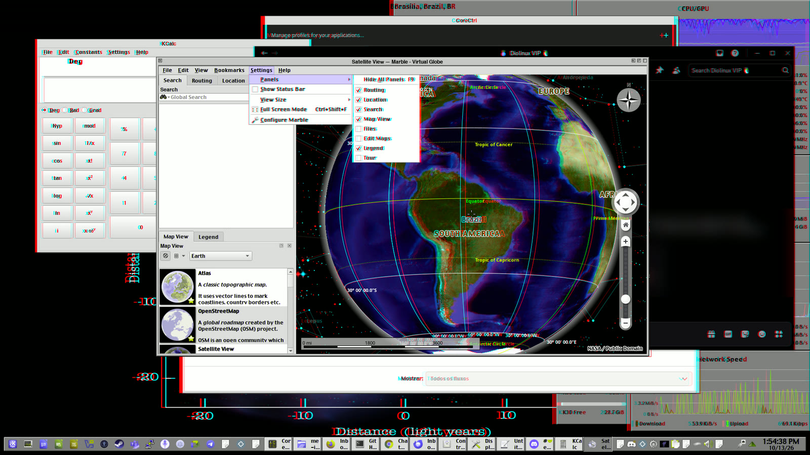

# Sparky Stereo OS

**Create and explore in 3D on the screen you already have: paint, edit photos and video, study molecules and globes, then watch films and play games.**
A 3D TV works, and so does any ordinary monitor with cheap red-cyan glasses.
Sparky Stereo OS, Daniel Ramos's edition of SparkyLinux (by Paweł "pavroo" Pijanowski), is a Linux system with the KDE Plasma desktop.

**Stereo Desktop:** the desktop itself has depth.
What you are using sits at the screen and its menus come forward, like Marble's menu and sub-menu here, while the windows behind step back one after another, like papers in a pile, with the wallpaper deepest.
A 3D program keeps its own depth inside its window, like Marble's globe.
A few pixels each, within limits you choose.

  

*Red-cyan glasses show these in 3D ([more](#seen-in-3d)).*

**In development:** nothing to download yet ([where it is going](#where-it-is-going)).

- **[Create](#create):** paint in 3D and in deep colour (16 bits per colour instead of 8), and edit 3D photos and video.
- **[Science and engineering](#science-and-engineering):** Marble's globe, KAlgebra's plots and Kalzium's molecules in 3D; 3D models and circuit boards are in progress.
- **[Watch and play](#watch-and-play):** 3D films, photos and games, in a window or full screen.
- **[Develop](#for-developers):** make your program 3D once; the desktop adapts it to each screen.
- **[Another distribution?](docs/other-distributions.md)** Why we do not package for it, and how its maintainers can adopt our fixes.

**Next step: tell us about your 3D gear** and hear first when it is ready.
 Sign up in your language: [🇨🇦](https://github.com/Sparky-OS/sparky-stereo-os/issues/26) [🇧🇷](https://github.com/Sparky-OS/sparky-stereo-os/issues/25) [🇵🇱](https://github.com/Sparky-OS/sparky-stereo-os/issues/27) [🇫🇷](https://github.com/Sparky-OS/sparky-stereo-os/issues/80) [🇯🇵](https://github.com/Sparky-OS/sparky-stereo-os/issues/81) [🇰🇷](https://github.com/Sparky-OS/sparky-stereo-os/issues/83) [🇨🇳](https://github.com/Sparky-OS/sparky-stereo-os/issues/84) [🇭🇰](https://github.com/Sparky-OS/sparky-stereo-os/issues/85)

### VR is also a stereo monitor

Most headsets are a pair of small screens, one for each eye, and the rest split one screen in two, just as a 3D TV does, so this one desktop serves both.
- **Your phone or tablet as the 3D screen (coming):** in a cardboard viewer, an Android phone shows the desktop in 3D; tablets are too big for a viewer, so their route is the glasses-free (lenticular) 3D tablets of the early 2010s. 3D films already play on it, and the whole desktop is next ([photos of the first test](https://github.com/Sparky-OS/flat-headset#the-first-test-12-october-2026)). That puts a 3D screen in the hands of billions of people who already own an Android phone or tablet ([Google's count, 2021](https://techcrunch.com/2021/05/18/android-now-powers-3b-devices)).
- **VR films:** Bino plays 360° and 180° films, flat or in 3D, on any 3D screen, and the mouse turns the view.
- **VR games:** Half-Life 2 and DOOM (2016) reach a 3D screen through their VR modes.

## Who builds it

Daniel, from a favela in Brasília, with one human contributor so far: Jeromy Streets, whose video wallpaper for Plasma ([org.kde.video](https://github.com/Sparky-OS/org.kde.video)) now lives in Sparky-OS, with him as its maintainer.
Stereo on Linux waited years for volunteers: earlier attempts stalled because reviewers had no 3D display, and the work spans the kernel, Mesa, KWin, FFmpeg, the players and the web standards.
No other developer came forward to carry it, so the other partners at work here are AI ones, directed and checked by Daniel and named in [AI provenance](docs/ai-provenance.md).
If you would rather see it built by human hands, you are more than welcome: every fork is public, and every task is open.

## Where it is going

The edition is the working proof, and what it finds goes back to open standards.
Daniel chairs the W3C [Procedural Memory Knowledge Representation Community Group (PM-KR)](https://www.w3.org/community/pm-kr/) with Milton Ponson.
Our report [Stereo 3D on Linux and the Web](https://www.w3.org/publications/spec-generator/?type=respec&url=https://raw.githubusercontent.com/w3c-cg/pm-kr/main/reports/source/stereo-3d-adoption-report.html) is there as an individual proposal, input for the group to discuss: which established specifications already carry 3D, what Linux and the web never adopted, and what a browser would need.
It is also the subject of our talk at W3C's Media and Entertainment Interest Group on 13 October 2026 ([slides](docs/talks/2026-10-13-w3c-me-ig.md)).
Joining the group is free with a W3C account, and help is welcome: test on your display, review the report, or bring your use case.

## Create

**Paint, edit photos and edit video in 3D, and paint in deep colour: 16 bits per colour instead of 8.**
- **Painting:** Krita paints on a 16-bit canvas, and on a 3D canvas with 16 bits in each eye.
- **Photos:** digiKam and Showfoto show 3D photos in the album, the light table, the slideshow and the editor; KolourPaint edits a 3D picture and saves it with its 3D mark.
- **Video:** in Kdenlive a clip knows its 3D layout, the monitors can show it in 3D, and the render keeps the 3D mark.
- **Stories:** [StorySplat](https://storysplat.com) ("Turn your 3D scans into interactive tours") builds tours inside 3D scans of real places, right in the browser, and its 3D View shows them in 3D on any of the registered outputs, first tested side by side on a Sony 3D television.

Each program in full: [Programs](#programs-the-edition-changes-for-stereo-3d-and-deep-colour).

### For theme designers and customizers

**On this desktop, depth is a design material.**
What is built, what is coming, and an example theme in words: [For theme designers and customizers](docs/for-theme-designers.md); ideas and mockups are welcome in the [themes issue](https://github.com/Sparky-OS/sparky-stereo-os/issues/78).

## Science and engineering

**Study and design in 3D: a globe, plots and molecules work in 3D today, and 3D models and circuit boards are in progress.**
- **Learning and science:** Marble's globe, KAlgebra's plots, Kalzium's molecules and the Kubrick cube, in 3D by default on a 3D desktop.
- **3D models and circuit boards:** 3D previews in OpenSCAD, KiCad and F3D are in progress.

Each program in full: [Programs](#programs-the-edition-changes-for-stereo-3d-and-deep-colour).

## Watch and play

**3D films, photos and games show in 3D in their own window or full screen, and the rest of the desktop stays as it is.**
- **Screens:** a 3D TV, monitor or projector, the HDMI 3D sets of 2010 to 2013 included, or any ordinary monitor with red-cyan glasses; each screen can show a different kind of 3D at the same time, and glasses-free 3D monitors are in progress with the DisplayXR team.
- **Films:** 3D videos play in 3D in Haruna, VLC, mpv, Bino, PlasmaTube and more.
- **Photos:** Gwenview, digiKam and KolourPaint show 3D photos (MPO, JPS and stereo PNG) in 3D.
- **Games:** DOOM (2016) in a window and Half-Life 2, both through a VR mode ([the formula](docs/formula.md)).

Each program, what it gains and how it was proven: [Programs](#programs-the-edition-changes-for-stereo-3d-and-deep-colour).

### Seen in 3D

The pictures on this page are screenshots taken with the edition's Spectacle, which keeps both eyes.
Red-cyan glasses show them in 3D here; the MPO files open in 3D in the edition's photo programs, on any of the registered outputs.

- **Stereo Desktop, a menu over a menu** ([MPO](docs/screenshots/stereo-desktop-dialogs.mpo)), on a 3D TV in frame packing, 13 October 2026. Measured between the eyes: the focused Marble window 0 px, its Settings menu +2 px and the Panels sub-menu +4 px, the four windows behind -3, -5, -8 and -10 px, the widgets and the wallpaper -10 px; inside the window, Marble's own 3D: the Earth's labels +12 px, the stars' -13 px. The messages in the Diolinux chat behind are blurred.
- **DOOM (2016) in an ordinary window** ([MPO](docs/screenshots/doom-2016-in-a-window.mpo)), based on [KHARVOX](https://github.com/CactusVRStudios/KHARVOX), CactusVRStudios' DOOM (2016) VR conversion mod (MIT): the game has depth while the panel and the window frame stay flat in both eyes. Measured between the eyes: the nearest rock 23 px apart, the far mountains 1 px, the panel 0 px.
- **Marble's globe** ([MPO](docs/screenshots/marble-globe.mpo)): the Earth in front of the screen (+11 px) and the stars behind it (-12 px), the side panel flat. This shot predates fixes made since; the menu-over-menu picture shows Marble today.
- **Stereo Desktop, a pop-up** ([MPO](docs/screenshots/stereo-desktop.mpo)), the same day. Measured between the eyes: the panel 0 px (at the screen), the sound pop-up +4 px (in front), the three windows behind -3, -7 and -10 px, and the system monitor widget -10 px, at the back with the wallpaper.

## Depth on the desktop

**The desktop itself gets a little depth, on every screen: built, and seen on a 3D TV on 13 October 2026 ([the picture at the top](#seen-in-3d)).**
The active window sits at the screen, its menus and tooltips come forward, and the wallpaper and the windows behind sink, a few pixels each, within the limits you set (System Settings, "3D Depth").
The details, and the Desktop Cube built on the same standard: [Depth on the desktop](docs/depth-on-the-desktop.md).

## For developers

**Make a program 3D once: hand the desktop both eyes, and it takes care of every screen.**
You can write and check the work on the screen you already have.
- [Develop 3D and XR on an ordinary monitor](docs/develop-3d-on-an-ordinary-monitor.md): start here.
- [House formats](docs/house-formats.md) and [Stereo labor division](docs/stereo-labor-division.md): the rules, tied to the specifications.
- [Test stereo without a 3D TV](docs/test-stereo-without-a-3d-tv.md) and [A virtual machine with a 3D display](docs/stereo-vm.md): test 3D output on a virtual display or in a virtual machine; a ready root file system with Stereo KWin is on [our repository server](https://repo.sparkyos.org/bench/kwin-root/).
- [Skills](skills/README.md): instructions for people and AI assistants working on the edition.

## How it works

**In short: every program hands the desktop both eyes the same way, and the desktop converts them for each screen.**

**The standard in three lines.**
- **Stereo KWin** (KDE Plasma's compositor, with our stereo changes) speaks full side by side, at any resolution.
- **Programs** decode or generate stereo in any standard, and deliver full side by side, at any resolution, to Stereo KWin.
- **Outputs** (Stereo KWin's filters at the end, one per kind of screen) convert from that to whatever each screen needs.

Why one format, why full side by side, one desktop on two 3D TVs from two GPUs, and why it is how Linux already handles sound: [How it works](docs/how-it-works.md).

## Stereo in the open stack, not in one product

Elsewhere, stereo is tied to one product: one headset, one vendor's injector, one vendor's kernel.
Here it is a property of the open layers (KDE, the kernel, the file formats), so it reaches the screen you already own: [Stereo in the open stack](docs/open-stack.md).

## Programs the edition changes for stereo 3D and deep colour

What 3D brings to each program, from films and photos to globes and molecules: [Programs](docs/programs.md).
How each one was changed and proven, by area (the display path, video, science and engineering, images, simulators, the system, and what is not done yet): [Programs in detail](docs/programs-in-detail.md).

## Our branches on KDE's GitLab

Every KDE change is a branch of our fork on [invent.kde.org](https://invent.kde.org/danielcamposramos), tested by KDE's own CI before it is proposed upstream: [the branches and their CI results](docs/kde-branches.md).

## Merged outside Sparky Stereo

Where a program breaks stereo or deep colour on the way to the screen, the fix goes to that program's own project.
Projects such as HandBrake, mpv, Qt Multimedia and PeerTube have merged fixes from our work; every one, with the maintainer who merged it, and what is in review, is in [Merged outside Sparky Stereo](docs/upstream-merges.md).
What people who work with stereo said about it, in public and with links: [What people said](docs/what-people-said.md).

## Documents

[The VR-engine-to-3D-display formula](docs/formula.md), [the first KWin runs on real TVs](docs/first-runs/kwin-2026-10-01/README.md) and [the W3C talk slides](docs/talks/2026-10-13-w3c-me-ig.md) of 13 October 2026; every page is in [docs](docs/).

## Tools

[vkms-stereo-bench](tools/vkms-stereo-bench/README.md) checks 3D modes on a virtual display, and [hibernate-bench](tools/hibernate-bench/README.md) checks hibernation under Secure Boot, both in a virtual machine.

## The base: three open lists

The research behind this edition is public, in three curated lists anyone can copy (CC0): [awesome-stereoscopy](https://github.com/danielcamposramos/awesome-stereoscopy) for stereo 3D, [awesome-linux-hdr](https://github.com/danielcamposramos/awesome-linux-hdr) for HDR and deep colour, and [awesome-vr](https://github.com/danielcamposramos/awesome-vr) for virtual reality.

## Credit

Sparky Stereo OS, Daniel Ramos's (Capitain Jack) edition of SparkyLinux (by Paweł "pavroo" Pijanowski).

**Version:** Sparky Stereo OS 9 "Mashtabba", based on Debian 14 "Forky", KDE Plasma only.

Everyone this edition stands on, by name: [ATTRIBUTIONS.md](ATTRIBUTIONS.md).

**Cite it:** 

<a href="https://sourceforge.net/p/sparkyos/"><picture><source media="(prefers-color-scheme: dark)" srcset="https://sourceforge.net/sflogo.php?type=18&amp;group_id=3189517"></picture></a>

## Licence

The documents are licensed under the [Creative Commons Attribution 4.0 International licence](https://creativecommons.org/licenses/by/4.0/) (CC BY 4.0): share and adapt them, giving credit to Sparky Stereo OS.

> "Information is power. But like all power, there are those who want to keep it for themselves."
> — Aaron Swartz, [*Guerilla Open Access Manifesto*](https://archive.org/details/GuerillaOpenAccessManifesto) (July 2008)

The scripts under `docs/first-runs/` and the tools under `tools/` are code and are licensed under the GNU General Public License, version 2 or later (GPL-2.0-or-later); see [LICENSE-GPL-2.0](LICENSE-GPL-2.0).
