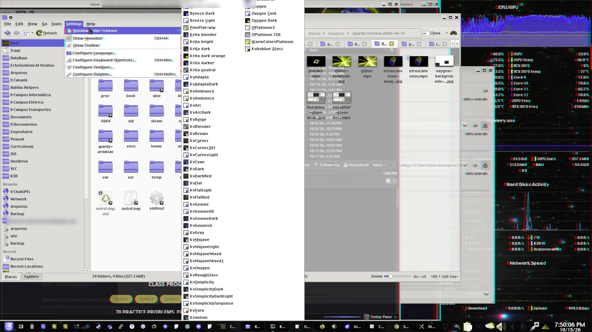
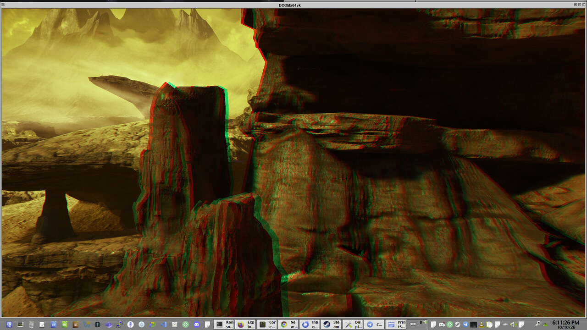
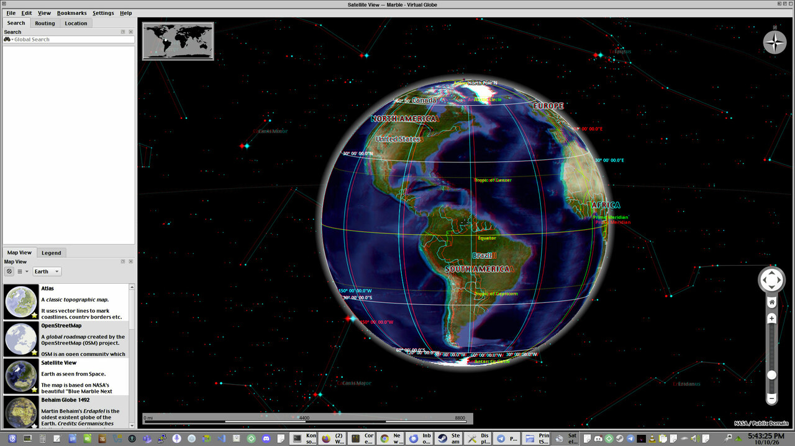
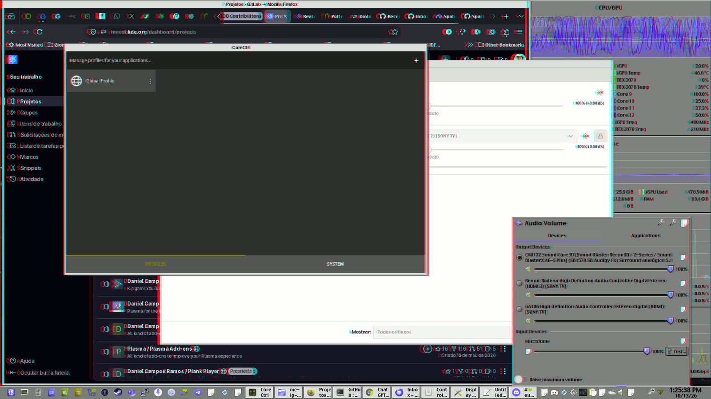

# Sparky Stereo OS

🇨🇦 [English](README.md) · 🇧🇷 [Português](README.pt-BR.md) · 🇵🇱 [Polski](README.pl.md) · 🇫🇷 [Français](README.fr.md) · 🇩🇪 [Deutsch](README.de.md) · 🇯🇵 [日本語](README.ja.md) · 🇰🇷 [한국어](README.ko.md) · 🇨🇳 [简体中文](README.zh-CN.md) · 🇭🇰 [繁體中文](README.zh-TW.md)

**Crie e explore em 3D na tela que você já tem: pinte, edite fotos e vídeos, estude moléculas e globos, depois assista a filmes e jogue.**
Ele é feito para todo tipo de tela 3D: TVs e projetores 3D, headsets de VR, telas 3D sem óculos e qualquer monitor com óculos vermelho e ciano.
Num monitor 2D comum, a mesma área de trabalho funciona sem nenhuma mudança.
Sparky Stereo OS, a edição de Daniel Ramos do SparkyLinux (de Paweł "pavroo" Pijanowski), é um sistema Linux com uma nova área de trabalho Stereo KDE Plasma.

**Mais leve para a sua máquina e para o planeta:** todo pacote vem sem os comentários e anotações que os programas nunca leem, então o mesmo trabalho exige menos processamento, menos energia e menos desgaste.
[Medido](docs/lean-code-packages.md#why-it-matters): ler os cabeçalhos C++ dá de 2 a 4% menos trabalho do que no Debian, sem perder nada.

  

*Óculos vermelho e ciano mostram essas imagens em 3D ([mais](docs/edition-in-detail.pt-BR.md#seen-in-3d)).*

**Situação: beta 1, para testadores.** Testado em TVs 3D, em monitores comuns com óculos vermelho e ciano e em um celular Android num visor de baixo custo; as telas sem óculos e os headsets autônomos estão em desenvolvimento.

**Próximo passo: experimente no seu PC com Windows, pelo pendrive, sem instalar nada:** [uma página, dez passos](docs/guides/try-on-windows.pt-BR.md).
 Peça o download e conte sobre seu equipamento 3D, no seu idioma: [🇨🇦](https://github.com/Sparky-OS/sparky-stereo-os/issues/26) [🇧🇷](https://github.com/Sparky-OS/sparky-stereo-os/issues/25) [🇵🇱](https://github.com/Sparky-OS/sparky-stereo-os/issues/27) [🇫🇷](https://github.com/Sparky-OS/sparky-stereo-os/issues/80) [🇩🇪](https://github.com/Sparky-OS/sparky-stereo-os/issues/153) [🇯🇵](https://github.com/Sparky-OS/sparky-stereo-os/issues/81) [🇰🇷](https://github.com/Sparky-OS/sparky-stereo-os/issues/83) [🇨🇳](https://github.com/Sparky-OS/sparky-stereo-os/issues/84) [🇭🇰](https://github.com/Sparky-OS/sparky-stereo-os/issues/85)

- **[Ciência e engenharia](docs/edition-in-detail.pt-BR.md#science-and-engineering):** o globo do Marble, os gráficos do KAlgebra e as moléculas do Kalzium em 3D; modelos 3D e placas de circuito estão em desenvolvimento.
- **[Criar](docs/edition-in-detail.pt-BR.md#create):** pinte em 3D e com maior profundidade de cor (16 bits por cor em vez de 8), e edite fotos e vídeos 3D.
- **[Assistir e jogar](docs/edition-in-detail.pt-BR.md#watch-and-play):** filmes, fotos e jogos 3D, numa janela ou em tela cheia.
- **[VR também é um monitor estéreo](docs/edition-in-detail.pt-BR.md#vr-is-also-a-stereo-monitor):** um headset, ou um celular num visor, também é uma tela 3D para esta área de trabalho.
- **[Desenvolver](docs/edition-in-detail.pt-BR.md#for-developers):** torne seu programa 3D uma vez; a área de trabalho o adapta a cada tela.
- **[Outra distribuição?](docs/other-distributions.md)** Por que não fazemos pacotes para ela e como seus mantenedores podem adotar nossas correções.

## A área de trabalho estéreo: novas fronteiras para o design de temas

**Nesta área de trabalho, um tema decide o que vem para a frente e o que vai para o fundo:** [novas fronteiras para o design de temas](docs/edition-in-detail.pt-BR.md#depth-on-the-desktop).

## Como funciona

**Os programas descrevem cada imagem; a área de trabalho a adapta a cada tela.** No estéreo, as duas vistas viajam juntas num único buffer no formato full side by side. A extensão HDR proposta preserva a descrição de cor da imagem e as informações de reconstrução por meio dessa mesma divisão do trabalho.
[Em detalhe](docs/edition-in-detail.pt-BR.md#how-it-works)

## Mais sobre a edição

- [Quem constrói](docs/edition-in-detail.pt-BR.md#who-builds-it)
- [Para onde vamos](docs/edition-in-detail.pt-BR.md#where-it-is-going)
- [Visto em 3D](docs/edition-in-detail.pt-BR.md#seen-in-3d)
- [Para quem cria e personaliza temas](docs/edition-in-detail.pt-BR.md#for-theme-designers-and-customizers)
- [Estéreo nas camadas abertas, não num único produto](docs/edition-in-detail.pt-BR.md#stereo-in-the-open-stack-not-in-one-product)
- [Programas que a edição modifica para estéreo 3D e maior profundidade de cor](docs/edition-in-detail.pt-BR.md#programs-the-edition-changes-for-stereo-3d-and-deep-colour)
- [Nossas branches no GitLab do KDE](docs/edition-in-detail.pt-BR.md#our-branches-on-kdes-gitlab)
- [Incorporado fora do Sparky Stereo](docs/edition-in-detail.pt-BR.md#merged-outside-sparky-stereo)
- [Documentos](docs/edition-in-detail.pt-BR.md#documents)
- [Ferramentas](docs/edition-in-detail.pt-BR.md#tools)
- [A base: três listas abertas](docs/edition-in-detail.pt-BR.md#the-base-three-open-lists)

## Créditos

Sparky Stereo OS, a edição de Daniel Ramos (Capitain Jack) do SparkyLinux (de Paweł "pavroo" Pijanowski).
Todas as pessoas em cujo trabalho esta edição se apoia, pelo nome: [ATTRIBUTIONS.md](ATTRIBUTIONS.md).

**Cite:** 

**Apoie:**   Patrocinar Daniel financia esta edição, e uma doação ao SparkyLinux apoia a distribuição de Paweł, a base sobre a qual ela é construída.

[Em detalhe](docs/edition-in-detail.pt-BR.md#credit)

## Licença

Os documentos estão sob a [licença Creative Commons Atribuição 4.0 Internacional](https://creativecommons.org/licenses/by/4.0/) (CC BY 4.0): compartilhe e adapte, dando crédito ao Sparky Stereo OS.
[Em detalhe](docs/edition-in-detail.pt-BR.md#licence)
