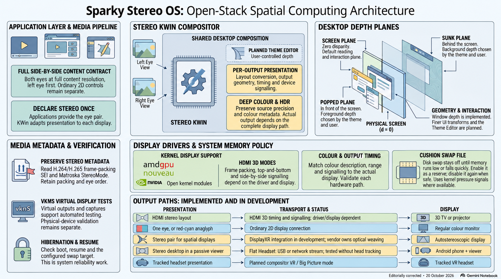
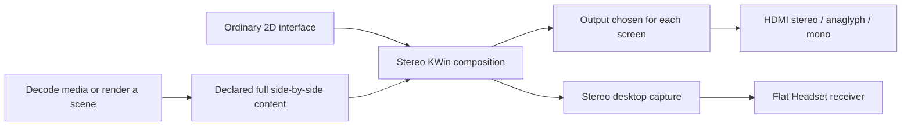

# Architectural synthesis of Sparky Stereo OS

**An overview of the display architecture, the repositories behind it, and the work still in progress.**

Prepared from a Gemini / NotebookLM research report requested by Daniel Ramos; edited and checked against the project's public documentation and repository records with OpenAI Codex on **20 October 2026**. This is a project-maintained synthesis. Implementation status and measurements belong to the linked evidence.

NotebookLM infographic, editorially corrected with Codex and OpenAI image generation on 20 October 2026.
[Full-size image and accessible text](architecture-infographic.md).
The Cushion Swap File is a reserve for system memory pressure; the diagram also distinguishes implemented features from planned integrations.

- [Architecture at a glance](#architecture-at-a-glance)
- [One stereo representation, outputs for different screens](#one-stereo-representation-outputs-for-different-screens)
- [Depth for the desktop and its themes](#depth-for-the-desktop-and-its-themes)
- [Colour, system services and verification](#colour-system-services-and-verification)
- [Repository map](#repository-map)
- [Media metadata and scientific applications](#media-metadata-and-scientific-applications)
- [Upstream work and open standards](#upstream-work-and-open-standards)
- [Sources and editorial notes](#sources-and-editorial-notes)

## Architecture at a glance

Sparky Stereo OS is Daniel Ramos's stereo edition of **SparkyLinux**, created by Paweł “pavroo” Pijanowski. Version 9, **Mashtabba**, is based on Debian 14 “Forky” and KDE Plasma. The [Sparky-OS organization](https://github.com/Sparky-OS) brings together the edition's work and the earlier small-business server and workstation projects.

The edition makes stereo a capability of shared Linux layers: applications and media libraries, graphics APIs, the desktop compositor, and display drivers. The purpose is to let an application deliver a stereo picture once, with the desktop adapting it to each supported screen. The [edition contract](../skills/sparky-stereo/SKILL.md) defines this division of responsibility.

| Part | Role and status |
| --- | --- |
| System | SparkyLinux-based development edition, Debian 14 “Forky”, KDE Plasma. See the [front page](../README.md) for current availability. |
| Application interface | Full side by side, left eye first, both eyes complete at the content's resolution, declared to the compositor. |
| Desktop | Stereo KWin composes the views and applies the output selected for each screen. |
| Hardware integration | Edition changes in DRM/KMS, graphics libraries and drivers expose or present the supported stereo modes. |
| Ordinary monitors | Anaglyph with appropriate glasses, or a full-colour mono view without anaglyph filtering. |
| Phones | Flat Headset has a usable USB desktop result on tested older hardware; video cadence and wireless performance remain development work. |
| Glasses-free displays | Collaboration with DisplayXR includes geometry and packaging work; broad display compatibility remains to be qualified. |
| Headset interaction | Flat Headset's current desktop receiver does not provide head tracking. Tracked VR and the broader spatial workspace are separate development goals. |

The [program status inventory](programs-in-detail.md), [hardware record](hardware.md) and [Flat Headset measurements](https://github.com/Sparky-OS/flat-headset/blob/main/docs/usb-desktop-2026-10-19.md) describe what has actually been packaged or tested.

## One stereo representation, outputs for different screens

### The full side-by-side contract

Applications decode an existing stereo format or render two views, then deliver one **full side-by-side buffer**. An eye image of width *w* and height *h* occupies half of a *2w × h* buffer. “Full” describes the complete eye views; it does not require rendering every source at a display's native resolution.

The two views are submitted together as one picture. This keeps their association through presentation; it does not synchronize unrelated camera recordings or make a frame-sequential screen display both eyes simultaneously. Stereo KWin converts that picture at the output boundary. The project's analogy is an audio server: applications supply the agreed representation, while shared infrastructure deals with the devices. [How it works](how-it-works.md), [house formats](house-formats.md).

The application window and its stereo content can be separate surfaces. Menus and controls stay at the interface's ordinary logical size; the video or 3D viewport carries the paired views. Shared libraries and toolkit changes make that separation reusable across applications. [Stereo labour division](stereo-labor-division.md), [stereo window and 3D area](../skills/stereo-window-3d-area/SKILL.md).

### Per-screen output and mixed GPUs

The project records a mirrored desktop on two televisions: AMD graphics supplying frame packing at 30 Hz and an NVIDIA RTX 3060 supplying top and bottom at 60 Hz. Those are measurements of that setup, rather than a compatibility guarantee for every GPU and display. [Mixed-GPU example](how-it-works.md), [first physical runs](first-runs/kwin-2026-10-01/README.md).

| Endpoint | Work at the output boundary | Qualification |
| --- | --- | --- |
| HDMI 3D television or projector | Compose the selected eye layout; use the corresponding DRM mode, timing and HDMI signalling. Frame packing involves timing and blanking as well as image placement. | Physical TV tests and virtual-display tests are documented. |
| Ordinary colour monitor | Select one eye for mono output, or combine the eyes using an anaglyph transform. | The edition documents both routes. |
| Android phone in a passive viewer | Capture, encode and transport the desktop; the receiver presents the eye views for its viewer. | USB desktop usability accepted on the tested Redmi Note 7 / A10 setup. Full-resolution and wider device coverage remain open. |
| Eye-tracked glasses-free display | Report window placement to the runtime; the display's own integration owns its optical weaving. | DisplayXR collaboration and audit work, with hardware-specific qualification still required. |
| Tracked headset | Supply stereo content within a runtime that also handles tracking, view poses and presentation timing. | A separate integration path; the untracked phone receiver alone does not establish it. |

See [the output contract](house-formats.md), [phone evidence](https://github.com/Sparky-OS/flat-headset/blob/main/docs/usb-desktop-2026-10-19.md) and the [DisplayXR geometry audit](https://github.com/Sparky-OS/displayxr-kwin-audit).

The driver changes are similarly specific. The edition documents amdgpu's HDMI stereo enumeration and signalling, NVIDIA open-kernel-module changes, and Mesa paths that turn stereo graphics buffers into the shared representation. NVIDIA's kernel module, user-space OpenGL driver and Wayland platform are distinct parts of that path; a working kernel mode does not establish that every user-space stereo API works. [Display-path implementation and limits](programs-in-detail.md).

## Depth for the desktop and its themes

### Declared planes and user limits

Stereo KWin gives desktop surfaces three reference planes:

| Plane | Desktop use |
| --- | --- |
| **screen** | The active window sits at the screen plane. |
| **popped** | Menus, dialogs, tooltips and notifications can appear in front. |
| **sunk** | Background windows step back by stacking order; the wallpaper is deepest. |

The implemented settings express depth limits in pixels referenced to a 1920-pixel-wide view and scale them for each output. They are not a viewer-calibrated camera model based on measured viewing distance and eye spacing. The user controls the limits and can set depth to zero. Edges, shadows and pointer placement have their own rules. [Theme-design reference](for-theme-designers.md#what-you-can-design-with-built).

Depth for an ordinary desktop plane can be drawn using **two synchronized 2D views of the same state**, with horizontal disparity. The application does not need to become a 3D scene engine to place a menu or a window at a depth. A real 3D scene still needs coherent per-eye projections, including visibility and view-dependent effects. [Qt/KDE depth guidance](../skills/stereo-window-3d-area/references/qt-kde-depth.md).

### Themes, Union and the proposed editor

The design aims to let a theme declare an element's plane while the user retains the final depth limits. A central theme editor and shared settings are planned to make those choices accessible and leave room for creative depth arrangements. Existing desktop-plane depth, effects implemented on a development branch, and the proposed editor are different completion states. [Theme design and effects](for-theme-designers.md).

The public [Ocean / Union discussion](https://discuss.kde.org/t/real-depth-for-oceans-elevation-a-design-question-for-union/50744) asks where this declaration should belong in KDE's styling system. It does not establish an accepted `elevation-plane` CSS property.

The proposed small scale and upward-left motion on a 2D screen, with input following the item transform, is also a design item. It should not be read as a claim that every widget already implements it. The current 2D desktop remains usable, while stereo surfaces keep their own two-eye content when moved through the window stack. [Built and planned theme behaviour](for-theme-designers.md).

## Colour, system services and verification

### Deep colour and HDR

The edition works to preserve precision through the graphics path and use 10, 12 or 16 bits per component where the content, software and display support them. Results are recorded per path: Krita's 16-bit canvas is one example; an NVIDIA-to-TV link running at the display's 12-bit maximum is another. This does **not** establish a universal 16-bit desktop or physical output. The documented Krita window chrome also has a separate precision limitation. [Application and driver evidence](programs-in-detail.md), [colour contract](house-formats.md).

Deep colour and HDR are separate properties. The proposed combined stereo/HDR declaration would keep colour and reconstruction information attached to each content layer. The HDR interchange representation and cross-format device tests remain open engineering work; the current stereo evidence does not qualify that proposal. [Stereo and HDR declaration](stereo-hdr-content.md).

A concrete upstream result is Qt Multimedia's mastering-display luminance fix: the backend reported a value 10,000 times too large instead of the API's expected nits. That is a metadata-units correction, not a measurement of the viewer's screen. [Merged change and tests](https://codereview.qt-project.org/c/qt/qtmultimedia/+/778399), [upstream record](upstream-merges.md).

### Memory policy and Lean Code

The **Cushion Swap File** is the edition's memory-pressure policy: enable swap when memory becomes scarce or falls quickly, and disable it when doing so is safe. It uses kernel pressure information where available. It is not a special mechanism for swapping left- and right-eye framebuffers, and no stereo frame-rate gain follows merely from its existence. [System implementation](programs-in-detail.md).

**Lean Code** retains authored source and creates checked runtime projections. Published packages use a versioned `lc1` marker tied to a payload manifest, with exact human-readable companions where projection changed files. Native pre-compilation processing has separate evidence. The full repository migration is in progress as of this page's review date. Byte savings, build time and measured application responsiveness are reported separately. [Lean Code package contract](lean-code-packages.md), [qualification and measurements](../skills/lean-code/SKILL.md).

### Verification tools

| Tool or record | What it establishes |
| --- | --- |
| [vkms-stereo-bench](../tools/vkms-stereo-bench/README.md) | Virtual HDMI stereo enumeration, timing, placement and per-eye readback in a QEMU guest, with optional compositor checks. |
| [Stereo virtual machine](stereo-vm.md) | A guest display with HDMI 3D modes and a stereo presentation path to its host. |
| [hibernate-bench](../tools/hibernate-bench/README.md) | Secure Boot, hibernation, resume and tamper scenarios using guest firmware and throwaway keys. Its records include failing expectations; it does not certify every system's hibernation. |
| [Proof gallery](proofs/README.md) | Individual application and compositor results, with images and measurements. |
| [KDE branch records](kde-branches.md) | Branches and their recorded CI results, separate from physical-display tests. |

## Repository map

This is a reading map of the report's main subjects, checked against the organization's public repository list on 20 October 2026, with a few shared components added for clarity. A repository's existence is not evidence that its integration is finished or shipped. The [program inventory](programs-in-detail.md) records those distinctions; the [organization's repository directory](https://github.com/orgs/Sparky-OS/repositories) is the live catalogue.

### Desktop, display and shared infrastructure

| Repository | Responsibility |
| --- | --- |
| [sparky-stereo-os](https://github.com/Sparky-OS/sparky-stereo-os) | Public documentation, maintainer skills, specifications and verification tools. |
| [kwin](https://github.com/Sparky-OS/kwin) | Compositor integration and per-output stereo presentation. |
| [kscreen](https://github.com/Sparky-OS/kscreen), [libkscreen](https://github.com/Sparky-OS/libkscreen) | Display configuration and its supporting library. |
| [plasma-wayland-protocols](https://github.com/Sparky-OS/plasma-wayland-protocols) | Edition protocol definitions for stereo content and output settings. |
| [libstereo-declare](https://github.com/Sparky-OS/libstereo-declare) | Shared X11/Wayland declaration of full side-by-side content. |
| [stereo-layer](https://github.com/Sparky-OS/stereo-layer) | Shared stereo policy and presentation components for Qt applications. |
| [qtbase](https://github.com/Sparky-OS/qtbase) | Toolkit integration, including stereo drawable and viewport work. |
| [kimageformats](https://github.com/Sparky-OS/kimageformats) | Stereo image-format handling in KDE's image plugins. |
| [spectacle](https://github.com/Sparky-OS/spectacle) | Screenshots that preserve both eye views. |
| [plasma-stereo-wallpaper](https://github.com/Sparky-OS/plasma-stereo-wallpaper) | Stereo still-image wallpaper. |
| [org.kde.video](https://github.com/Sparky-OS/org.kde.video) | Jeromy Streets' video wallpaper and lock-screen plugin; base for the planned stereo-video background work. |
| [linux](https://github.com/Sparky-OS/linux) | Kernel-side stereo display work. |
| [egl-wayland](https://github.com/Sparky-OS/egl-wayland) | NVIDIA Wayland-platform stereo work, subject to the driver limitations documented above. |
| [qemu](https://github.com/Sparky-OS/qemu) | Virtual-display integration for stereo guests. |
| [displayxr-packaging](https://github.com/Sparky-OS/displayxr-packaging), [displayxr-kwin-audit](https://github.com/Sparky-OS/displayxr-kwin-audit) | DisplayXR packaging and compositor-geometry verification. |
| [sparky-aptus-stereo-appcenter](https://github.com/Sparky-OS/sparky-aptus-stereo-appcenter) | Edition app-centre work based on Sparky APTus. |

The NVIDIA kernel-module fork is in Daniel's account: [open-gpu-kernel-modules](https://github.com/danielcamposramos/open-gpu-kernel-modules). The edition also depends on work outside this organization; see [attributions](../ATTRIBUTIONS.md) and [KDE branches](kde-branches.md).

### Video and audio

| Repository | Responsibility |
| --- | --- |
| [mpv](https://github.com/Sparky-OS/mpv), [vlc](https://github.com/Sparky-OS/vlc) | Playback, stereo interpretation and compositor presentation. |
| [bino](https://github.com/Sparky-OS/bino) | Stereo playback, including 180°/360° video; edition output follows the compositor contract. |
| [mlt](https://github.com/Sparky-OS/mlt) | Media framework used by Kdenlive, including stereo metadata work. |
| [qtmultimedia](https://github.com/Sparky-OS/qtmultimedia) | Qt video-frame stereo metadata and presentation integration. |
| [pipewire](https://github.com/Sparky-OS/pipewire), [wireplumber](https://github.com/Sparky-OS/wireplumber) | Audio-system and session-policy work. |
| [plasma-pa](https://github.com/Sparky-OS/plasma-pa), [pulseaudio-qt](https://github.com/Sparky-OS/pulseaudio-qt) | Plasma audio settings and their Qt interface. |
| [stereo-create](https://github.com/Sparky-OS/stereo-create) | Stereo image/video conversion and context-menu integration. |

The audio repositories' presence does not establish a completed spatial-audio renderer. Their public descriptions identify audio work; the [house formats](house-formats.md) describe the intended audio policy.

### Science, engineering and simulation

| Repository | Area |
| --- | --- |
| [openscad](https://github.com/Sparky-OS/openscad) | Parametric CAD preview work. |
| [grass](https://github.com/Sparky-OS/grass) | Geospatial visualization integration. |
| [octave](https://github.com/Sparky-OS/octave) | Numerical plots and their graphics path. |
| [netgen](https://github.com/Sparky-OS/netgen) | Mesh visualization. |
| [f3d](https://github.com/Sparky-OS/f3d) | 3D model viewing. |
| [avogadrolibs](https://github.com/Sparky-OS/avogadrolibs) | Molecular visualization libraries. |
| [flightgear](https://github.com/Sparky-OS/flightgear), [simgear](https://github.com/Sparky-OS/simgear) | Flight simulation and its rendering framework. |
| [OpenSceneGraph](https://github.com/Sparky-OS/OpenSceneGraph), [plib](https://github.com/Sparky-OS/plib) | Shared rendering infrastructure used by simulation applications. |

These projects are at different stages. For example, the edition's recorded child-window checks distinguish demonstrated Netgen presentation from applications whose child-window paths still need proof. [Per-program results](programs-in-detail.md).

### Games, web and mobile displays

| Repository | Responsibility and distinction |
| --- | --- |
| [wine](https://github.com/Sparky-OS/wine), [proton-wine](https://github.com/Sparky-OS/proton-wine) | Stereo work in Wine and Valve's Wine fork; `proton-wine` is not the entire Proton distribution. |
| [dxvk](https://github.com/Sparky-OS/dxvk) | Direct3D-to-Vulkan translation work. |
| [glfw](https://github.com/Sparky-OS/glfw), [SDL](https://github.com/Sparky-OS/SDL), [fltk](https://github.com/Sparky-OS/fltk), [freeglut](https://github.com/Sparky-OS/freeglut) | Shared window and graphics-context support. |
| [source-sdk-2013](https://github.com/Sparky-OS/source-sdk-2013) | Source-engine stereo work, including the Half-Life 2 path. |
| [KHARVOX](https://github.com/Sparky-OS/KHARVOX) | Fork of CactusVRStudios' DOOM (2016) VR conversion mod, used for the desktop stereo demonstration. |
| [waterfox-stereo](https://github.com/Sparky-OS/waterfox-stereo) | Browser-side stereo and WebXR development. |
| [flat-headset](https://github.com/Sparky-OS/flat-headset) | Android phone as an untracked stereo desktop screen; [APK and development instructions](https://github.com/Sparky-OS/flat-headset/tree/main/apk). |
| [stereodroid](https://github.com/Sparky-OS/stereodroid) | Planned phone-headset work with tracking through ALVR and PhoneVR. |
| [OpenVR-ArduinoHMD](https://github.com/Sparky-OS/OpenVR-ArduinoHMD) | DIY headset driver fork; Linux compatibility work is a starting point, not a qualified end-to-end headset output. |

### Business editions and system utilities

The server/workstation line began in 2018. Its historical repositories cover deployment, domain membership, time service and supervision; the organization describes the Debian 14 port as later work. [Organization profile](https://github.com/Sparky-OS#business-editions).

| Repository | Responsibility |
| --- | --- |
| [sparky-server](https://github.com/Sparky-OS/sparky-server) | Post-install server configuration. |
| [sparky-ad-server](https://github.com/Sparky-OS/sparky-ad-server) | Samba Active Directory controller installation. |
| [sparky-ad-client](https://github.com/Sparky-OS/sparky-ad-client) | Domain membership and workstation service management. |
| [sparky-ntp-server](https://github.com/Sparky-OS/sparky-ntp-server) | WAN time synchronization and LAN time service. |
| [sparky-server-run](https://github.com/Sparky-OS/sparky-server-run) | Check and start configured services. |
| [sparky-meta-server](https://github.com/Sparky-OS/sparky-meta-server) | Server dependency selection. |
| [sparky-server-doc](https://github.com/Sparky-OS/sparky-server-doc) | Administration documentation. |
| [sparky-beep](https://github.com/Sparky-OS/sparky-beep) | Audible service announcements. |
| [sparky-ca](https://github.com/Sparky-OS/sparky-ca) | Installation of CA certificates into the system. |
| [SparkyBlack](https://github.com/Sparky-OS/SparkyBlack) | Plasma, login and boot artwork. |

## Media metadata and scientific applications

### Keep the description with the picture

Stereo layout, eye order, display geometry and projection are distinct facts. A codec's frame-packing message and a container's stereo field can describe related properties at different levels. The edition's guidance follows the applicable specifications and decoder state, including SEI persistence and cancellation. Frame dimensions alone do not establish a half-resolution stereo layout. [Stereo-video guidance](../skills/stereo-video/SKILL.md), [stereo metadata decisions](../skills/stereo-video/references/metadata-and-geometry.md).

Work across FFmpeg, HandBrake, MKVToolNix, mpv, Universal Media Server and other projects repairs particular losses or misinterpretations along this path. The exact fixes and their upstream states are recorded in [Merged outside Sparky Stereo](upstream-merges.md). That record should be used instead of assuming every transcoder preserves every stereo mode.

The intended path is:

1. Read the source's declared layout, eye order and geometry.
2. Preserve or correctly rewrite metadata when changing the representation.
3. Decode or unpack into the edition's complete per-eye views.
4. Declare the stereo content to the compositor.
5. Convert at the selected screen output.

### Scientific displays and shared presentation

Applications that already render stereo may be able to reuse their graphics path through the edition's shared layers. Each integration still needs testing: graphics-context creation, window geometry, input, correct eye assignment and the surrounding 2D interface all matter.

The [ChimeraX mailing-list discussion](https://mail.cgl.ucsf.edu/mailman/archives/list/chimerax-users@cgl.ucsf.edu/thread/AOWMLGLFWSRXPSUZSYGI5K4PGPCXVSE5/) explores its existing stereo and XR modes. It is an invitation to compatibility testing, not a completed ChimeraX qualification.

For DisplayXR, the compositor supplies placement information while the runtime/display integration handles the optical details. See the [window-geometry specification](https://github.com/DisplayXR/displayxr-runtime/blob/main/docs/specs/runtime/wayland-window-geometry.md), [ADR-033](https://github.com/DisplayXR/displayxr-runtime/blob/main/docs/adr/ADR-033-placement-reports-geometry-weaver-owns-phase.md) and [Sparky's audit repository](https://github.com/Sparky-OS/displayxr-kwin-audit). Placement work does not eliminate vendor display support or device calibration.

This division makes a common application picture useful for different presentation contexts: a workstation display, a classroom or cinema projector, and a phone viewer. It is an architectural opportunity; the evidence for each physical route remains separate.

## Upstream work and open standards

The edition maintains its own branches while offering suitable fixes upstream. Accepted changes reduce the work the distribution must carry; remaining edition-specific changes stay explicit. The [upstream record](upstream-merges.md) links merged work, submissions in review and the exact issues they address.

Daniel co-chairs the W3C **Procedural Memory Knowledge Representation Community Group (PM-KR)** with Milton Ponson and presented the stereo work to the Media & Entertainment Interest Group on 13 October 2026. The [presentation](talks/2026-10-13-w3c-me-ig.md) and [Stereo 3D adoption report](https://github.com/w3c-cg/pm-kr/blob/main/reports/source/stereo-3d-adoption-report.html) connect implementation findings to standards discussion. The report is proposal material for discussion, not a W3C Recommendation or an institutional endorsement.

The architectural contribution is a clear boundary: applications own content and its description; shared graphics layers carry it; the compositor and outputs adapt its presentation. Desktop planes, real 3D scenes and tracked interaction can use that boundary while retaining their different rendering and input requirements.

## Sources and editorial notes

The copied NotebookLM report contained six numbered citations. Their source titles and links are recovered below. The body of this edition uses more specific project references where those establish a claim or correct an older status.

| Original citation | Recovered source | Use in this edition |
| --- | --- | --- |
| 1 | [Sparky Stereo OS](https://github.com/Sparky-OS/sparky-stereo-os) | Architecture and project status; linked to the relevant detailed pages above. |
| 2 | [Sparky-OS organization](https://github.com/Sparky-OS) | Repository identities and organizational history; repository links checked against the public GitHub API. |
| 3 | [ChimeraX-users archive](https://mail.cgl.ucsf.edu/mailman/archives/list/chimerax-users@cgl.ucsf.edu/latest?count=200&page=1) | Replaced in the scientific section by the specific stereo discussion, because the “latest” listing changes over time. |
| 4 | [Ocean / Union depth discussion](https://discuss.kde.org/t/real-depth-for-oceans-elevation-a-design-question-for-union/50744) | Design discussion, read alongside the explicit built/planned distinctions in the theme-design page. |
| 5 | [Deep colour and Canadian 3D labs: original topic address](https://linustechtips.com/topic/1643543-real-depth-and-deep-colour-on-a-kde-desktop-and-canadas-3d-labs-sparky-stereo-os-in-development/) | Historical outreach reference. The forum records a topic merge in the [surviving thread](https://linustechtips.com/topic/1643492-stereo-3d-virtual-machines-on-linux-a-qemu-guest-with-real-hdmi-3d-modes/#findComment-16942752). |
| 6 | [Stereo virtual machines: surviving forum thread](https://linustechtips.com/topic/1643492-stereo-3d-virtual-machines-on-linux-a-qemu-guest-with-real-hdmi-3d-modes/) | Outreach context; the technical reference is now the project's [virtual-machine guide](stereo-vm.md). |

Editorial corrections include the separation of implemented and planned features; content resolution versus display resolution; deep colour versus HDR; mastering-display metadata versus output-screen capability; KHARVOX's identity; the scope of the Cushion Swap File; and Flat Headset versus tracked phone VR. An unsupported camera-depth formula, illustrative but unimplemented CSS syntax, repository-language percentages and broad competitor comparisons were omitted.

For current implementation details, start with [Programs in detail](programs-in-detail.md). For contributing, use the [maintainer workflow](maintainer-workflow.md) and [skills index](../skills/README.md).
