# Sparky Stereo OS 9 Beta 1: ausprobieren und neben Windows installieren

Diese Anleitung führt vom Download bis zum 3D-Desktop, zuerst vom USB-Stick und dann fest installiert neben Windows auf derselben Festplatte.
Sie richtet sich an alle, die Linux noch klassisch kennen, mit einer eigenen Partition für jedes Systemverzeichnis, und sie fängt genau dort an.

Sparky Stereo OS, Daniel Ramos's edition of SparkyLinux (by Paweł "pavroo" Pijanowski).
Darunter steckt Debian 14 „Forky“ mit SparkyLinux und KDE Plasma, dazu ein Stereo-3D-Unterbau: Der ganze Desktop, nicht nur Filme und Spiele, lässt sich auf den vorhandenen Bildschirmen in 3D darstellen.


Dies ist Beta 1.
Alles in dieser Anleitung wurde mit dem Abbild von Beta 1 in virtuellen Maschinen durchgespielt, wie in den einzelnen Abschnitten beschrieben.
Was sich dort nicht prüfen ließ, ist als nicht getestet gekennzeichnet.
Die bekannten Probleme von Beta 1 stehen am Ende.

## Inhalt

1. [Abbild herunterladen und prüfen](#1-abbild-herunterladen-und-prüfen)
2. [Der Live-Stick: wofür er da ist](#2-der-live-stick-wofür-er-da-ist)
3. [Den Stick beschreiben](#3-den-stick-beschreiben)
4. [Vom Stick starten](#4-vom-stick-starten)
5. [Der 3D-Desktop in der Live-Sitzung](#5-der-3d-desktop-in-der-live-sitzung)
6. [Von einer Partition je Verzeichnis zu einer Partition](#6-von-einer-partition-je-verzeichnis-zu-einer-partition)
7. [Neben Windows installieren](#7-neben-windows-installieren)
8. [Nach der Installation](#8-nach-der-installation)
9. [Bekannte Probleme von Beta 1](#9-bekannte-probleme-von-beta-1)
10. [Fehler melden](#10-fehler-melden)

## 1. Abbild herunterladen und prüfen

Das Abbild gibt es hier: `<DOWNLOAD-LINK>`

| Datei | sparky-stereo-os-9-mashtabba-beta1-x86_64.iso |
|---|---|
| Größe | 5.166.120.960 Bytes |
| SHA-256 | `3564fc23315117bb552543235e889e5a398c9cf13e41ec0cceb6086ff43a25ab` |
| SHA-512 | `cd7c3da5ae699b951471a4c9d6e7443f5a8944fd7eb3a0f2f7d311c96275689be1e056c0ea96296f4ffd75ba4c3b21a5d79c499bb8a34e43b7d89784a35bd377` |

Prüfen Sie die Datei, bevor Sie sie auf einen Stick schreiben.

Unter Windows, in der Eingabeaufforderung im Download-Ordner:

```
certutil -hashfile sparky-stereo-os-9-mashtabba-beta1-x86_64.iso SHA256
certutil -hashfile sparky-stereo-os-9-mashtabba-beta1-x86_64.iso SHA512
```

In der PowerShell liefert `Get-FileHash .\sparky-stereo-os-9-mashtabba-beta1-x86_64.iso -Algorithm SHA256` dasselbe.
Ob Windows die Prüfsumme in Groß- oder Kleinbuchstaben ausgibt, spielt keine Rolle.

Unter Linux:

```
sha256sum sparky-stereo-os-9-mashtabba-beta1-x86_64.iso
sha512sum sparky-stereo-os-9-mashtabba-beta1-x86_64.iso
```

Weicht eine Prüfsumme ab, laden Sie die Datei erneut herunter.

## 2. Der Live-Stick: wofür er da ist

Der Stick ist ein vollständiges System, das vom USB-Stick und aus dem Arbeitsspeicher läuft und an Ihren Festplatten nichts verändert, solange Sie das Installationsprogramm nicht starten.
Er dient zum Testen der Hardware, zum Vorführen des 3D-Desktops und zum Installieren.

Eine Live-Sitzung ist langsamer als ein installiertes System.
Jedes Programm wird aus einem komprimierten Abbild auf dem Stick gelesen und erst beim Start entpackt, deshalb starten Programme langsamer, und der erste Start des Desktops dauert einige Minuten.
Beurteilen Sie die Geschwindigkeit von Sparky Stereo OS erst nach der Installation.

Was Sie in der Live-Sitzung ändern, ist nach einem Neustart wieder weg.
Der Live-Benutzer heißt `live`, das Passwort ist ebenfalls `live`.

Was sich in der Live-Sitzung ausprobieren lässt:

- der 3D-Desktop auf Ihren Bildschirmen, in dem Format, das der jeweilige Bildschirm versteht (Abschnitt 5);
- 3D-Fotos in Gwenview, 3D-Videos in mpv und Bino sowie die 3D-Bildschirmschoner und Hintergrundbilder;
- Ihre Grafikkarten und Bildschirme: welche Karte welchen Bildschirm ansteuert und ob die 3D-Formate dort richtig ankommen.

## 3. Den Stick beschreiben

Sie brauchen einen USB-Stick mit mindestens 8 GB.
Alles, was darauf ist, wird gelöscht.

Drei Wege kommen in Frage: Rufus und Ventoy unter Windows, Ventoy und dd unter Linux.

| Werkzeug | Modus | Stand in Beta 1 |
|---|---|---|
| dd (Linux) | Rohkopie | Getestet: Das Abbild startet als USB-Datenträger auf allen Firmware-Varianten des Tests |
| Rufus (Windows) | DD-Abbild-Modus | Eine Rohkopie wie dd, daher dasselbe Ergebnis zu erwarten; Rufus selbst wurde nicht ausgeführt |
| Rufus (Windows) | ISO-Abbild-Modus | Nicht getestet; für Beta 1 nicht empfohlen |
| Ventoy (Linux) | Ventoy 1.1.18 mit Secure-Boot-Unterstützung | Getestet: BIOS, UEFI sowie UEFI mit Secure Boot |
| Ventoy (Windows) | dasselbe Ventoy, unter Windows geschrieben | Derselbe Stick wie oben, daher dasselbe Ergebnis zu erwarten; unter Windows nicht ausgeführt |

### Rufus im DD-Abbild-Modus

1. Rufus starten und unter Laufwerk den Stick wählen.
2. Unter Startart auf AUSWAHL klicken und das Abbild wählen.
3. Auf START klicken.
4. Rufus meldet, dass es sich um ein ISOHybrid-Abbild handelt, und fragt nach dem Schreibmodus.
   Wählen Sie „Im DD-Abbild-Modus schreiben“ und bestätigen Sie mit OK.
5. Bestätigen, dass der Stick gelöscht wird.

Im DD-Abbild-Modus übergeht Rufus seine Einstellungen für Partitionsschema und Dateisystem: Der Stick wird eine exakte Kopie des Abbilds und startet im BIOS- wie im UEFI-Modus, mit und ohne Secure Boot.

Der ISO-Abbild-Modus kopiert stattdessen die Dateien auf einen FAT32- oder NTFS-Stick.
Das Abbild enthält eine Datei über 4 GB, also müsste Rufus NTFS mit seinem eigenen UEFI:NTFS-Lader verwenden.
Dieser Weg wurde für Beta 1 nicht getestet, nehmen Sie daher den DD-Abbild-Modus.

Die Beschriftungen in Rufus stammen aus der deutschen Oberfläche und können je nach Version leicht abweichen.

### Ventoy

Ventoy legt ein kleines Startmenü auf den Stick, und die Abbilddateien kopieren Sie einfach darauf wie auf jeden anderen Stick.

Unter Windows starten Sie `Ventoy2Disk.exe`, setzen im Menü Option den Haken bei Secure Boot Support, wählen den Stick und klicken auf Install.
Unter Linux, im entpackten Ventoy-Ordner, als root:

```
sh Ventoy2Disk.sh -i -s /dev/sdX
```

Dabei schaltet `-s` die Secure-Boot-Unterstützung ein, und `/dev/sdX` ist Ihr Stick (vorher mit `lsblk` prüfen).
Danach kopieren Sie die Abbilddatei auf die große Partition des Sticks und prüfen sie bei Bedarf noch einmal mit `sha256sum`.

Bei eingeschaltetem Secure Boot braucht Ventoy eine eigene, einmalige Schlüsselregistrierung, unabhängig vom Schlüssel von Sparky Stereo OS aus Abschnitt 4.
Beim ersten Start hält die Firmware mit „Verification failed: (0x1A) Security Violation“ an.


Drücken Sie die Eingabetaste, wählen Sie „Enroll key from disk“, öffnen Sie den Datenträger VTOYEFI des Sticks und wählen Sie `ENROLL_THIS_KEY_IN_MOKMANAGER.cer`.


Dann Continue, Yes und Reboot.
Danach zeigt das Ventoy-Menü das Abbild an; wählen Sie es und dann „Boot in normal mode“, und es folgt das eigene Menü des Sticks.

### dd unter Linux

```
lsblk
sudo dd if=sparky-stereo-os-9-mashtabba-beta1-x86_64.iso of=/dev/sdX bs=4M status=progress oflag=sync
```

Ersetzen Sie `/dev/sdX` durch den ganzen Stick (nicht durch eine Partition wie `/dev/sdX1`) und prüfen Sie das zweimal mit `lsblk`: dd schreibt auf jedes Gerät, das man ihm nennt.

## 4. Vom Stick starten

### Den Stick auswählen

Die meisten Firmwares öffnen beim Einschalten mit einer Taste ein einmaliges Startmenü: F8 bei ASUS-Boards, F11 oder F12 bei vielen anderen, manchmal Esc.
Wählen Sie dort den Stick.
Erscheint der Stick zweimal, einmal mit „UEFI:“ davor, nehmen Sie den UEFI-Eintrag: Nur so klappt die Installation neben einem Windows im UEFI-Modus.

Im Titel des Startmenüs steht, in welchem Modus der Stick gestartet ist, „(UEFI mode)“ oder „(BIOS mode)“.
Für eine Live-Sitzung geht beides.
Für die Installation neben Windows muss es der UEFI-Modus sein, denn Windows auf einer GPT-Festplatte startet im UEFI-Modus, und beide Systeme teilen sich seine EFI-Systempartition.

Das Menü bietet:

| Eintrag | Was er tut |
|---|---|
| Sparky Stereo OS (live) | Die Live-Sitzung auf Englisch, mit dem Kernel der Edition |
| Sparky Stereo OS (live, Deutsch) | Dasselbe auf Deutsch mit deutscher Tastatur |
| Sparky Stereo OS with Debian's signed kernel | Die Live-Sitzung mit Debians eigenem Kernel, der keinen Schlüssel braucht; die Stereo-Funktionen des Edition-Kernels fehlen dann |
| Enrol the Sparky Stereo OS key | Öffnet den MokManager, um den Schlüssel der Edition vom Stick zu registrieren (siehe unten) |
| Safe graphics (nomodeset) | Für einen Bildschirm, der mit dem normalen Eintrag schwarz bleibt |
| Copy ToRAM | Kopiert zuerst das ganze Abbild in den Arbeitsspeicher und läuft dann ohne Stick |

### Boards mit eigenem Management-Controller

Server- und Workstation-Boards mit Management-Controller (BMC) haben einen eigenen kleinen VGA-Chip.
Firmware-Bildschirme, das Startmenü des Sticks und der Startbildschirm erscheinen dann unter Umständen an diesem VGA-Anschluss und nicht an Ihrer Grafikkarte.
Im Firmware-Setup legt eine Einstellung, meist „VGA Priority“ genannt (bei AMI-Firmware unter Advanced, PCI Subsystem Settings), fest, welche Grafik Vorrang hat; stellen Sie sie auf die eingesteckte Karte („Offboard Device“).
Manche Boards haben zusätzlich einen Jumper, mit dem sich die Onboard-Grafik abschalten lässt.

Auf solchen Boards starten USB-Sticks ab Werk oft nur im Legacy-Modus (CSM).
Sehen Sie in den CSM-Einstellungen nach: „Boot Option filter“ sollte UEFI zulassen („UEFI and Legacy“ oder „UEFI only“), und die Option-ROM-Richtlinie für Video sollte auf UEFI stehen, wenn die Firmware-Bildschirme im UEFI-Modus auf der eingesteckten Karte erscheinen sollen.

Sobald der Desktop läuft, legt Sparky Stereo OS ihn auf die Grafikkarte, an der Bildschirme hängen, auch wenn die Firmware zuerst die VGA des Management-Controllers gewählt hat.
Das wurde mit nachgebildeten Kartenanordnungen getestet, nicht auf einem Board mit Management-Controller.

### Grafikkarten

Die Live-Sitzung wählt den Grafiktreiber selbst und sagt das in einer Benachrichtigung:

- NVIDIA-Karten ab der Turing-Generation (GeForce RTX, Quadro RTX, RTX A-Serie und neuer) bekommen den NVIDIA-Treiber der Edition, Version 615 mit offenen Kernelmodulen.
- Ältere NVIDIA-Karten (Pascal und davor, etwa GeForce 10 und Quadro P) bekommen den freien Treiber nouveau.
  Die geschlossenen NVIDIA-Legacy-Treiber lassen sich für den Kernel von Beta 1 nicht bauen.
- Ist Secure Boot an und der Schlüssel der Edition nicht registriert, startet die Live-Sitzung mit Debians Kernel, der keine NVIDIA-Module hat, und verwendet ebenfalls nouveau.

Um selbst zu wählen, bearbeiten Sie den Menüeintrag mit `e`, hängen an die Zeile, die mit `linux` beginnt, `sparky.gpu=nvidia` oder `sparky.gpu=nouveau` an und starten mit F10.

### Secure Boot und der Schlüssel von Sparky Stereo OS

Mit eingeschaltetem Secure Boot startet der Stick über Debians signiertes shim und Debians signiertes GRUB, die jeder Secure-Boot-Rechner akzeptiert.
Der eigene Kernel der Edition ist mit dem Schlüssel der Edition signiert.
Diesen Schlüssel kennt Ihre Firmware erst, wenn Sie ihn einmal als Machine Owner Key (MOK) registrieren.

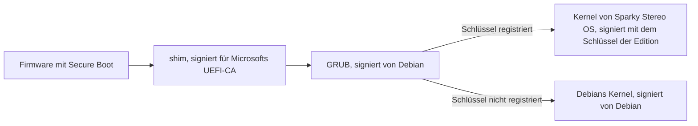

Ohne Schlüssel geht nichts kaputt.
Der Stick zeigt „error: bad shim loader signature.“ und „The Sparky Stereo OS key is not enrolled: starting Debian's signed kernel instead.“, wartet bis zu 10 Sekunden und startet dann Debians Kernel.
Mit registriertem Schlüssel startet der Kernel der Edition, mit seinen Stereo-Funktionen und dem NVIDIA-Treiber.

Das Zertifikat des Schlüssels heißt „Sparky Stereo OS Secure Boot 2026“ und gilt bis Oktober 2036.
Der MokManager zeigt als Fingerabdruck `02 56 F3 3B 33 F4 68 9A 31 27 0E 8A AF 9F 13 B4 4D 8B 46 D7`; vergleichen Sie ihn, bevor Sie registrieren.

Es gibt zwei Wege zur Registrierung.
Beide wurden unter Secure Boot mit den Schlüsseln von Microsoft getestet.

Vorher wichtig: Der MokManager zeigt zuerst „Press any key to perform MOK management“ und wartet nur etwa 10 Sekunden.
Drücken Sie sofort eine Taste.
Verpassen Sie den Moment, schließt sich der MokManager, und der Rechner zeigt unter Umständen einen Fehler oder kehrt ins Firmware-Menü zurück; starten Sie den Stick einfach noch einmal.


Die Bildschirme des MokManagers sind auf Englisch; die Anleitung nennt die Einträge so, wie sie dort stehen.

#### Weg 1: aus der Live-Sitzung mit mokutil

Starten Sie die Live-Sitzung (mit Secure Boot läuft sie zu diesem Zeitpunkt mit Debians Kernel), öffnen Sie Konsole und geben Sie ein:

```
sudo mokutil --import /usr/lib/sparkybackup/stereo/secureboot/sparky-stereo-secureboot-2026.der
```

mokutil fragt zweimal nach einem Einmal-Passwort; wählen Sie etwas Kurzes, Sie brauchen es nur einmal.
Starten Sie den Rechner neu und booten Sie wieder vom Stick.
Der MokManager erscheint vor dem Startmenü des Sticks.

| | |
|---|---|
|  | Sofort eine Taste drücken. |
|  | „Enroll MOK“ wählen. |
|  | Zum Prüfen „View key 0“ wählen, sonst Continue. |
|  | Fingerabdruck vergleichen, mit einer Taste zurück und dann Continue wählen. |
|  | Yes wählen. |
|  | Das Einmal-Passwort aus mokutil eingeben. |
|  | Reboot wählen. |

#### Weg 2: aus dem Startmenü des Sticks

Wählen Sie im Startmenü des Sticks „Enrol the Sparky Stereo OS key (MokManager, Secure Boot)“.
Auf diesem Weg ist kein Passwort nötig.

| | |
|---|---|
|  | Sofort eine Taste drücken. |
|  | „Enroll key from disk“ wählen. |
|  | Den ersten Datenträger wählen, das EFI-Abbild des Sticks. |
|  | `EFI/` öffnen, dann `boot/`. |
|  | `sparky-stereo-secureboot-2026.der` wählen. |
|  | Fingerabdruck prüfen, dann Continue. |
|  | Yes wählen. |
|  | Reboot wählen. |

Nach beiden Wegen startet der erste Eintrag des Sticks den Kernel der Edition unter Secure Boot.
In der Live-Sitzung meldet `mokutil --sb-state` dann „SecureBoot enabled“, und `uname -r` zeigt `7.3.0-rc6-stereo3d8`.

Der Schlüssel bleibt in der Firmware des Rechners registriert.
Ein installiertes Sparky Stereo OS verwendet denselben Schlüssel, Sie registrieren ihn also einmal pro Rechner.

#### Secure Boot aus

Bei ausgeschaltetem Secure Boot startet der Stick den Kernel der Edition direkt, und es muss nichts registriert werden.
Dasselbe gilt, wenn der Stick im BIOS-Modus (CSM) startet.

## 5. Der 3D-Desktop in der Live-Sitzung


Der Desktop startet mit dem Fenster Sparky Welcome und dem Willkommenscenter von KDE.
Schließen Sie beide, wenn Sie sie gelesen haben.


Die Bildschirmfotos in diesem Abschnitt stammen aus einer englischen Live-Sitzung; in der deutschen Sitzung sind die Menüs von KDE deutsch, die neuen 3D-Einträge aber noch englisch.

### Wo die 3D-Formate zu finden sind

Öffnen Sie in den Systemeinstellungen die Seite Anzeige-Einrichtung.
Jeder Bildschirm hat zwei Schalter, beide ab Werk aus.
Diese Schalter und die neuen 3D-Einträge sind in Beta 1 noch nicht übersetzt und erscheinen auch in der deutschen Sitzung auf Englisch:

- Anaglyph: rot und cyan, für jeden Bildschirm und eine Anaglyphenbrille.
- Other stereo formats: die Formate von 3D-Monitoren, Projektoren und Fernsehern, die man von Hand auf 3D umschaltet, sowie von passiven und brillenlosen Bildschirmen.


Setzen Sie den Haken und klicken Sie auf Anwenden.
Die neuen Möglichkeiten erscheinen dann in den Listen darunter.

Mit Anaglyph erscheint jede Auflösung in der Liste Auflösung zweimal zusätzlich, „(anaglyph, modern screens)“ und „(anaglyph, CRT)“, also für moderne Bildschirme und für Röhrenbildschirme.


Mit „Other stereo formats“ bietet die Liste Bildwiederholrate für die gewählte Auflösung:

- Side by Side und Top and Bottom, für Anzeigen, die Sie mit der eigenen Fernbedienung oder dem eigenen Menü auf 3D umschalten;
- Zeilen (rows), für passive Bildschirme mit polarisierten Zeilen;
- Spalten (columns), für Bildschirme mit Parallaxbarriere oder Linsenraster;
- Schachbrett (checkerboard), für 3D-fähige DLP-Projektoren und Fernseher;
- bildsequenziell (frame sequential), für Geräte mit eigener Brillensynchronisation, wenn der Bildschirm mit 100 oder 120 Hz läuft.

Zeilen, Spalten und Schachbrett gibt es in beiden Augenreihenfolgen, „left eye first“ und „right eye first“; wirkt die Tiefe verkehrt herum, nehmen Sie die andere Reihenfolge.


Eine Anzeige, die eigene HDMI-3D-Modi meldet (Frame Packing, Side by Side, Top and Bottom), bekommt diese ebenfalls in der Liste Bildwiederholrate, beschriftet etwa mit „3D frame packing“.
Sie werden nie automatisch gewählt; wählt man einen, schaltet die Anzeige selbst auf 3D um.
Die virtuellen Maschinen des Tests haben keine solche Anzeige, daher fehlen diese Einträge auf den Bildern.

Jede Änderung fragt „Anzeigeeinstellungen beibehalten?“ und wird nach 10 Sekunden von selbst zurückgenommen, wenn Sie nicht auf Beibehalten klicken.

### Zwei Bildschirme als 3D-Paar

Doppelprojektion, Spiegelaufbauten und Beamsplitter-Monitore mit zwei Panels zeigen jedes Auge auf einem eigenen Bildschirm.
Mit eingeschaltetem „Other stereo formats“ und zwei aktiven Bildschirmen bietet die Anzeige-Einrichtung für jeden Bildschirm ein Stereopaar an:

- Stereo pair: der andere Bildschirm des Paars.
- Pair type: Dual projection (Doppelprojektion), Mirror rig (Spiegelaufbau) oder iZ3D monitor.
- This output: Left eye (linkes Auge) oder Right eye (rechtes Auge).
- Reflection (beim Spiegelaufbau): None, Horizontal oder Vertical.


Für einen Beamsplitter-Monitor mit zwei Panels wählen Sie Mirror rig, stellen ein Panel auf Left eye und das andere auf Right eye und schauen durch die Brille.
Steht das Bild im Spiegel auf dem Kopf, stellen Sie dessen Reflection auf Vertical; ist es seitenverkehrt, auf Horizontal.
Dreht der Monitor das gespiegelte Bild bereits selbst richtig herum, bleibt es bei None.

Beide Bildschirme eines Paars müssen an derselben Grafikkarte hängen und dieselbe Auflösung, Bildwiederholrate und Skalierung haben.
In Beta 1 wurde das Stereopaar nicht an echter Hardware getestet.
In der Test-VM hingen die beiden Bildschirme an zwei getrennten virtuellen Karten, und das Paar wurde wie erwartet abgelehnt; berichten Sie bitte, wie es sich mit Ihrer Ausrüstung verhält.

### Tiefe auf dem Desktop

In den Systemeinstellungen legt die Seite 3D Depth fest, wie weit hervorgehobene Elemente (Menüs, Tooltips) aus dem Bildschirm treten und wie weit der Hintergrund dahinter zurückweicht.

## 6. Von einer Partition je Verzeichnis zu einer Partition

Die klassische Aufteilung gab jedem Systemverzeichnis seine eigene Partition:

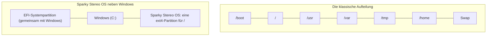

Jede dieser Partitionen hatte ihre Gründe, und für jeden Grund gibt es heute eine neuere Antwort:

| Früherer Grund | Heute |
|---|---|
| `/boot` weit vorn auf der Platte, wo das BIOS es lesen konnte | UEFI liest die EFI-Systempartition an jeder Stelle einer GPT-Festplatte, und GRUB liest `/boot` aus dem Wurzeldateisystem. |
| `/usr` schreibgeschützt oder über das Netz geteilt | Debian hat `/bin`, `/sbin` und `/lib` mit `/usr` zusammengelegt; ein eigenes `/usr` muss die Initramfs einhängen und bringt auf einem Desktop nichts. |
| `/var`, damit Protokolle die Wurzel nicht füllen | Das systemd-Journal begrenzt sich selbst (standardmäßig auf 10 % des Dateisystems, höchstens 4 GB), den Rest erledigt die Protokollrotation. |
| `/tmp` mit eigener Größengrenze | `/tmp` ist im aktuellen Debian ein Dateisystem im Arbeitsspeicher (tmpfs), auf einen Teil des RAMs begrenzt und bei jedem Start leer. |
| `/home` über Neuinstallationen hinweg behalten | Weiterhin sinnvoll; die manuelle Partitionierung des Installationsprogramms legt es an (siehe unten). |
| Quotas pro Verzeichnis | Projekt-Quotas von ext4 begrenzen einen Verzeichnisbaum ohne eigene Partition. |
| Swap-Partition | Optional; Sparky Stereo OS richtet komprimierten Swap im Arbeitsspeicher (zram) selbst ein, wo er hilft: bei 8 GB RAM oder weniger oder auf langsamen Datenträgern. |

Windows macht es genauso: eine Partition C: für System, Programme und Benutzer, daneben einige kleine verborgene Partitionen (EFI-Systempartition, Microsoft-reservierte Partition, Wiederherstellungspartition).
Sparky Stereo OS fügt sich mit einer eigenen Partition in diese Aufteilung ein und teilt sich die EFI-Systempartition mit Windows.

Eine Partition heißt auch ein gemeinsamer freier Platz: Keine Partition läuft voll, während eine andere leer bleibt.

Wer trotzdem ein eigenes `/home` möchte, wählt im Installationsprogramm Manuelle Partitionierung, legt im freien Platz die Wurzelpartition und die `/home`-Partition an und setzt bei der vorhandenen EFI-Systempartition den Einhängepunkt `/boot/efi`, ohne sie zu formatieren.


## 7. Neben Windows installieren

### Zuerst in Windows

1. Platz schaffen: In der Datenträgerverwaltung (Rechtsklick auf die Start-Schaltfläche) mit der rechten Maustaste auf die Partition C: klicken, Volume verkleinern wählen und mindestens 30 GB frei lassen, gern mehr.
2. Den Schnellstart abschalten: Systemsteuerung, Energieoptionen, „Auswählen, was beim Drücken von Netzschaltern geschehen soll“, Haken bei „Schnellstart aktivieren“ entfernen.
   Der Schnellstart lässt die Windows-Partition halb geöffnet zurück, und Änderungen von Linux aus könnten verloren gehen.
3. Ist BitLocker aktiv, den Wiederherstellungsschlüssel notieren.
   Startet Windows auf einem anderen Startweg, kann BitLocker danach fragen.
4. Sichern, was wichtig ist, wie vor jeder Änderung an Partitionen.

Der freie Platz bleibt unformatiert; das Installationsprogramm nutzt ihn.

### Das Installationsprogramm

Starten Sie die Live-Sitzung im UEFI-Modus, am besten mit dem Eintrag „live, Deutsch“, schließen Sie die Willkommensfenster und doppelklicken Sie auf dem Desktop auf Sparky Installer.
Das Installationsprogramm braucht keine Netzwerkverbindung.
Ohne Netzwerk meldet es, dass der Computer nicht mit dem Internet verbunden ist; das ist nur ein Hinweis.

| | |
|---|---|
| 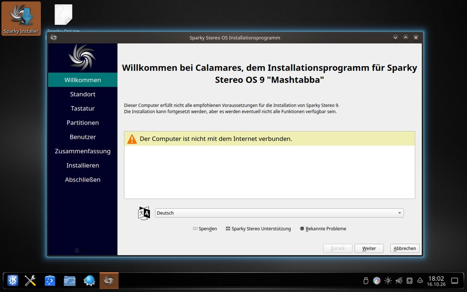 | Sprache wählen. |
| 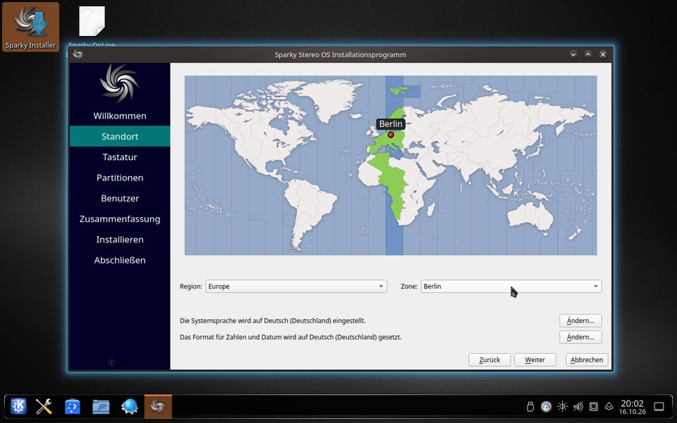 | Region und Zeitzone wählen. |
| 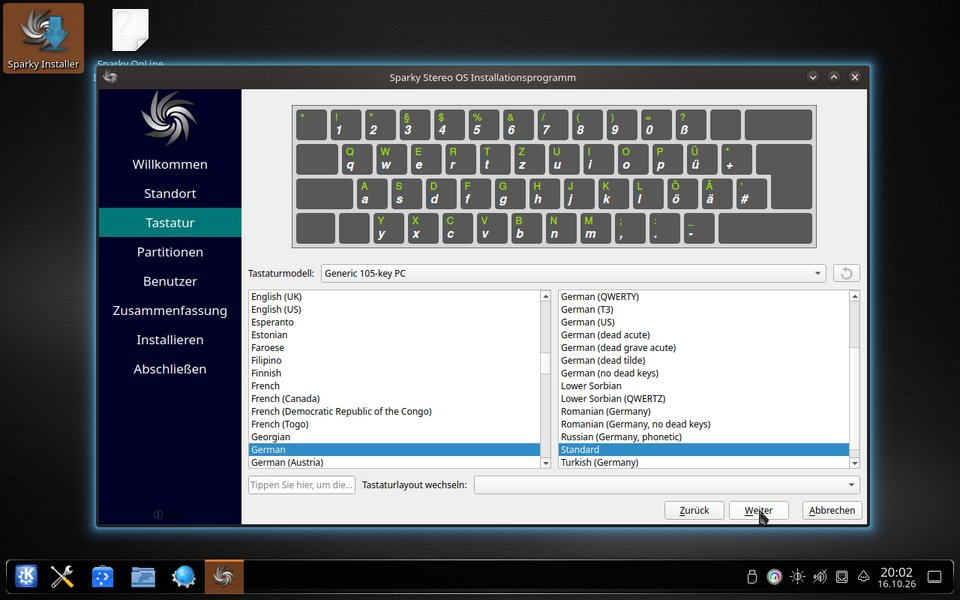 | Tastaturbelegung wählen und im Feld darunter ausprobieren. |

Unter Partitionen zeigt das Installationsprogramm die Festplatte, wie sie ist: Windows Boot Manager (die EFI-Systempartition), die reservierte Partition, Windows, den freien Platz und die Wiederherstellungspartition.

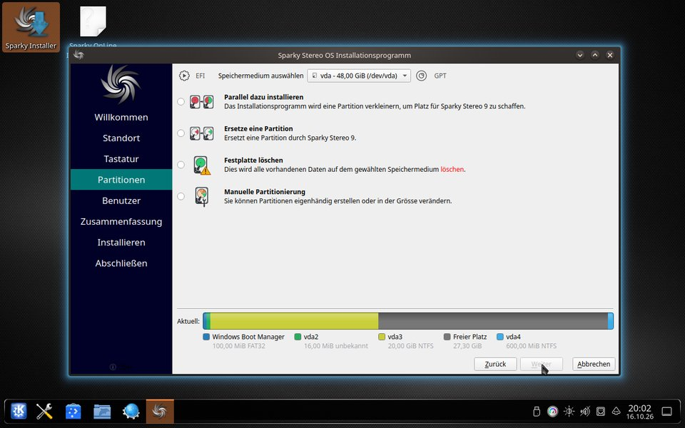

Wählen Sie „Ersetze eine Partition“ und klicken Sie im Balken „Aktuell“ auf den freien Platz.
Der Balken „Nachher“ zeigt eine neue ext4-Partition für Sparky Stereo OS im freien Platz, und die Zeile darunter sagt, dass die vorhandene EFI-Systempartition zum Starten verwendet wird.
Sonst wird nichts verändert.

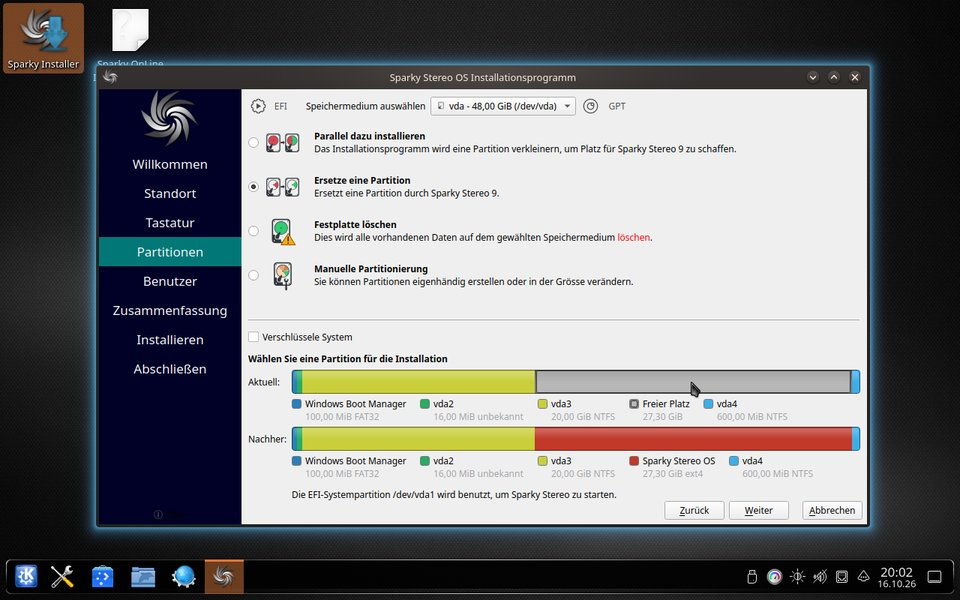

„Parallel dazu installieren“ würde eine Partition aus dem Installationsprogramm heraus verkleinern; Windows von Windows aus zu verkleinern, wie oben beschrieben, ist sicherer und war der getestete Weg.
„Festplatte löschen“ entfernt Windows; auf einer gemeinsam genutzten Festplatte also nicht wählen.

| | |
|---|---|
| 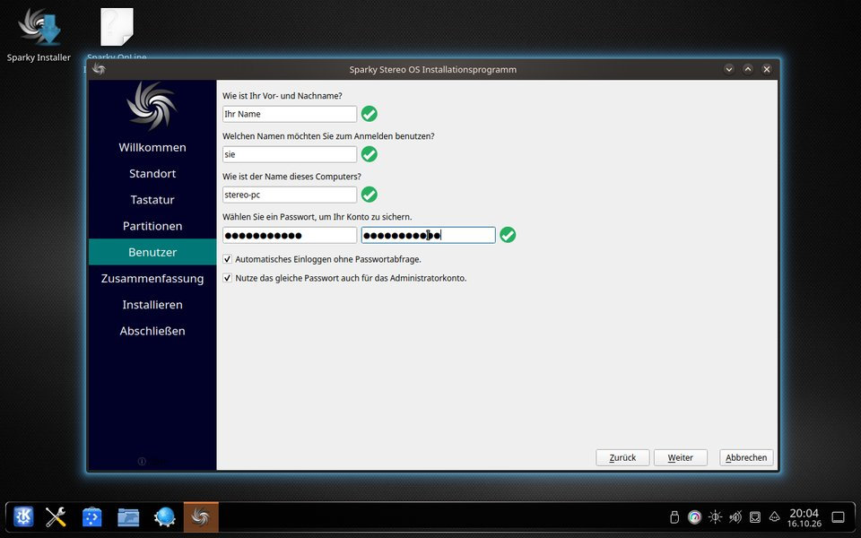 | Name, Anmeldename, Rechnername und Passwort. Erlaubt sind im Rechnernamen nur Buchstaben, Ziffern, Unter- und Bindestriche. |
| 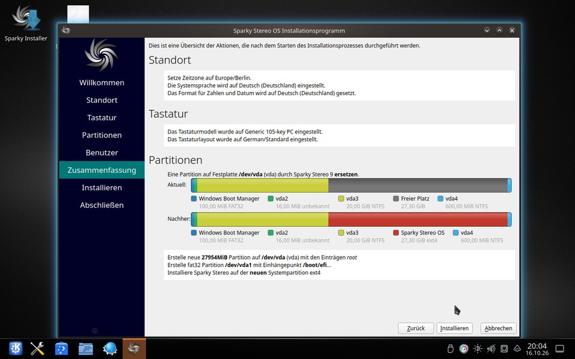 | Zusammenfassung prüfen: eine neue Partition, die EFI-Systempartition bleibt. Dann auf Installieren klicken. |

In der Zusammenfassung steht bei der EFI-Systempartition „Erstelle fat32 Partition /dev/vda1 mit Einhängepunkt /boot/efi“.
Trotz des Wortes „Erstelle“ wird sie nicht neu formatiert; im Test blieben die Dateien von Windows darauf erhalten.

Während der Installation zeigt das Installationsprogramm Folien über die Edition.
In Beta 1 sind diese Folien auf Englisch, auch wenn das Installationsprogramm Deutsch spricht.
In den Test-VMs dauerte die Installation etwa 20 Minuten.

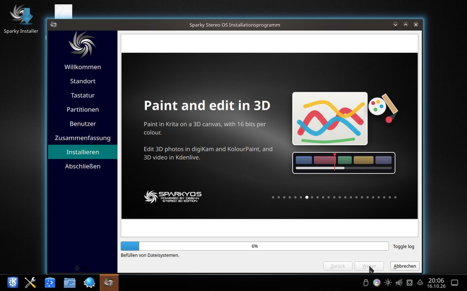

Meldet es „Alles erledigt“, starten Sie neu und ziehen den Stick ab.

### Was das Installationsprogramm für den Doppelstart einrichtet

- Das Startmenü listet zuerst Sparky Stereo OS und darunter den Windows Boot Manager, mit 5 Sekunden Wartezeit.
- Der Boot-Manager von Windows und sein Rückfall-Lader auf der EFI-Systempartition bleiben unverändert.
- Die Hardware-Uhr bleibt auf Ortszeit, so wie Windows sie führt, damit beide Systeme die richtige Uhrzeit zeigen.


Getestet wurde mit einer Festplatte, die so aufgeteilt ist, wie sich Windows 10 und 11 selbst installieren, mit einem kleinen Platzhalter anstelle des Windows-Boot-Managers.
Der Windows-Eintrag startete diesen Platzhalter; wie er ein echtes Windows startet, zeigt sich auf Ihrem Rechner.

Wer die Hardware-Uhr lieber in UTC führt, wie Linux es üblicherweise tut, stellt Windows auf UTC um, in einer Eingabeaufforderung mit Administratorrechten:

```
reg add "HKLM\System\CurrentControlSet\Control\TimeZoneInformation" /v RealTimeIsUniversal /t REG_DWORD /d 1 /f
```

und in Sparky Stereo OS:

```
sudo timedatectl set-local-rtc 0
```

## 8. Nach der Installation

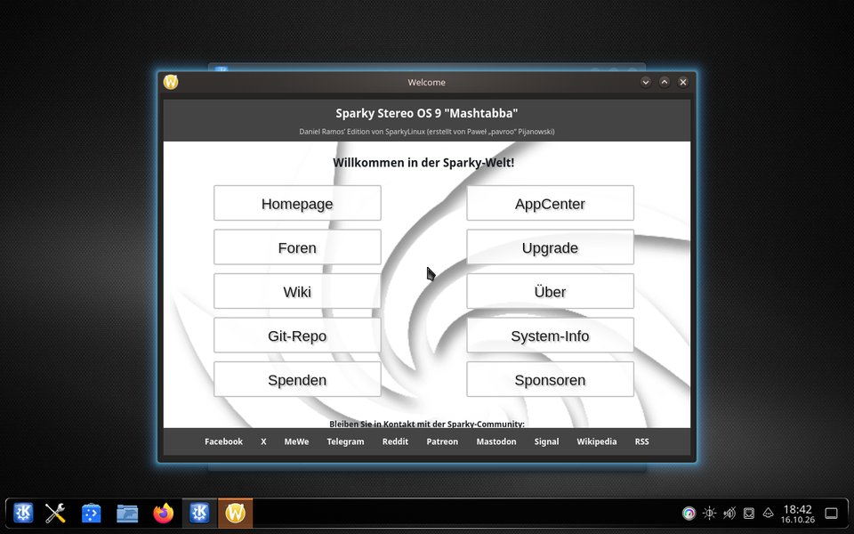

Das installierte System startet denselben Kernel der Edition wie der Stick und nutzt unter Secure Boot den registrierten Schlüssel.
Auf einem Rechner ohne registrierten Schlüssel registrieren Sie ihn wie in Abschnitt 4.

Die Paketquelle der Edition, `repo.sparkyos.org`, ist noch nicht öffentlich.
Aktualisierungen von Debian, SparkyLinux und deb-multimedia funktionieren wie gewohnt.
Bis die Paketquelle der Edition online geht, meldet `apt update` diese Quelle als nicht erreichbar; diese Meldung kann vorerst übergangen werden.

## 9. Bekannte Probleme von Beta 1

- 32-Bit-UEFI (ia32-Firmware, meist ältere Tablets und kleine Notebooks) startet das Abbild nicht.
- Die Folien im Installationsprogramm sind auf Englisch, auch wenn das Installationsprogramm Deutsch oder eine andere Sprache spricht.
- Der Bildschirm „Press any key“ des MokManagers wartet nur etwa 10 Sekunden (Abschnitt 4).
- Die Paketquelle der Edition, `repo.sparkyos.org`, ist noch nicht online (Abschnitt 8).
- Das Stereopaar aus zwei Bildschirmen wurde nicht an echter Hardware getestet (Abschnitt 5).
- Das Willkommenscenter von KDE öffnet sich bei der ersten Anmeldung neben Sparky Welcome.
- Die GRUB-Menüs zeigen noch das blaue Hintergrundbild von SparkyLinux.
- Ältere NVIDIA-Karten (Pascal und davor) laufen mit nouveau (Abschnitt 4).

## 10. Fehler melden

Fehler bitte im Tracker der Edition melden: https://github.com/Sparky-OS/sparky-stereo-os/issues

Schreiben Sie, was Sie getan haben, was Sie erwartet haben und was passiert ist, und hängen Sie an, was passt:

```
cat /etc/os-release
uname -r
mokutil --sb-state
inxi -Fxz
stereo-display-info
kscreen-doctor -o
journalctl -b -p warning --no-pager > journal.txt
```

`stereo-display-info` zeigt, was jeder angeschlossene Bildschirm laut seinen EDID-Daten in 3D und mit erhöhter Farbtiefe kann und was er gerade tut.

Bei Problemen mit der Installation sichern Sie das Protokoll des Installationsprogramms, bevor Sie die Live-Sitzung neu starten, denn die Live-Sitzung vergisst es:

```
sudo cp /root/.cache/calamares/session.log ~/installer.log
```

und speichern es auf einem anderen Stick.

Für alles, was vor dem Desktop geschieht (Firmware, Startmenü des Sticks, MokManager), hilft ein Foto des Bildschirms.

Hinweis zu dieser Übersetzung: Der deutsche Text wurde nicht von einem zweiten Sprachmodell gegengelesen.
Korrekturen von Muttersprachlern sind willkommen.
