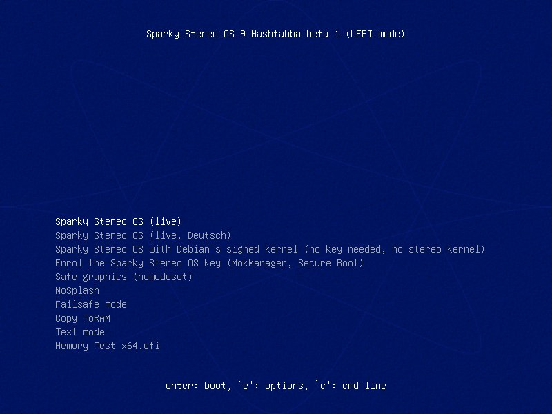
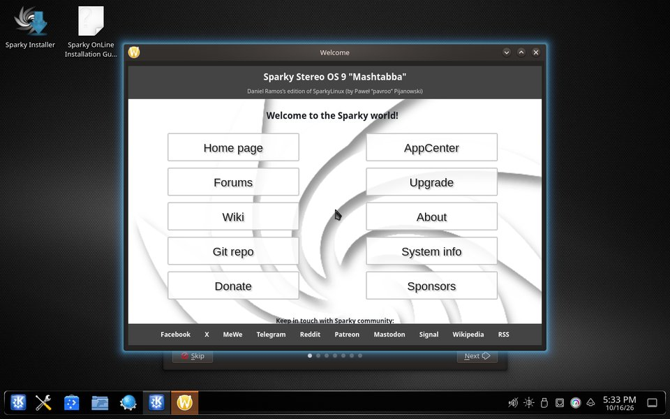
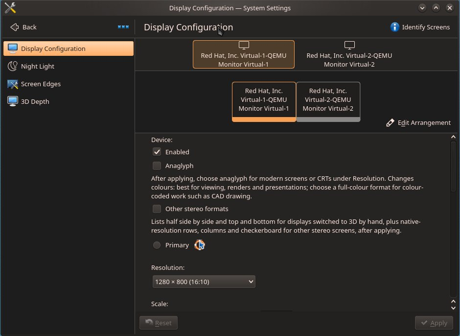

# Auf dem eigenen Windows-PC ausprobieren

🇨🇦 [English](try-on-windows.en.md) · 🇩🇪 [Deutsch](try-on-windows.de.md) · 🇧🇷 [Português](try-on-windows.pt-BR.md)

**Für** alle mit einem Windows-PC und einem USB-Stick: den 3D-Desktop in zehn Schritten auf dem eigenen Bildschirm sehen, ohne etwas zu installieren und ohne Windows zu verändern.

Sparky Stereo OS startet vom USB-Stick und läuft vom Stick und aus dem Arbeitsspeicher.
Es ändert nichts an Ihren Festplatten, solange Sie nicht selbst das Installationsprogramm starten, und nichts aus der Sitzung bleibt nach einem Neustart erhalten.
Dies ist Beta 1 für Tester; jeder Schritt stammt aus [der ausführlichen Anleitung](beta1-install-classic-linux.de.md), in der jeder einzelne mit dem Beta-1-Abbild ausgeführt wurde.

**Zuerst der sichere Weg. Dann das 3D.**

1. **BitLocker-Wiederherstellungsschlüssel sichern und Dateien sichern.**
   Viele Windows-PCs verschlüsseln ihre Festplatte, ohne dass jemand das eingeschaltet hat, und Windows kann nach einer Änderung am Startvorgang einen 48-stelligen Schlüssel verlangen.
   Suchen Sie den Schlüssel jetzt heraus, mit Microsofts eigener Seite: [BitLocker-Wiederherstellungsschlüssel finden](https://support.microsoft.com/de-de/windows/find-your-bitlocker-recovery-key-6b71ad27-0b89-ea08-f143-056f5ab347d6).
   **Prüfen:** Sie können den Schlüssel auf Papier oder auf einem anderen Gerät lesen, nicht nur auf diesem PC.
2. **Secure Boot eingeschaltet lassen.**
   Ändern Sie nichts in den Firmware-Einstellungen (dem „BIOS“): Der Stick startet mit eingeschaltetem Secure Boot.
   Wer Secure Boot ausschaltet, riskiert, dass Windows beim nächsten Start den Wiederherstellungsschlüssel verlangt.
3. **Nach dem Download fragen.**
   Den Link bekommen Tester: Fragen Sie im [Tester-Thread](https://github.com/Sparky-OS/sparky-stereo-os/issues/153) und schreiben Sie dazu, welchen 3D-Bildschirm oder welche Brille Sie haben, falls vorhanden.
4. **Die Datei prüfen.**
   Führen Sie in einer Eingabeaufforderung im Download-Ordner `certutil -hashfile sparky-stereo-os-9-mashtabba-beta1-x86_64.iso SHA256` aus und vergleichen Sie das Ergebnis mit [der Prüfsumme in der ausführlichen Anleitung](beta1-install-classic-linux.de.md#1-abbild-herunterladen-und-prüfen).
   **Prüfen:** Jedes Zeichen stimmt überein. Wenn nicht, laden Sie die Datei erneut herunter.
5. **Auf einen USB-Stick mit mindestens 8 GB schreiben.**
   Alles auf dem Stick wird gelöscht.
   Wählen Sie in Rufus den Stick und die Datei, klicken Sie auf START und wählen Sie auf Nachfrage „Im DD-Abbild-Modus schreiben“ ([Rufus Schritt für Schritt](beta1-install-classic-linux.de.md#rufus-im-dd-abbild-modus)).
   Rufus selbst wurde in unseren Tests nicht ausgeführt; der DD-Abbild-Modus erzeugt dieselbe exakte Kopie wie das getestete Werkzeug.
6. **Neu starten und den Stick wählen.**
   Drücken Sie beim Einschalten die Taste für das einmalige Startmenü (F12 oder F11 bei vielen PCs, F8 bei ASUS-Boards, manchmal Esc) und wählen Sie den Eintrag des Sticks, der mit „UEFI:“ beginnt.
7. **„Sparky Stereo OS (live, Deutsch)“ wählen.**

   

   Solange der Schlüssel der Edition nicht registriert ist, zeigt der Bildschirm „error: bad shim loader signature.“ und „The Sparky Stereo OS key is not enrolled: starting Debian's signed kernel instead.“
   Das ist so vorgesehen, und nichts ist kaputt: Warten Sie zehn Sekunden.
8. **Auf den Desktop warten.**
   Der erste Start dauert einige Minuten, weil alles vom Stick gelesen wird.

   

   **Wenn die Schrift zu klein ist:** Öffnen Sie in den Systemeinstellungen die Seite Anzeige-Einrichtung und erhöhen Sie die Skalierung.
9. **3D für Ihren Bildschirm einschalten.**
   Öffnen Sie in den Systemeinstellungen die Seite Anzeige-Einrichtung.
   Mit einer Rot-Cyan-Brille an jedem Monitor: Schalter Anaglyph einschalten, auf Anwenden klicken und die Auflösung mit dem Zusatz „(anaglyph, modern screens)“ wählen.
   Mit einem 3D-Fernseher, 3D-Projektor oder 3D-Monitor: „Other stereo formats“ einschalten, auf Anwenden klicken und in der Liste Bildwiederholrate das Format Ihres Bildschirms wählen.
   Ohne beides bleibt der Desktop ein gewöhnlicher 2D-Desktop.

   

   **Prüfen:** Die Frage „Anzeigeeinstellungen beibehalten?“ erscheint; klicken Sie auf Beibehalten, wenn das Bild stimmt, oder warten Sie zehn Sekunden, dann wird die Änderung von selbst zurückgenommen.
10. **Umsehen, dann herunterfahren und den Stick abziehen.**
    Öffnen Sie ein 3D-Foto in Gwenview oder einen 3D-Film in Bino oder mpv, und schieben Sie ein Fenster über ein anderes, um die Tiefe des Desktops selbst zu sehen.
    Nach dem Herunterfahren und dem Abziehen des Sticks startet Windows wie zuvor.

**Was Sie gerade getan haben:** Sie haben ein vollständiges System vom Stick ausgeführt.
Auf Ihre Festplatten wurde nichts geschrieben, und der Stick merkt sich nichts aus der Sitzung.

## Wenn Sie mehr möchten

Eine Seite nach der anderen, jeweils in [der ausführlichen Anleitung](beta1-install-classic-linux.de.md):

- **Der eigene Kernel der Edition und der NVIDIA-Treiber, mit weiterhin eingeschaltetem Secure Boot:** [den Schlüssel von Sparky Stereo OS registrieren](beta1-install-classic-linux.de.md#secure-boot-und-der-schlüssel-von-sparky-stereo-os), einmal je Computer.
- **Alle 3D-Formate und zwei Bildschirme als 3D-Paar:** [der 3D-Desktop in der Live-Sitzung](beta1-install-classic-linux.de.md#5-der-3d-desktop-in-der-live-sitzung).
- **Neben Windows installieren:** [was zuerst in Windows zu tun ist](beta1-install-classic-linux.de.md#7-neben-windows-installieren), dann das Installationsprogramm.
- **Was noch nicht geht:** [bekannte Probleme von Beta 1](beta1-install-classic-linux.de.md#9-bekannte-probleme-von-beta-1).

## Warum Schritt 1 zuerst kommt

Die Verschlüsselung kann eingeschaltet sein, ohne dass jemand sie gewählt hat: Microsoft beschreibt die Geräteverschlüsselung als Funktion, die BitLocker für das Betriebssystemlaufwerk automatisch einschaltet ([Device Encryption in Windows](https://support.microsoft.com/en-us/windows/device-encryption-in-windows-cf7e2b6f-3e70-4882-9532-18633605b7df)).
Windows bewahrt den Schlüssel einer verschlüsselten Festplatte in einem Chip auf der Hauptplatine auf und gibt ihn nur frei, wenn der PC so startet wie zu dem Zeitpunkt, als der Schlüssel abgelegt wurde.
Microsoft, im englischen Original: „By default, BitLocker provides integrity protection for Secure Boot by utilizing the TPM PCR[7] measurement“ ([BitLocker countermeasures](https://learn.microsoft.com/en-us/windows/security/operating-system-security/data-protection/bitlocker/countermeasures)).
Zu den Ereignissen, die laut Microsoft die Wiederherstellung auslösen, gehören „Changes to the boot manager“ und „On devices with TPM 1.2, changing the BIOS or firmware boot device order“ ([BitLocker recovery overview](https://learn.microsoft.com/en-us/windows/security/operating-system-security/data-protection/bitlocker/recovery-overview)).
Mit gesichertem Schlüssel kostet ein Wiederherstellungsbildschirm eine Minute Tipparbeit.
Ohne ihn sind die Dateien auf dieser Festplatte verloren.

Sparky Stereo OS, Daniel Ramos's edition of SparkyLinux (by Paweł "pavroo" Pijanowski).
