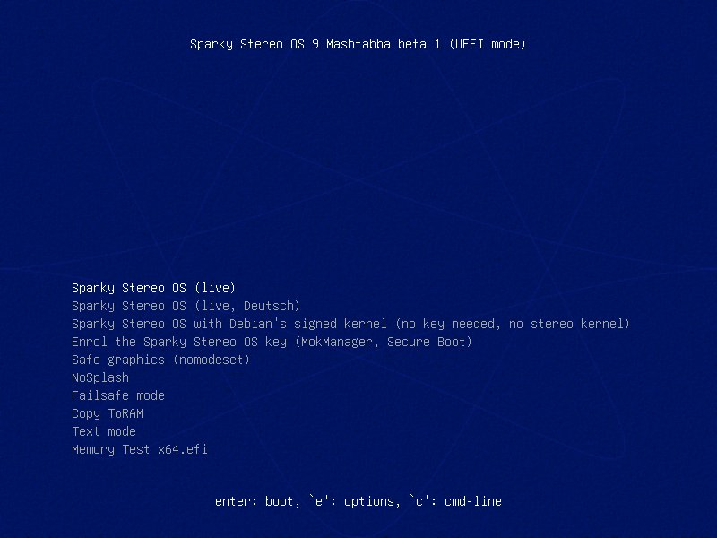
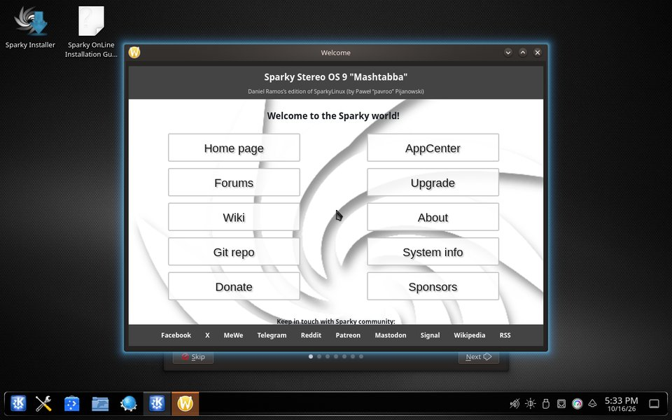
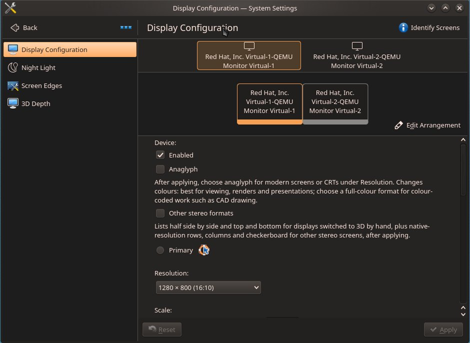

# Try it on your Windows PC

🇨🇦 [English](try-on-windows.en.md) · 🇩🇪 [Deutsch](try-on-windows.de.md) · 🇧🇷 [Português](try-on-windows.pt-BR.md) · 🇲🇽 [Español](try-on-windows.es.md)

**For** anyone with a Windows PC and a USB stick: see the 3D desktop on your own screen in ten steps, without installing anything and without changing Windows.

Sparky Stereo OS starts from the USB stick and runs from the stick and from memory.
It changes nothing on your disks unless you start the installer yourself, and nothing you do in it is kept after a restart.
This is beta 1: anyone may try it, and the download link is given on request (step 3). Every step below is taken from [the long guide](beta1-install-classic-linux.en.md), where each one was run on the beta 1 image.

**First, the safe way. Then the 3D.**

1. **Save your BitLocker recovery key, and back up your files.**
   Many Windows PCs encrypt their disk without anyone turning that on, and Windows can ask for a 48-digit key after a change to how the PC starts.
   Find the key now, with Microsoft's own page: [Find your BitLocker recovery key](https://support.microsoft.com/en-us/windows/find-your-bitlocker-recovery-key-6b71ad27-0b89-ea08-f143-056f5ab347d6).
   **Check:** you can read the key on paper or on another device, not only on this PC.
2. **Leave Secure Boot on.**
   Secure Boot is the PC's own check that only signed systems may start.
   Change nothing in the firmware (the "BIOS") settings: the stick is signed and starts with Secure Boot on.
   Turning Secure Boot off can make Windows ask for the recovery key at its next start.
3. **Ask for the download.**
   The link goes to testers: ask in the [tester thread](https://github.com/Sparky-OS/sparky-stereo-os/issues/26) and say which 3D screen or glasses you have, if any.
4. **Check the file.**
   This proves the download is complete and unchanged.
   In a Command Prompt (type `cmd` in the Start menu) in the download folder, run `certutil -hashfile sparky-stereo-os-9-mashtabba-beta1-x86_64.iso SHA256` and compare the result with [the sum in the long guide](beta1-install-classic-linux.en.md#1-download-and-check-the-image).
   **Check:** every character is the same. If not, download again.
5. **Write it to a USB stick of at least 8 GB.**
   Everything on the stick is erased.
   In [Rufus](https://rufus.ie), a free Windows program that writes USB sticks, choose the stick and the file, click START, and choose "Write in DD Image mode" when it asks ([Rufus, step by step](beta1-install-classic-linux.en.md#rufus-in-dd-image-mode)).
   Rufus itself was not run in our tests; DD Image mode makes the same exact copy as the tool that was tested.
6. **Restart and choose the stick.**
   Press the one-time boot menu key as the PC switches on (F12 or F11 on many PCs, F8 on ASUS boards, sometimes Esc), and choose the entry for the stick that starts with "UEFI:".
7. **Choose "Sparky Stereo OS (live)".**

   

   The screen then shows two lines in English, "error: bad shim loader signature." and "The Sparky Stereo OS key is not enrolled: starting Debian's signed kernel instead."
   Both are expected on a first try, and nothing is broken: wait ten seconds and the system starts.
8. **Wait for the desktop.**
   The first start takes a few minutes, because everything is read from the stick.

   

   **If the text is too small to read:** right-click the desktop, choose Configure Display Settings, and raise Scale.
9. **Switch on 3D for your screen.**
   Right-click the desktop and choose Configure Display Settings.
   With red-cyan glasses on any monitor: tick Anaglyph (the name of the red-cyan kind of 3D), click Apply, and pick the resolution marked "(anaglyph, modern screens)".
   With a 3D TV, projector or monitor: tick "Other stereo formats", click Apply, and pick your screen's format in the Refresh rate list.
   Without either, the desktop stays an ordinary 2D desktop.

   

   **Check:** the question "Keep display configuration?" appears; click Keep if the picture is right, or wait ten seconds and it goes back by itself.
10. **Look around, then shut down and pull the stick.**
    Open a 3D photo in Gwenview or a 3D film in Bino or mpv, and move a window over another to see the desktop's own depth.
    When you shut down and remove the stick, Windows starts as it did before.

**What you just did:** you ran a complete system from the stick.
Your disks were not written, and the stick remembers nothing from the session.

## When you want more

One page at a time, each in [the long guide](beta1-install-classic-linux.en.md):

- **The edition's own kernel and the NVIDIA driver, with Secure Boot still on:** [enrol the Sparky Stereo OS key](beta1-install-classic-linux.en.md#secure-boot-and-the-sparky-stereo-os-key), once per computer.
- **Every 3D format, and two screens as one 3D pair:** [the 3D desktop in the live session](beta1-install-classic-linux.en.md#5-the-3d-desktop-in-the-live-session).
- **Installing it beside Windows:** [what to do in Windows first](beta1-install-classic-linux.en.md#7-installing-beside-windows), then the installer.
- **What does not work yet:** [known issues of beta 1](beta1-install-classic-linux.en.md#9-known-issues-of-beta-1).

## Why step 1 comes first

The encryption may be on without anyone having chosen it: "Device Encryption is a Windows feature that enables BitLocker encryption automatically for the Operating System drive and fixed drives" ([Device Encryption in Windows](https://support.microsoft.com/en-us/windows/device-encryption-in-windows-cf7e2b6f-3e70-4882-9532-18633605b7df)).
Windows keeps the key to an encrypted disk in a chip on the mainboard, and releases it only while the PC starts the way it did when the key was stored.
Microsoft: "By default, BitLocker provides integrity protection for Secure Boot by utilizing the TPM PCR[7] measurement" ([BitLocker countermeasures](https://learn.microsoft.com/en-us/windows/security/operating-system-security/data-protection/bitlocker/countermeasures)).
Among the events Microsoft lists as starting recovery are "Changes to the boot manager" and "On devices with TPM 1.2, changing the BIOS or firmware boot device order" ([BitLocker recovery overview](https://learn.microsoft.com/en-us/windows/security/operating-system-security/data-protection/bitlocker/recovery-overview)).
With the key saved, a recovery screen costs one minute of typing.
Without it, the files on that disk are lost.

Sparky Stereo OS, Daniel Ramos's edition of SparkyLinux (by Paweł "pavroo" Pijanowski).
