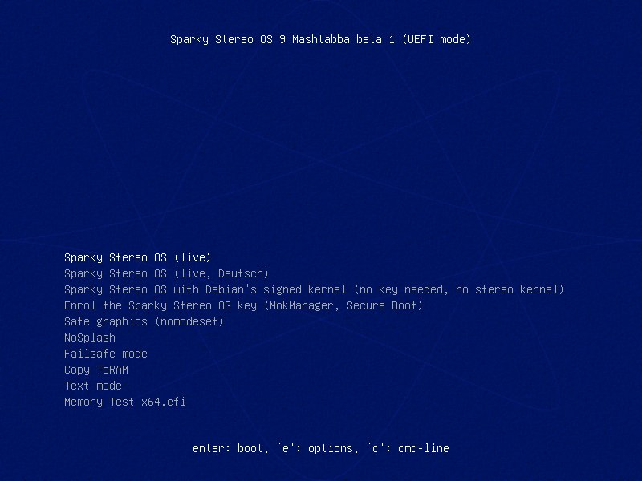
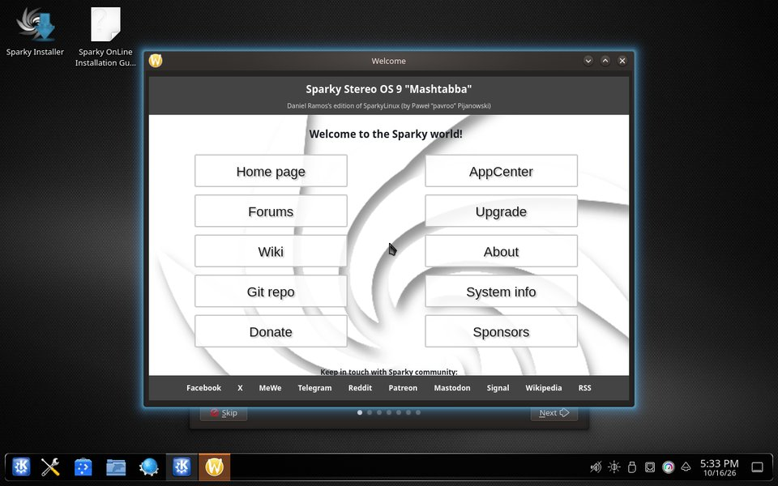
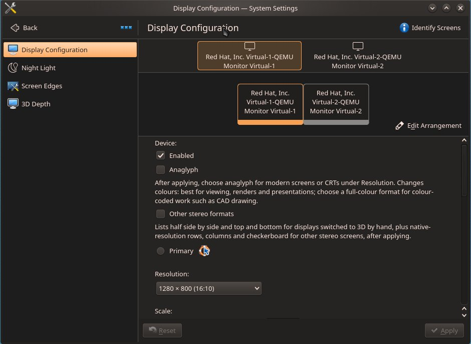

# Pruébelo en su PC con Windows

🇨🇦 [English](try-on-windows.en.md) · 🇩🇪 [Deutsch](try-on-windows.de.md) · 🇧🇷 [Português](try-on-windows.pt-BR.md) · 🇲🇽 [Español](try-on-windows.es.md)

**Para** quien tenga un PC con Windows y una memoria USB: vea el escritorio 3D en su propia pantalla en diez pasos, sin instalar nada y sin cambiar Windows.

Sparky Stereo OS arranca desde la memoria USB y funciona desde ella y desde la memoria RAM.
No cambia nada en sus discos a menos que usted mismo inicie el instalador, y nada de lo que haga en él se conserva después de reiniciar.
Esta es la beta 1: cualquiera puede probarla, y el enlace de descarga se entrega a quien lo pide (paso 3). Cada paso de abajo viene de [la guía larga, en inglés](beta1-install-classic-linux.en.md), donde cada uno se ejecutó en la imagen de la beta 1.

**Primero, el camino seguro. Después, el 3D.**

1. **Guarde su clave de recuperación de BitLocker y haga una copia de seguridad de sus archivos.**
   Muchos PC con Windows cifran su disco sin que nadie lo haya activado, y Windows puede pedir una clave de 48 dígitos después de un cambio en la forma en que arranca el PC.
   Busque la clave ahora, con la página de la propia Microsoft: [Buscar la clave de recuperación de BitLocker](https://support.microsoft.com/es-es/windows/find-your-bitlocker-recovery-key-6b71ad27-0b89-ea08-f143-056f5ab347d6).
   **Compruebe:** puede leer la clave en papel o en otro dispositivo, no solo en este PC.
2. **Deje Secure Boot activado.**
   Secure Boot (arranque seguro) es la comprobación del propio PC de que solo pueden arrancar sistemas firmados.
   No cambie nada en la configuración del firmware (la "BIOS"): la memoria USB está firmada y arranca con Secure Boot activado.
   Desactivar Secure Boot puede hacer que Windows pida la clave de recuperación en su siguiente arranque.
3. **Pida la descarga.**
   El enlace es para probadores: pídalo en el [hilo de probadores](https://github.com/Sparky-OS/sparky-stereo-os/issues/351) y diga qué pantalla 3D o qué gafas tiene, si tiene alguna.
4. **Compruebe el archivo.**
   Esto demuestra que la descarga está completa y sin cambios.
   En un Símbolo del sistema (escriba `cmd` en el menú Inicio), en la carpeta de la descarga, ejecute `certutil -hashfile sparky-stereo-os-9-mashtabba-beta1-x86_64.iso SHA256` y compare el resultado con [la suma de la guía larga](beta1-install-classic-linux.en.md#1-download-and-check-the-image).
   **Compruebe:** todos los caracteres son iguales. Si no lo son, descargue el archivo de nuevo.
5. **Grábelo en una memoria USB de al menos 8 GB.**
   Todo lo que hay en la memoria USB se borra.
   En [Rufus](https://rufus.ie), un programa gratuito para Windows que graba memorias USB, elija la memoria USB y el archivo, haga clic en START y, cuando pregunte, elija "Write in DD Image mode" ([Rufus, paso a paso, en inglés](beta1-install-classic-linux.en.md#rufus-in-dd-image-mode)).
   El propio Rufus no se ejecutó en nuestras pruebas; el modo DD Image hace la misma copia exacta que la herramienta que sí se probó.
6. **Reinicie y elija la memoria USB.**
   Pulse la tecla del menú de arranque al encender el PC (F12 o F11 en muchos PC, F8 en las placas ASUS, a veces Esc) y elija la entrada de la memoria USB que empieza por "UEFI:".
7. **Elija "Sparky Stereo OS (live)".**

   

   La pantalla muestra entonces dos líneas en inglés, "error: bad shim loader signature." y "The Sparky Stereo OS key is not enrolled: starting Debian's signed kernel instead."
   Las dos son de esperar en un primer intento, y nada está roto: espere diez segundos y el sistema arranca.
   Esta entrada inicia la sesión en inglés, así que los pasos 8 y 9 nombran cada opción como aparece en la pantalla, con su significado entre paréntesis.
8. **Espere al escritorio.**
   El primer arranque tarda unos minutos, porque todo se lee desde la memoria USB.

   

   **Si el texto es demasiado pequeño para leerlo:** haga clic con el botón derecho en el escritorio, elija Configure Display Settings (configurar las preferencias de la pantalla) y aumente Scale (escalar).
9. **Active el 3D para su pantalla.**
   Haga clic con el botón derecho en el escritorio y elija Configure Display Settings.
   Con gafas rojo-cian en cualquier monitor: marque Anaglyph (anaglifo, el nombre del 3D en rojo y cian), haga clic en Apply (aplicar) y elija la resolución marcada con "(anaglyph, modern screens)".
   Con un televisor, un proyector o un monitor 3D: marque "Other stereo formats" (otros formatos estéreo), haga clic en Apply y elija el formato de su pantalla en la lista Refresh rate (velocidad de refresco).
   Sin ninguno de los dos, el escritorio sigue siendo un escritorio 2D común.

   

   **Compruebe:** aparece la pregunta "Keep display configuration?" (¿mantener la configuración de la pantalla?); haga clic en Keep (mantener) si la imagen es correcta, o espere diez segundos y la pantalla vuelve sola a como estaba.
10. **Explore, y después apague y retire la memoria USB.**
    Abra una foto 3D en Gwenview o una película 3D en Bino o en mpv, y pase una ventana por encima de otra para ver la profundidad propia del escritorio.
    Cuando apague y retire la memoria USB, Windows arranca como antes.

**Lo que acaba de hacer:** ejecutó un sistema completo desde la memoria USB.
No se escribió nada en sus discos, y la memoria USB no recuerda nada de la sesión.

## Cuando quiera más

Una página cada vez, todas en [la guía larga, en inglés](beta1-install-classic-linux.en.md):

- **El kernel propio de la edición y el controlador de NVIDIA, con Secure Boot todavía activado:** [registre la clave de Sparky Stereo OS](beta1-install-classic-linux.en.md#secure-boot-and-the-sparky-stereo-os-key), una vez por equipo.
- **Todos los formatos 3D, y dos pantallas como un par 3D:** [el escritorio 3D en la sesión en vivo](beta1-install-classic-linux.en.md#5-the-3d-desktop-in-the-live-session).
- **Instalarlo junto a Windows:** [qué hacer primero en Windows](beta1-install-classic-linux.en.md#7-installing-beside-windows), y después el instalador.
- **Lo que todavía no funciona:** [problemas conocidos de la beta 1](beta1-install-classic-linux.en.md#9-known-issues-of-beta-1).

## Por qué el paso 1 va primero

El cifrado puede estar activado sin que nadie lo haya elegido: "Cifrado de dispositivo es una característica de Windows que habilita el cifrado de BitLocker automáticamente para unidades de sistema operativo y unidades fijas" ([Cifrado del dispositivo en Windows](https://support.microsoft.com/es-es/windows/device-encryption-in-windows-cf7e2b6f-3e70-4882-9532-18633605b7df)).
Windows guarda la clave de un disco cifrado en un chip de la placa base, y solo la entrega mientras el PC arranca de la misma forma que cuando se guardó la clave.
Microsoft, en el original en inglés: "By default, BitLocker provides integrity protection for Secure Boot by utilizing the TPM PCR[7] measurement" ([BitLocker countermeasures](https://learn.microsoft.com/en-us/windows/security/operating-system-security/data-protection/bitlocker/countermeasures)).
Entre los eventos que Microsoft enumera como causa de la recuperación están "Changes to the boot manager" y "On devices with TPM 1.2, changing the BIOS or firmware boot device order" ([BitLocker recovery overview](https://learn.microsoft.com/en-us/windows/security/operating-system-security/data-protection/bitlocker/recovery-overview)).
Con la clave guardada, una pantalla de recuperación cuesta un minuto de tecleo.
Sin ella, los archivos de ese disco se pierden.

Sparky Stereo OS, la edición de Daniel Ramos de SparkyLinux (de Paweł "pavroo" Pijanowski).
