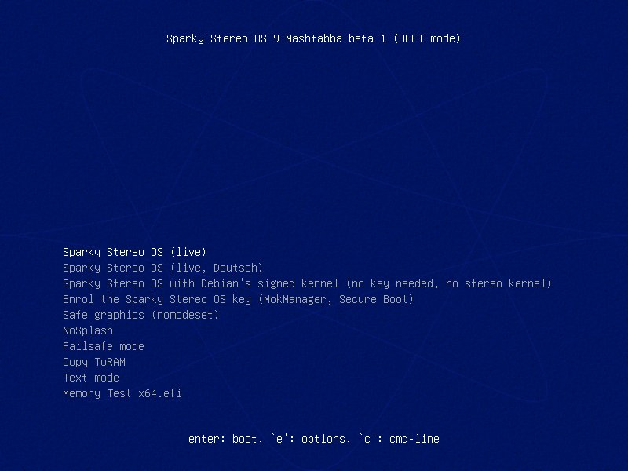
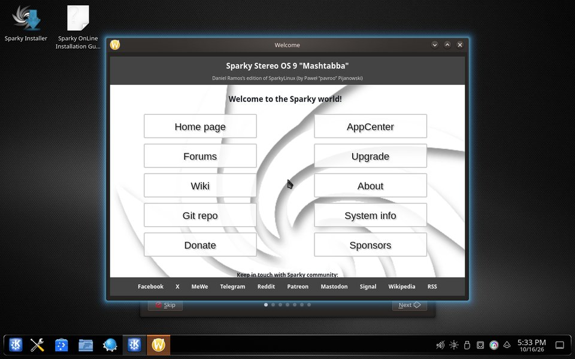
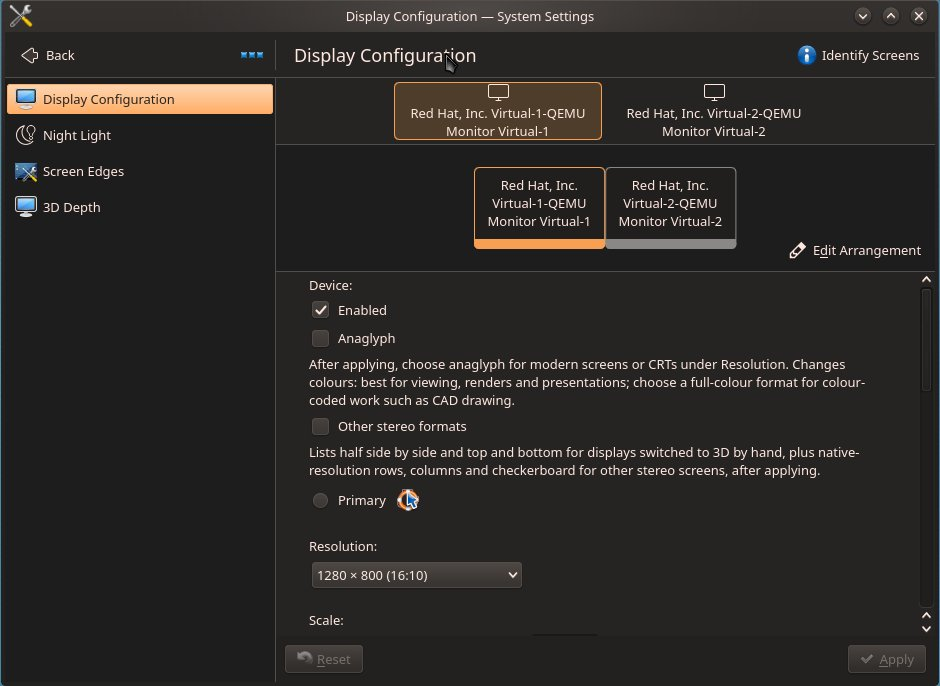

# Experimente no seu PC com Windows

🇨🇦 [English](try-on-windows.en.md) · 🇩🇪 [Deutsch](try-on-windows.de.md) · 🇧🇷 [Português](try-on-windows.pt-BR.md) · 🇲🇽 [Español](try-on-windows.es.md)

**Para** quem tem um PC com Windows e um pendrive: veja o desktop 3D na sua própria tela em dez passos, sem instalar nada e sem mudar o Windows.

O Sparky Stereo OS inicia pelo pendrive e roda a partir dele e da memória.
Ele não altera nada nos seus discos, a não ser que você mesmo abra o instalador, e nada do que você fizer na sessão fica guardado depois de reiniciar.
Esta é a beta 1: qualquer pessoa pode experimentar, e o link do download é dado a pedido (passo 3). Cada passo vem do [guia completo, em inglês](beta1-install-classic-linux.en.md), onde cada um foi executado na imagem da beta 1, e do [kit em português](beta1-dev-kit.pt-BR.md).

**Primeiro, o caminho seguro. Depois, o 3D.**

1. **Guarde a chave de recuperação do BitLocker e faça backup dos seus arquivos.**
   Muitos PCs com Windows criptografam o disco sem que ninguém tenha ligado isso, e o Windows pode pedir uma chave de 48 dígitos depois de uma mudança na forma como o PC inicia.
   Encontre a chave agora, pela página da própria Microsoft: [Encontrar a chave de recuperação do BitLocker](https://support.microsoft.com/pt-br/windows/find-your-bitlocker-recovery-key-6b71ad27-0b89-ea08-f143-056f5ab347d6).
   **Confira:** você consegue ler a chave no papel ou em outro aparelho, não só neste PC.
2. **Deixe o Secure Boot ligado.**
   O Secure Boot é a verificação do próprio PC de que só sistemas assinados podem iniciar.
   Não mude nada nas configurações do firmware (a "BIOS"): o pendrive é assinado e inicia com o Secure Boot ligado.
   Desligar o Secure Boot pode fazer o Windows pedir a chave de recuperação na próxima inicialização.
3. **Peça o download.**
   O link vai para testadores: peça no [tópico dos testadores](https://github.com/Sparky-OS/sparky-stereo-os/issues/25) e conte qual tela 3D ou quais óculos você tem, se tiver.
4. **Confira o arquivo.**
   Isso prova que o download está completo e não foi alterado.
   Em um Prompt de Comando (digite `cmd` no menu Iniciar), na pasta do download, rode `certutil -hashfile sparky-stereo-os-9-mashtabba-beta1-x86_64.iso SHA256` e compare o resultado com [a soma do kit](beta1-dev-kit.pt-BR.md#baixe-e-confira-a-imagem).
   **Confira:** todos os caracteres são iguais. Se não forem, baixe de novo.
5. **Grave em um pendrive de pelo menos 8 GB.**
   Tudo o que está no pendrive é apagado.
   No [Rufus](https://rufus.ie), um programa gratuito para Windows que grava pendrives, escolha o pendrive e o arquivo, clique em START e, quando ele perguntar, escolha “Write in DD Image mode” ([o pendrive no kit](beta1-dev-kit.pt-BR.md#experimente-pelo-pendrive)).
   O próprio Rufus não foi executado nos nossos testes; o modo DD faz a mesma cópia exata da ferramenta que foi testada.
6. **Reinicie e escolha o pendrive.**
   Aperte a tecla do menu de inicialização ao ligar o PC (F12 ou F11 em muitos PCs, F8 nas placas ASUS, às vezes Esc) e escolha a entrada do pendrive que começa com "UEFI:".
7. **Escolha "Sparky Stereo OS (live)".**

   

   A tela mostra então duas linhas em inglês, "error: bad shim loader signature." e "The Sparky Stereo OS key is not enrolled: starting Debian's signed kernel instead."
   As duas são esperadas na primeira tentativa, e nada está quebrado: espere dez segundos e o sistema inicia.
8. **Espere o desktop.**
   A primeira inicialização leva alguns minutos, porque tudo é lido do pendrive.

   

   **Se as letras estiverem pequenas demais:** clique com o botão direito no desktop, escolha Configure Display Settings e aumente Scale.
9. **Ligue o 3D na sua tela.**
   Abra "System Settings" e "Display Configuration".
   Com óculos vermelho e ciano em qualquer monitor: ligue "Anaglyph" (o nome do 3D em vermelho e ciano), clique em Apply e escolha a resolução marcada com "(anaglyph, modern screens)".
   Com uma TV 3D, um projetor 3D ou um monitor 3D: ligue "Other stereo formats", clique em Apply e escolha o formato da sua tela na lista da taxa de atualização.
   Sem nenhum dos dois, o desktop continua um desktop 2D comum.

   

   **Confira:** aparece a pergunta sobre manter a configuração da tela; confirme se a imagem estiver certa, ou espere dez segundos e ela volta sozinha.
10. **Explore, depois desligue e tire o pendrive.**
    Abra uma foto 3D no Gwenview ou um filme 3D no Bino ou no mpv, e passe uma janela por cima de outra para ver a profundidade do próprio desktop.
    Depois de desligar e tirar o pendrive, o Windows inicia como antes.

**O que você acabou de fazer:** rodou um sistema completo a partir do pendrive.
Nada foi gravado nos seus discos, e o pendrive não guarda nada da sessão.

## Quando quiser mais

Uma página de cada vez:

- **O kernel da própria edição e o driver da NVIDIA, com o Secure Boot ainda ligado:** [autorize a chave para o Secure Boot](beta1-dev-kit.pt-BR.md#autorize-a-chave-para-o-secure-boot), uma vez por computador.
- **Os formatos 3D:** [use o desktop 3D na sua tela](beta1-dev-kit.pt-BR.md#use-o-desktop-3d-na-sua-tela).
- **Instalar ao lado do Windows:** [instale ao lado do Windows](beta1-dev-kit.pt-BR.md#instale-ao-lado-do-windows).
- **O que ainda não funciona tão bem:** [o que esta beta ainda não faz tão bem](beta1-dev-kit.pt-BR.md#o-que-esta-beta-ainda-não-faz-tão-bem).

## Por que o passo 1 vem primeiro

A criptografia pode estar ligada sem que ninguém a tenha escolhido: a Microsoft descreve a Criptografia do Dispositivo como um recurso que liga o BitLocker automaticamente na unidade do sistema ([Device Encryption in Windows](https://support.microsoft.com/en-us/windows/device-encryption-in-windows-cf7e2b6f-3e70-4882-9532-18633605b7df)).
O Windows guarda a chave de um disco criptografado em um chip da placa-mãe e só a libera enquanto o PC inicia do mesmo jeito de quando a chave foi guardada.
A Microsoft, no original em inglês: "By default, BitLocker provides integrity protection for Secure Boot by utilizing the TPM PCR[7] measurement" ([BitLocker countermeasures](https://learn.microsoft.com/en-us/windows/security/operating-system-security/data-protection/bitlocker/countermeasures)).
Entre os eventos que a Microsoft lista como causa da recuperação estão "Changes to the boot manager" e "On devices with TPM 1.2, changing the BIOS or firmware boot device order" ([BitLocker recovery overview](https://learn.microsoft.com/en-us/windows/security/operating-system-security/data-protection/bitlocker/recovery-overview)).
Com a chave guardada, uma tela de recuperação custa um minuto de digitação.
Sem ela, os arquivos daquele disco se perdem.

Sparky Stereo OS, a edição de Daniel Ramos do SparkyLinux (de Paweł "pavroo" Pijanowski).
