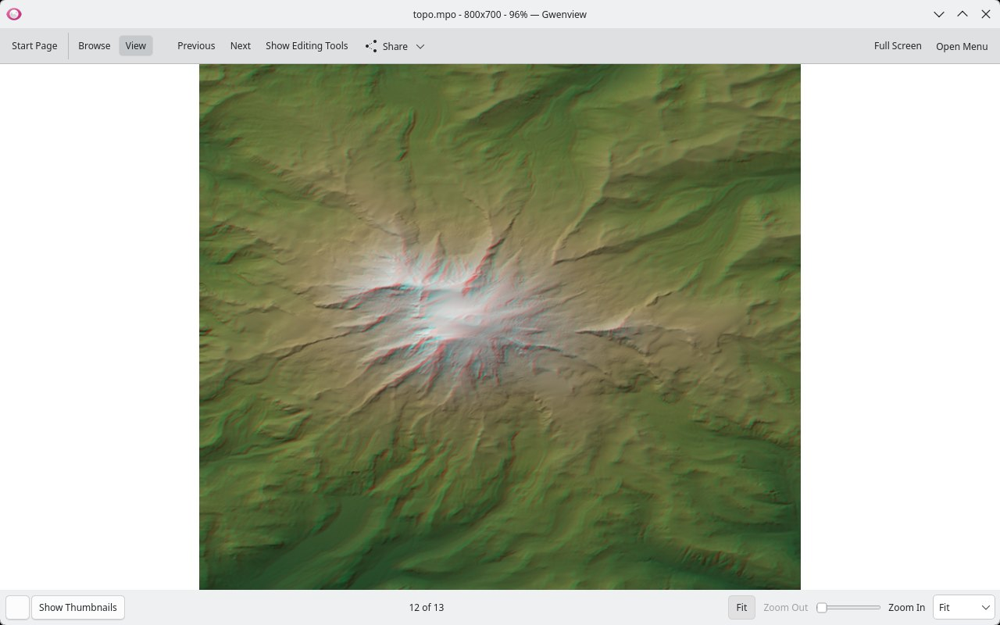
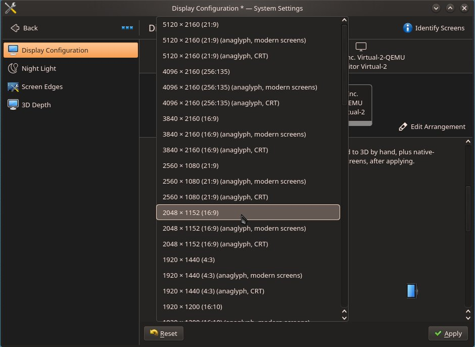
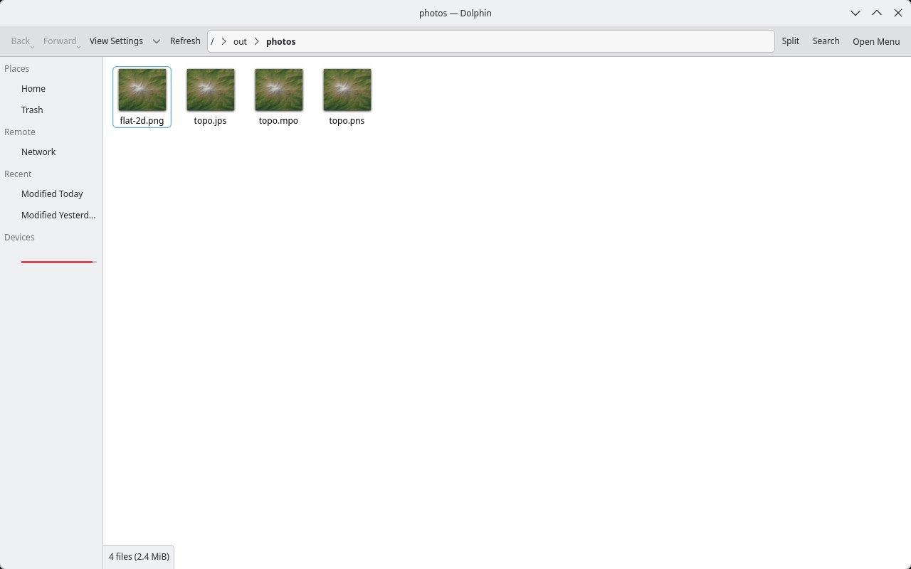
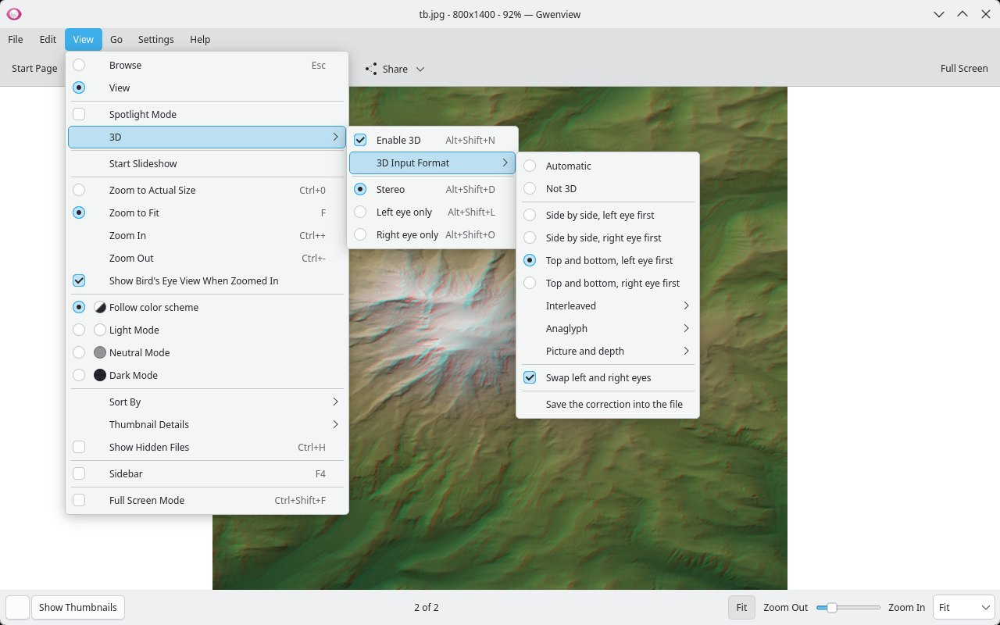

# View stereo pairs and photos on any monitor

**For** anyone with a 3D photo or a left and right pair of pictures: see it in 3D on the monitor you already have, keep the files as they are, and fix a pair that shows the wrong way round.

Any monitor with red-cyan glasses is where you start.
The same desktop also drives 3D TVs and projectors, VR headsets and glasses-free 3D displays, and each screen can show its own kind of 3D at the same time.
Sparky Stereo OS, Daniel Ramos's edition of SparkyLinux (by Paweł "pavroo" Pijanowski).

*Red-cyan glasses show this in 3D.
The summit stands 8 px in front of the screen between the eyes and the low ground 7 px behind it.
[Download the MPO (both eyes)](https://raw.githubusercontent.com/Sparky-OS/sparky-stereo-os/main/docs/guides/images/view-stereo-pairs/01-gwenview-opens-a-marked-pair.mpo)*

## 1. Turn on the 3D output for your monitor

Open System Settings, then Display Configuration, and tick **Anaglyph** for your monitor.
After applying, choose the entry **(anaglyph, modern screens)** under Resolution; a CRT has its own entry.
Every other kind of screen has its entry in the same place, for example the 3D modes of a television.
This is the only place where a screen's kind is chosen: the programs below hand the desktop the same picture for every screen.

## 2. Open a pair that carries its mark

A stereo camera's **MPO** or **JPS** file, and a **PNG named .pns** with the stereo chunk, say by themselves that they hold two pictures.
Open one in Gwenview, digiKam, Showfoto, KolourPaint or sView: each eye gets its own picture, the left eye first, and the rest of the window stays flat.
Dolphin shows the same files as 3D thumbnails.

*[Download the MPO (both eyes)](https://raw.githubusercontent.com/Sparky-OS/sparky-stereo-os/main/docs/guides/images/view-stereo-pairs/04-dolphin-thumbnails-in-3d.mpo)*

Showing a file in 3D never changes it.

## 3. Give a plain pair its packing

A picture with the two views side by side or one above the other says nothing about itself, so it opens flat.
In Gwenview choose **View, 3D, 3D Input Format** and pick how the pair is packed: **Side by side** or **Top and bottom**, **left eye first** or **right eye first**.
The pair shows in 3D at once.

*[Download the MPO (both eyes)](https://raw.githubusercontent.com/Sparky-OS/sparky-stereo-os/main/docs/guides/images/view-stereo-pairs/02-gwenview-3d-input-format-menu.mpo)*

## 4. Fix a pair that shows the wrong way round

If near things look far and far things look near, the eyes are swapped: tick **Swap left and right eyes** in the same menu.
The choice is kept for that file in your own state folder, and the file itself is untouched.
It applies to a file shown in 3D, declared or not, because a declaration can be wrong.

## 5. Keep the correction in the file, only if you want to

**Save the correction into the file** writes the packing and the eye order into a JPEG, a JPS or an MPO, and only when you choose it.
Then the file carries the correction, the choice in the menu goes back to Automatic, and every program opens the file right.

## 6. Make a pair from two pictures

Select the left picture and the right picture in Dolphin, open the context menu and choose **Align stereo pair**.
Pick **Save as MPO**, **Save as JPS** or **Save as PNS**, and say which picture is the left eye.
The two pictures are aligned first, and the result is a new file beside them.

## Try it on a real pair

The [sample pairs](samples/view-stereo-pairs/README.md) are free to use and each one lists its author and licence: a topographic pair made from a public elevation model, and a pair taken with a Nintendo 3DS.
Open one now, then give a pair of your own the same treatment.

Credits for the programs and the pictures: [ATTRIBUTIONS.md](../../ATTRIBUTIONS.md).
