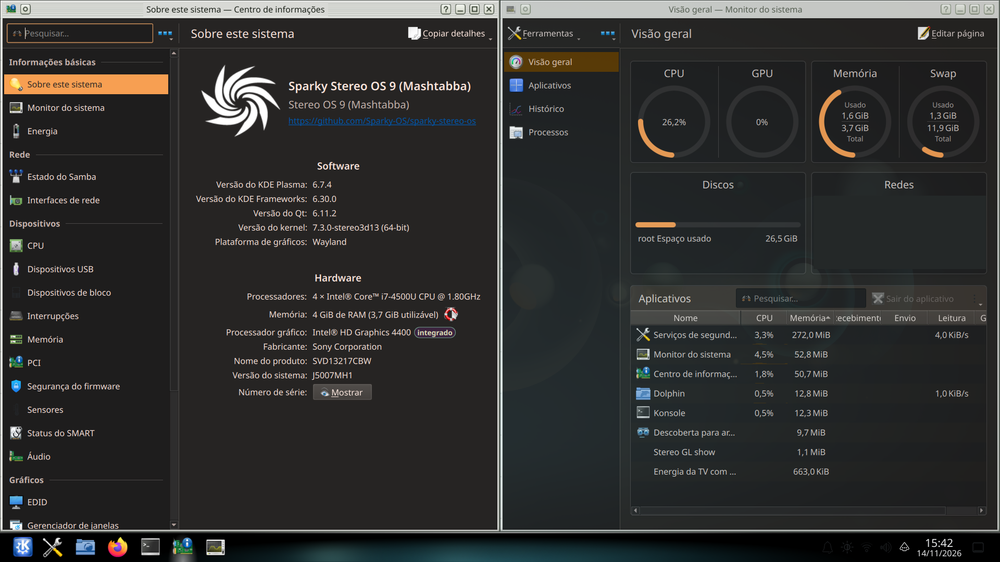
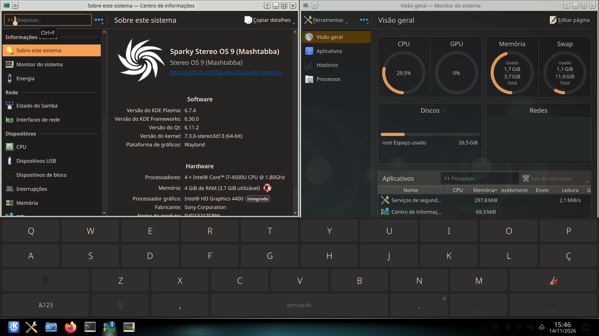

# The hardware behind it

**For** anyone who wonders what it takes: the two ordinary machines and the two 3D TVs that everything here is built and tested on.

Sparky Stereo OS is built and tested on two ordinary machines, the ones Daniel already had: a home PC and a 2016 laptop.
There is no workstation graphics card and no special 3D monitor.
The 3D screens are two Sony TVs from 2011 and 2012, and any monitor with red-cyan glasses.

Stereo programs used to need all of that: a workstation graphics card, its vendor's driver and a stereo monitor.
Here the 3D comes from the open software every Linux desktop already runs, the graphics drivers and the desktop itself, so the computer you have is the computer that shows 3D.

## The desktop

Daniel's home PC, where the edition is built and used every day.

| Part | Model |
|---|---|
| Processor | AMD Ryzen 5 5600G, 6 cores, with its own Radeon graphics |
| Graphics | the processor's Radeon graphics, and an NVIDIA GeForce RTX 3060 (12 GB) |
| Board | ASUS TUF Gaming X570-Plus |
| Memory | 96 GB |
| Storage | two NVMe SSDs, SATA SSDs, and hard disks for files |
| 3D screens | Sony BRAVIA KDL-46EX725 (2011) and KDL-46HX855 (2012), both 3D TVs |

The screens run from both graphics chips at once: the processor's own Radeon and the RTX 3060.
The large memory and the many disks are for building the whole system from its source code, again and again: the core, the graphics drivers, the desktop and the video libraries.
Using the desktop needs far less, as the laptop below shows.

## The laptop

Daniel's field machine, an entry-level laptop from 2016.

| Part | Model |
|---|---|
| Laptop | Lenovo ideapad 310-15ABR |
| Processor | AMD A10-9600P, 4 cores (2016), with Radeon R5 graphics |
| Graphics | the processor's Radeon R5, and a small second Radeon (R5 M330 class, 2 GB) |
| Memory | 12 GB, the most it takes |
| Storage | two SATA SSDs, one in the old DVD drive's bay |
| Screens | its own 1366x768 screen, and [HDMI®](https://www.hdmi.org/resource/brand) out to the KDL-46HX855 3D TV, on the TV's second input |

It runs the same edition, installed from the same packages as the desktop: our stereo core, desktop and graphics drivers.
On the KDL-46HX855 it runs the 3D desktop by itself, with its own screen off, in full HD for each eye (the TV's frame packing mode).
Red-cyan 3D works on it too, tested by Daniel.

## An older notebook, tested

In November 2026 the edition was installed on a third machine: a Sony Vaio Duo 13 from 2013, a notebook whose screen slides down to make a tablet.

| Part | Model |
|---|---|
| Notebook | Sony Vaio Duo 13 (SVD13217CBW), 2013 |
| Processor | Intel Core i7-4500U, 2 cores and 4 threads |
| Graphics | the processor's Intel HD Graphics 4400 |
| Memory | 4 GB of DDR3 |
| Screen | 13.3 inches, 1920x1080, touch and pen |
| 3D screen | a Sony 3D TV on HDMI® |

What worked, tested by Daniel on the machine:

- The desktop on its own screen, using 1.6 GB of the 4 GB with the Info Centre and System Monitor open.
- The touch screen, with pinch to zoom in the file manager.
- Tablet mode, with the on-screen keyboard in Portuguese and the tablet's Windows key opening the launcher.
- Both cameras in Kamoso.
- The 3D desktop on the Sony TV, in the TV's frame packing mode.

What the TV showed, both eyes, as a marked stereo picture: [vaio-duo-13-tv-3d-desktop.pns](images/hardware/vaio-duo-13-tv-3d-desktop.pns).

### The front camera

The notebook's front camera (USB 0bda:5722) sends its pictures in a way the Linux camera driver does not expect, and Kamoso could not show it.
The edition's kernel carries a correction for this camera and for one sibling model, with its test, following the patches of Julian Meyer and Muhammad Waleed Badar.
Mainline Linux does not have this correction.
With it, 640x480, 1280x720 and 1920x1080 all came through as whole frames on this notebook.

### What the edition learned from it

- A small dense screen like this one starts at 125 %, so the text is readable from the first minute.
- On a machine with a touch screen, the on-screen keyboard appears by itself in tablet mode, and the panel hides there.
- A machine with a known fault gets its known correction from the edition's hardware detection; this notebook is the first entry.

## What it costs on the laptop

The laptop holds 24 fps in every desktop case, 2D and 3D; the numbers, the method and the scripts: [what stereo costs KWin on a 2016 laptop](measurements/kwin-stereo-cost-a10-2026-10-23.md).

## Your hardware

If your machine runs a current Linux desktop, it is the kind of machine this is made for.
Tell us what you have: sign up in your language on [the front page](../README.md) and list your 3D gear.

HDMI®, HDMI® High-Definition Multimedia Interface and the HDMI® Logo are trademarks or registered trademarks of HDMI Licensing Administrator, Inc.
