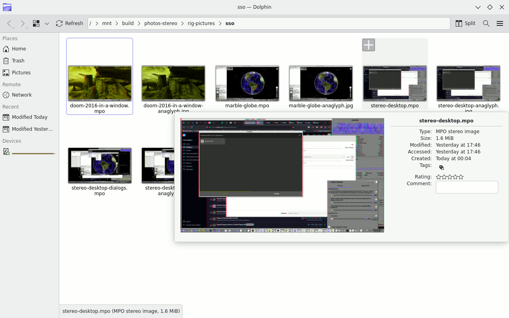
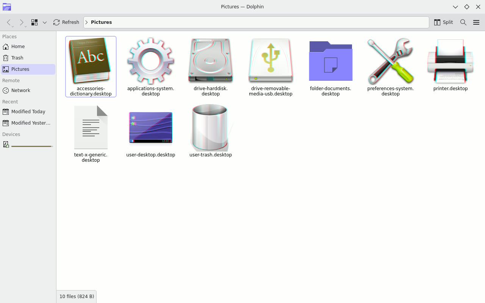

# Dolphin shows stereo files in 3D

Tested on 14 October 2026, and passed on Daniel's own 3D TV: "dolphin preview - pass", "both, icon and preview".

## What changed

- A stereo photo or video gets a thumbnail that keeps both views, so on a 3D screen each eye sees its own.
- The hover tooltip and the information panel show the file in 3D, each view as large as a flat preview.
- A stereo icon theme draws each icon once per eye.
- A setting, "Preview stereo files: As 3D / Flat", with As 3D by default.
- On a 2D screen, and with Flat, Dolphin draws exactly what the unmodified Dolphin draws.

## Look at it

The edition's screenshot folder, with the 3D tooltip open over a stereo screenshot:

[MPO for a 3D TV or stereo viewer](images/screenshot-folder-tooltip.mpo)

A stereo icon theme, each icon drawn per eye:

[MPO](images/stereo-icons-128.mpo)

## The measurements

Captured from a headless KWin (4:6.7.4-2+stereo3d21) that shows both eyes side by side, compared pixel by pixel.

| Check | Result |
|---|---|
| Left eye in 3D against the Flat setting | 0 differing pixels |
| A 2D screen against the Flat setting | 0 differing pixels |
| 3D tooltip's left eye against the flat tooltip | 0 of 314,025 pixels |
| Stereo icons, each eye against its own view | mean difference 0 (with the eyes swapped: 5.6 to 16.3) |
| 2D icons against the unmodified Dolphin | 0 differing pixels |
| Grid thumbnail detail at 160 pixel icons | 31 to 33 (a flat thumbnail: 31 to 32; before this work: 24 to 26) |

The full tables, the captures of both eyes and the logs: [repo.sparkyos.org/proofs/dolphin-stereo-previews-2026-10-14](https://repo.sparkyos.org/proofs/dolphin-stereo-previews-2026-10-14/).

## The code and the packages

- [stereo-layer](https://github.com/Sparky-OS/stereo-layer) 1.3.0, the shared stereo library the previews are built on.
- Branches `stereo3d` of [Dolphin](https://invent.kde.org/danielcamposramos/dolphin/-/tree/stereo3d), [KIO](https://invent.kde.org/danielcamposramos/kio/-/tree/stereo3d), [kio-extras](https://invent.kde.org/danielcamposramos/kio-extras/-/tree/stereo3d), [ffmpegthumbs](https://invent.kde.org/danielcamposramos/ffmpegthumbs/-/tree/stereo3d) and [KIconThemes](https://invent.kde.org/danielcamposramos/kiconthemes/-/tree/stereo3d).
- Packages: dolphin 4:26.08.0-1+stereo3d3, kio 6.30.0-1+stereo3d2, kio-extras and ffmpegthumbs +stereo3d2, KIconThemes 6.30.0-1+stereo3d1.
