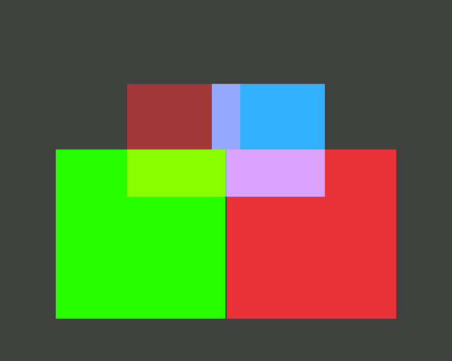

# Waterfox: stereo video marks and WebXR on a flat 3D screen

Tested on 14 October 2026.

## What changed

- A web video's stereo mark is read in this order: the stream's frame packing SEI, the container's mark (Matroska StereoMode, the MP4 `st3d` box), the user's choice in a 3D Video menu, and the picture's shape last.
- Right-eye-first, top-and-bottom and clipped pictures are repacked into two views side by side, left eye first, and handed to the desktop.
- The screen itself is a WebXR device: a page that opens an immersive or inline-stereo session reaches a 3D TV or monitor with no headset.
- 2D pages and flat videos look exactly as before.

## Look at it

A WebXR immersive session on a flat 3D screen: the near square in front of the screen, the far one behind it.

[MPO](images/webxr-immersive-flat-screen.mpo)

## The measurements

32 test cases on KWin 4:6.7.4-2+stereo3d21 and Mesa 26.1.6-1+stereo3d10, with the disparity measured in both eyes against the expected value.

| | Before | After |
|---|---|---|
| Cases passing | 17 of 32 | 30 of 32 |
| Right-eye-first and top-and-bottom marks | fail | pass (+24.0 / -16.0 px, expected +24 / -16) |
| The user's choice on an unmarked video | fail | pass (+36.0 / -24.0 px, expected +36 / -24) |
| A 2.40:1 film that is not stereo | wrongly declared | flat |
| WebXR immersive on the flat screen | fail | pass (+242.0 px, expected +241.9) |
| Flat cases on Wayland | | pixel-identical (0.000 %) |

Still open: video with opacity or rotation stays flat, because WebRender draws it in its own tiles; that is the next milestone.

The full results, the before and after sheets for every case, and the protocol logs: [repo.sparkyos.org/proofs/waterfox-stereo-m3-2026-10-14](https://repo.sparkyos.org/proofs/waterfox-stereo-m3-2026-10-14/).

## The code and the package

- The browser's branch: [Sparky-OS/waterfox, `stereo3d`](https://github.com/Sparky-OS/waterfox/tree/stereo3d), and its packaging: [`stereo3d-packaging`](https://github.com/Sparky-OS/waterfox/tree/stereo3d-packaging).
- Package: sparky-stereo-browser 6.7.5-0+stereo3d3.
