# Screenshots in 3D

Every screenshot here was taken with the edition's Spectacle, which keeps both eyes.
Each one is shown as a red-cyan anaglyph, so red-cyan glasses show it in 3D on any screen.
Its MPO file holds both eyes as taken; GitHub cannot show an MPO, so the link downloads it, and it opens in 3D in the edition's photo programs on any of the registered outputs.
Measurements are the distance between the eyes in pixels: positive pops in front of the screen, negative sinks behind it.

## Slay the Tire, a game with its own 3D mode (24 November 2026)

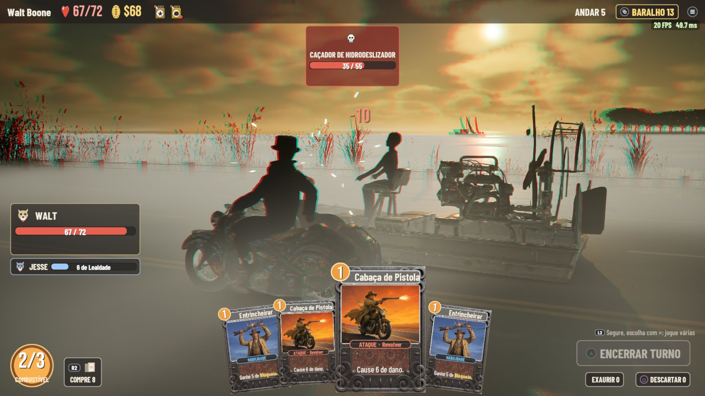

[Download the MPO (both eyes)](https://raw.githubusercontent.com/Sparky-OS/sparky-stereo-os/main/docs/screenshots/slay-the-tire-battle.mpo)

[Slay the Tire](https://store.steampowered.com/app/5379690/Slay_the_Tire/?utm_source=web-github-com&utm_medium=press&utm_campaign=launch_2026) by Save Point LLC, a Windows game running through Proton, on a 3D TV in frame packing.
Its Full SBS mode draws a full 1920x1080 picture for each eye and the desktop hands the pair to the TV.
At the game's 40 % depth: the cards and the game's own panels 0 px, the rider in front up to +6 px, the trees on the far shore -20 px.
This one was captured from the game's window, both eyes whole, not with Spectacle.

## A stereo picture in the photo viewer (17 November 2026)

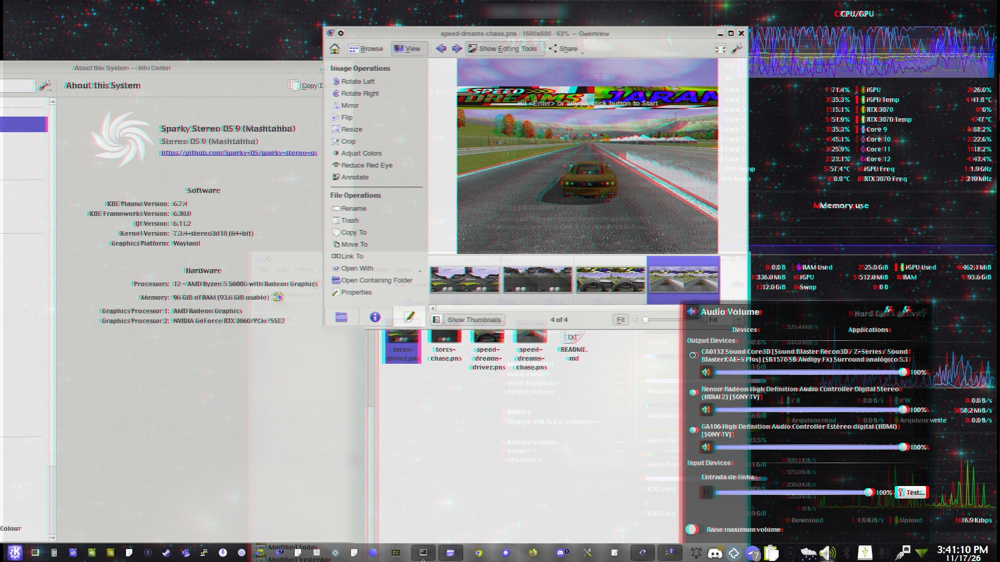

[Download the MPO (both eyes)](https://raw.githubusercontent.com/Sparky-OS/sparky-stereo-os/main/docs/screenshots/speed-dreams-in-gwenview.mpo)

Gwenview shows a marked stereo picture in depth inside its window, among the glass windows of the desktop.
The Audio Volume pop-up +6 px; the panel 0 px, at the screen.
Gwenview -2 px, the Info Centre -5 px, the file manager -7 px; the widgets and the wallpaper -12 px.
Inside Gwenview the picture keeps its own depth: the car -2 px, the road ahead -6 px, the stands and the sky -12 px.
An e-mail address, the personal folders in the file manager's side list, the weather widget's city and the UPS widget's source name are blurred in both eyes.

## Speed Dreams, from the driver's seat and from behind the car

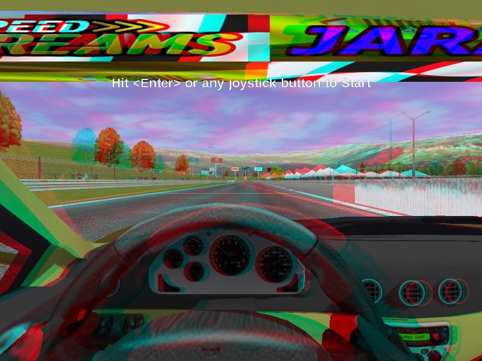 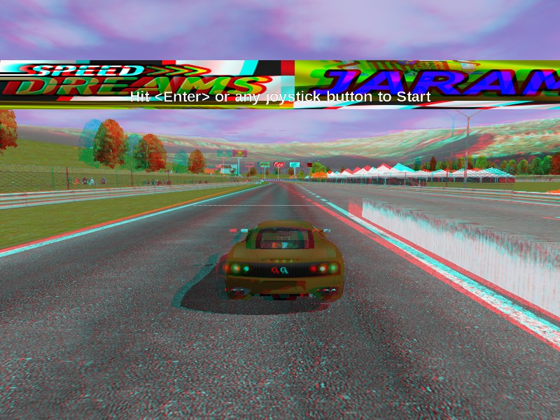

Download the MPO (both eyes): [the driver's seat](https://raw.githubusercontent.com/Sparky-OS/sparky-stereo-os/main/docs/screenshots/speed-dreams-driver-view.mpo), [behind the car](https://raw.githubusercontent.com/Sparky-OS/sparky-stereo-os/main/docs/screenshots/speed-dreams-chase-view.mpo)

Speed Dreams, the free racing simulator, drawn by two cameras through its own renderer.
Each view has its own screen plane.
From the driver's seat the panel and the steering wheel come in front of the screen and the track sinks behind it; from behind the car everything sinks, with more depth.
Measured at 800 px per eye, from the driver's seat: the panel +9 px, the steering wheel about +49 px, the far scenery -39 px.
From behind the car: the car -13 px, the road -10 px, the far scenery -22 px.
These two were captured from the desktop's compositor, not with Spectacle.
[Speed Dreams](https://www.speed-dreams.net/) is the work of the Speed Dreams team: its code under the GPL, version 2 or later, and its artwork under the Free Art License by default.

## Stereo Desktop, the Info Centre and the menu (17 October 2026)

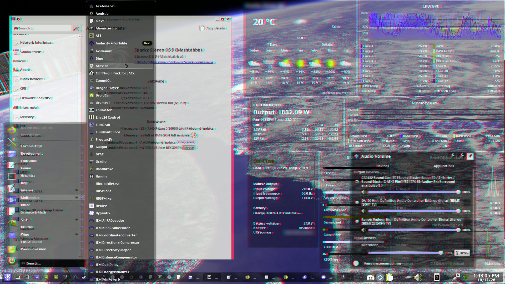

[Download the MPO (both eyes)](https://raw.githubusercontent.com/Sparky-OS/sparky-stereo-os/main/docs/screenshots/stereo-info-translucent.mpo)

The application menu's column +5 px, its list of programs 0 px; the Audio Volume pop-up +3 px; the panel 0 px, at the screen.
The Info Centre window, the weather and system monitor widgets and the wallpaper -10 px.
The weather widget's city and the UPS widget's source name are blurred in both eyes.

## Stereo Desktop, translucent (15 October 2026)

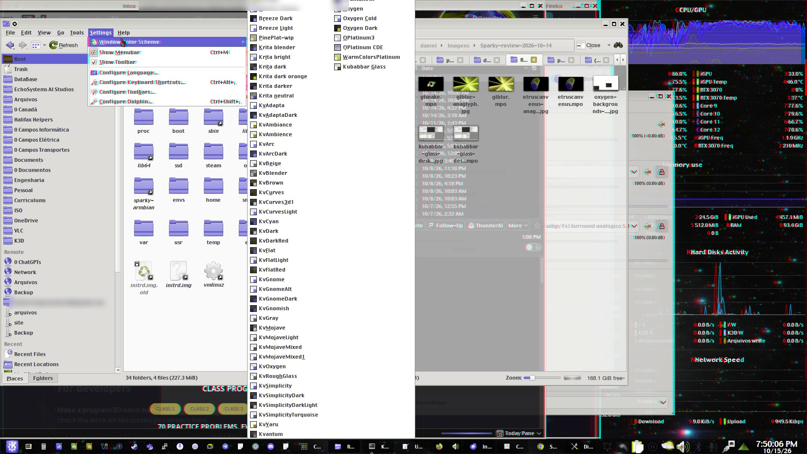

[Download the MPO (both eyes)](https://raw.githubusercontent.com/Sparky-OS/sparky-stereo-os/main/docs/screenshots/translucent-stereo-desktop.mpo)

The windows are glass, so the pile shows through.
Dolphin, the focused window, 0 px, and its Settings menu +5 px, at the user's popped limit.
The long colour-scheme list 0 px: it touches the top of the screen, and a popped thing that touches the edge stays at the screen.
Thunderbird behind -3 px; the system monitor widget and the wallpaper -10 px; the panel 0 px.
The two email addresses are blurred in both eyes.

## Stereo Desktop, a menu over a menu (13 October 2026)

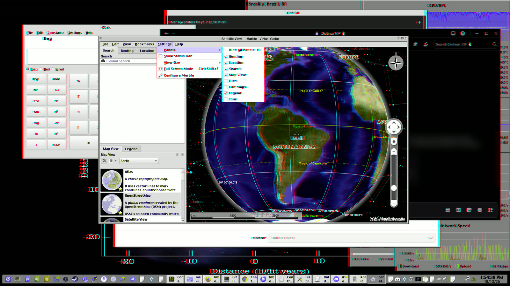

[Download the MPO (both eyes)](https://raw.githubusercontent.com/Sparky-OS/sparky-stereo-os/main/docs/screenshots/stereo-desktop-dialogs.mpo)

On a 3D TV in frame packing.
The focused Marble window 0 px, its Settings menu +2 px and the Panels sub-menu +4 px.
The four windows behind -3, -5, -8 and -10 px; the widgets and the wallpaper -10 px.
Inside the window, Marble's own 3D: the Earth's labels +12 px, the stars -13 px.
The messages in the Diolinux chat behind are blurred in both eyes.

## Stereo Desktop, a pop-up (13 October 2026)

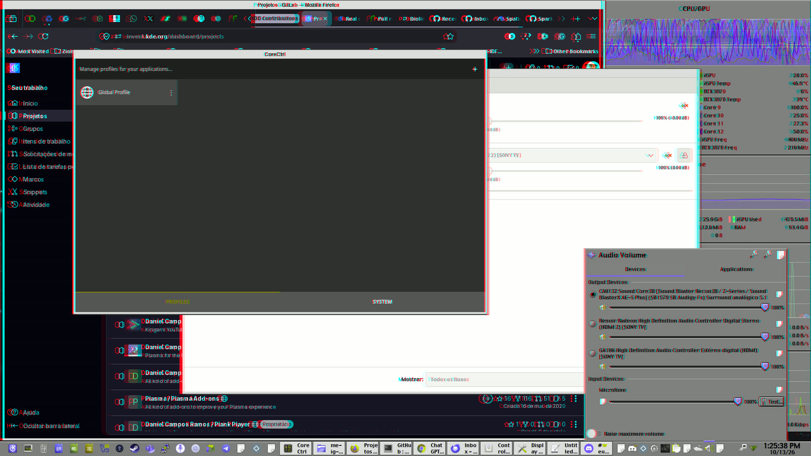

[Download the MPO (both eyes)](https://raw.githubusercontent.com/Sparky-OS/sparky-stereo-os/main/docs/screenshots/stereo-desktop.mpo)

The panel 0 px, at the screen; the sound pop-up +4 px, in front.
The three windows behind -3, -7 and -10 px; the system monitor widget -10 px, at the back with the wallpaper.

## DOOM (2016) in an ordinary window

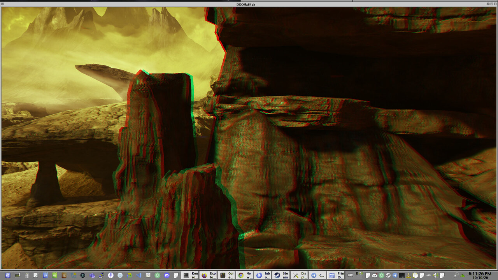

[Download the MPO (both eyes)](https://raw.githubusercontent.com/Sparky-OS/sparky-stereo-os/main/docs/screenshots/doom-2016-in-a-window.mpo)

Based on [KHARVOX](https://github.com/CactusVRStudios/KHARVOX), CactusVRStudios' DOOM (2016) VR conversion mod (MIT).
The game has depth while the panel and the window frame stay flat in both eyes.
The nearest rock 23 px apart, the far mountains 1 px, the panel 0 px.

## Marble's globe

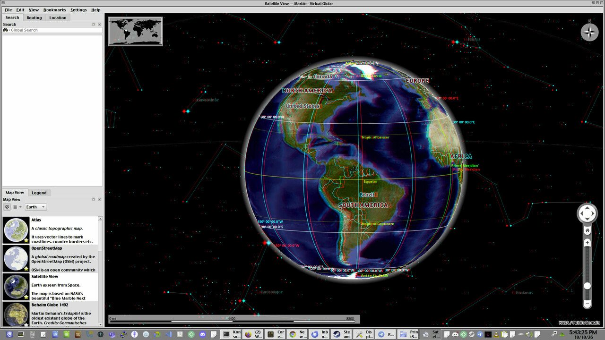

[Download the MPO (both eyes)](https://raw.githubusercontent.com/Sparky-OS/sparky-stereo-os/main/docs/screenshots/marble-globe.mpo)

The Earth in front of the screen (+11 px) and the stars behind it (-12 px), the side panel flat.
This shot predates fixes made since; the menu-over-menu picture shows Marble today.

## FreeCAD's EngineBlock example

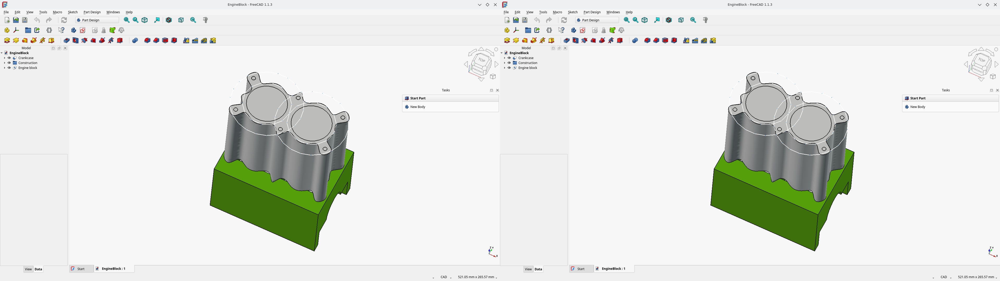

[Download the marked pair (PNG with sTER, .pns)](https://raw.githubusercontent.com/Sparky-OS/sparky-stereo-os/main/docs/screenshots/freecad-engineblock-pair.pns)

FreeCAD 1.1.3 in the edition's build: the 3D view is drawn with two parallel cameras and handed to the desktop as a pair, the depth fitted to the person's limits.
Both eyes are shown side by side, as the program hands them over.

Back to [the front page](../../README.md#seen-in-3d).
