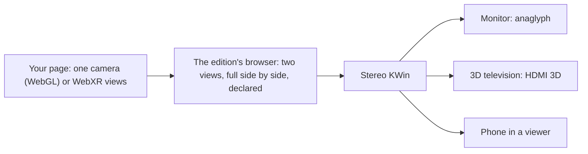

# Your 3D scene in stereo, from a web page

**For web and JavaScript developers who already render 3D worlds:** how a scene you draw today shows in stereo 3D, first in any browser with red and cyan glasses, then on Sparky Stereo OS on any 3D screen: a television, a projector, an ordinary monitor in anaglyph, a phone in a viewer.

**The short answer:** you already have the 3D world.
Stereo is the same world seen from two cameras, about an eye's distance apart.
There is nothing special to create: every object already in your scene shows up in depth, and its distance from the camera decides whether it sits behind the screen, on it or in front of it.

## 1. How a flat screen shows depth

Each eye sees its own picture.
When the two pictures differ only by a horizontal shift, the brain fuses them into one picture with depth: that shift is the **parallax**.
- **Zero parallax:** the object is identical in both pictures and sits on the screen.
- **Uncrossed parallax** (the left eye's picture further left): the object sits behind the screen, as if seen through a window.
- **Crossed parallax** (the left eye's picture further right): the object comes out of the screen.

A 3D scene gets this for free from two cameras.
A 2D picture can get it too, by shifting its parts (section 6).

## 2. The formula: two cameras, one window

The rule we use everywhere, from games to the desktop, is in [the formula, section 1](formula.md#1-the-eyes-a-window-not-a-headset) and [the two-cameras skill](../skills/stereo-two-cameras/SKILL.md):

- **Parallel axes, never toe-in.** Each eye's camera is the scene camera moved sideways by half the separation, looking in the same direction. Turning the cameras inward towards one point makes vertical disparity at the edges, which the eyes cannot fuse.
- **Off-axis frustums that share one window.** Each eye's frustum is shifted so that both meet at the same rectangle at the convergence distance `C`: that rectangle is the screen plane.
- **No vertical disparity.** Any vertical difference between the eyes is a bug.
- **2D on top** (labels, a legend, the cursor) is drawn once and is identical in both eyes, so it sits on the screen plane.

**The numbers.** For two cameras `e` apart and a point at distance `Z`, the parallax measured on the screen plane is

```
p = e · (1 − C / Z)
```

zero at `Z = C`, growing towards `e` as `Z` goes to infinity, and negative (in front of the screen) for `Z < C`.
On the physical screen it is `p` times the screen's width divided by the width of the view at the screen plane, `W = 2 · C · tan(horizontal field of view / 2)`.
So **what a point at infinity shows on the screen is `e / W` of the screen's width.**

A worked example with three.js's default separation, `e = 0.064` (64 mm in metres), the screen plane at `C = 3` and a 90° horizontal field of view: `W = 6`, so infinity shows 1.07 % of the width, about 1.1 cm on a television one metre wide.
An object at half the screen distance (`Z = 1.5`) comes out of the screen by the same amount.

## 3. A headset is not a screen

The same two cameras serve both, but the separation that looks right differs, and this is the difference most VR code carries into 3D screens.

| | Headset (VR) | 3D screen (television, monitor, projector, anaglyph) |
|---|---|---|
| Each eye sees | its own display, through its own lens | one screen, shared by both eyes |
| Projection | symmetric per eye, centred on its lens | off-axis, both frustums sharing the screen's window |
| The view follows | the head (tracking) | the program: mouse, keys, animation |
| Scale | the world at life size; the separation is the person's own eye distance | the screen is a window; the world behind it can have any scale |
| Separation | **can be larger**: nothing frames the picture, and the eyes' pictures never mix | **gentle**: a frame around the picture, and pictures that mix a little (anaglyph more) |
| Text and HUD | a panel floating in the world | on the screen plane, or at its own element's depth |

Why the screen needs less:
- **The eyes focus on the screen** while they turn towards the object. The further the object is from the screen plane, the bigger that conflict, and the sooner the eyes tire.
- **Behind the screen, the parallax must never exceed the distance between the eyes** (about 6.5 cm on the physical screen), or the eyes would have to turn outwards. Comfortable is well below it.
- **The frame is part of the scene.** An object in front of the screen that touches the screen's edge is cut by something that should be behind it, and the depth breaks. Keep popped objects away from the edges.
- **The pictures mix a little:** anaglyph glasses let some of the other eye's colour through, and so do some active and passive screens. Large parallax doubles the ghost.

So on a screen, most of the scene goes a little behind the screen plane, and the nearest things come a little in front: **a gentle pop**.
Our measured defaults:
- **Half-Life 2 on a 46-inch television:** separation 2.5 game units (about 64 mm) with the screen plane at 120 units ([formula](formula.md)).
- **The edition's browser:** 2 % of the view's width for a point at infinity.

The edition's browser will get both modes for WebXR pages, its next step there: one for 3D screens and anaglyph (gentle) and one for a phone in a viewer (larger).
The person chooses between them; they are never chosen automatically, because one desktop can show a 3D television and a viewer at the same time.

## 4. Step one: any browser, red and cyan glasses

To test with colour glasses before anything else, render anaglyph straight from the page.
three.js does it properly: its [`AnaglyphEffect`](https://github.com/mrdoob/three.js/blob/dev/examples/jsm/effects/AnaglyphEffect.js) builds two cameras with parallel axes and frustums framed on one virtual screen, and mixes them with Dubois' colour matrices.

```js
import * as THREE from 'three';
import { AnaglyphEffect } from 'three/addons/effects/AnaglyphEffect.js';

const renderer = new THREE.WebGLRenderer({ antialias: true });
document.body.appendChild(renderer.domElement);
const camera = new THREE.PerspectiveCamera(60, innerWidth / innerHeight, 0.1, 100);
const scene = new THREE.Scene();
// ... your world, as today ...

const effect = new AnaglyphEffect(renderer, innerWidth, innerHeight);
effect.eyeSep = 0.064;      // the distance between the two cameras, in world units
effect.planeDistance = 3;   // the screen plane: objects at this distance sit on the screen

renderer.setAnimationLoop(() => effect.render(scene, camera));
```

Red lens on the left eye.
`eyeSep` and `planeDistance` are in recent three.js; older releases took the screen plane from `camera.focus` instead.

**Other ways in three.js:**
- [`StereoCamera`](https://github.com/mrdoob/three.js/blob/dev/src/cameras/StereoCamera.js) gives the two eye cameras of any `PerspectiveCamera` (off-axis, after Paul Bourke; `eyeSep`, and the screen plane at `camera.focus`), for your own rendering: two viewports, two render targets, your own compositing.
- [`StereoEffect`](https://github.com/mrdoob/three.js/blob/dev/examples/jsm/effects/StereoEffect.js) draws the two eyes side by side, left eye on the left, for parallel viewing or a phone viewer.

**Babylon.js** has anaglyph and side-by-side cameras (`AnaglyphArcRotateCamera`, `AnaglyphUniversalCamera`, `StereoscopicArcRotateCamera` and the rig modes on `Camera`), but its rigs turn both cameras towards one focal point ([`_getRigCamPositionAndTarget`](https://github.com/BabylonJS/Babylon.js/blob/master/packages/dev/core/src/Cameras/targetCamera.pure.ts)): that is toe-in, so check the vertical disparity near the corners, or build the two cameras yourself the three.js way.

**This anaglyph is for testing only.**
On Sparky Stereo OS a page never makes anaglyph or side by side itself: the system does it for every screen (step two), and anaglyph inside anaglyph is unreadable.

## 5. Step two: Sparky Stereo OS, any 3D screen

On the edition, a program hands the desktop its two views once, as full side by side (left view first, each view at its own resolution), and the desktop's compositor, Stereo KWin, turns that into whatever each screen needs ([house formats](house-formats.md), [KWin's design](https://invent.kde.org/danielcamposramos/kwin/-/blob/stereo3d/STEREO3D.md)).
In the browser, you never touch that: the edition's browser, `sparky-stereo-browser` ([Sparky-OS/waterfox, `stereo3d`](https://github.com/Sparky-OS/waterfox/tree/stereo3d)), does the handing over.



**Route A: a plain WebGL page, unchanged.**
Draw your scene with one camera, as today, and the browser draws it once per eye from that camera: parallel axes, off-axis frustums, never toe-in ([dom/canvas/WebGLStereoCamera.h](https://github.com/Sparky-OS/waterfox/blob/stereo3d/dom/canvas/WebGLStereoCamera.h)).
- **Turn it on per site:** right-click the page, **3D Canvas**: Off, On, and Less, Normal, More or Most Depth (1, 2, 3 or 4 % of the view's width at infinity). It is off until you choose.
- **What it needs from your page:** the camera reaches the GPU as a `mat4` uniform, the projection or the view-projection product, which three.js, Babylon.js and PlayCanvas all do.
- **Post-processing** (bloom, an effect composer) gets a render target per eye, so effects drawn from the scene are stereo too.
- **The HTML around the canvas stays 2D**, identical in both eyes.
- Tested in the edition on three.js, Babylon.js and PlayCanvas pages, with WebGL 1 and 2; the browser's measured video and WebXR cases are in [its proof page](proofs/waterfox-stereo-m3.md).

**Route B: WebXR.**
Ask for an immersive session as for a headset; on the edition, the 3D screen itself is offered as the WebXR device whenever an output shows 3D, or can.
Your page renders both views; on a real headset the same page runs unchanged.

```js
import { VRButton } from 'three/addons/webxr/VRButton.js';
renderer.xr.enabled = true;
document.body.appendChild(VRButton.createButton(renderer));
renderer.setAnimationLoop(() => renderer.render(scene, camera));
```

Today that route hands the page a headset's views, so the depth is too strong for a screen (section 3); the screen mode comes next.
A page can also ask for an `inline-stereo` session, which the WebXR Device API gained on 9 June 2026 ([#1436](https://github.com/immersive-web/webxr/pull/1436)): the two views are drawn inside the page itself, and the edition's browser hands them to the 3D screen ([its proof page](proofs/waterfox-stereo-m3.md)).
WebXR follows its own specifications, and we add no attribute of our own: [WebXR Device API](https://www.w3.org/TR/webxr/) (written at [immersive-web/webxr](https://github.com/immersive-web/webxr)), [WebXR Layers](https://www.w3.org/TR/webxrlayers-1/).

**Then the screen is the person's choice,** in System Settings, Display Configuration, in the screen's Resolution list: anaglyph on an ordinary monitor, HDMI 3D on a television, several screens at once, each with its own output ([develop on an ordinary monitor](develop-3d-on-an-ordinary-monitor.md)).
Your page does not change.

**WebGPU.** Route A works on WebGL.
For WebXR, the W3C Immersive Web Working Group is writing the [WebXR/WebGPU Binding Module](https://immersive-web.github.io/webxr-webgpu-binding/) (an Editor's Draft, 12 August 2026).
A native program (Rust with wgpu, C++ with Vulkan) can draw both views side by side into its own surface and declare it with the shared declaration library ([libstereo-declare](https://github.com/Sparky-OS/libstereo-declare), Wayland and X11), or ask Vulkan for a two-layer swapchain, which the edition's Mesa packs and declares for it.

## 6. Depth from flat pictures

A 2D interface has no cameras, but it can still have depth: **draw it twice, one picture per eye, and shift each element sideways by its own amount**.
Nothing is rendered in 3D; the depth is only the shift.

- **An element at depth `d` pixels:** in the left eye's picture move it `d / 2` to the right, in the right eye's picture `d / 2` to the left. Positive `d` pops it out of the screen, negative sinks it behind, zero leaves it on the screen.
- **Its text moves with it.** Text at its element's depth reads fine; what tires the eyes is text at one depth lying over a picture at another.
- **A few pixels are enough.** The desktop uses three places, sunk, screen and popped, all subtle, and everything in between by stacking order ([depth on the desktop](depth-on-the-desktop.md)).
- **What the interface already fakes becomes real.** A shadow or an elevation that says "this is above" turns into a real shift: the 2D cue drawn twice, not a new design.
- **Nothing popped touches the screen's edge,** for the frame reason in section 3.

A sketch for a 2D canvas, tested with red and cyan glasses in any browser:

```js
// leftCtx, rightCtx, outCtx: three 2D canvases of the same size, w x h
// items: { draw(ctx, x, y), x, y, depth }   depth in pixels: > 0 pops, < 0 sinks
function drawEye(ctx, eye) {                 // eye = -1 for the left eye, +1 for the right
  ctx.clearRect(0, 0, ctx.canvas.width, ctx.canvas.height);
  for (const item of items) item.draw(ctx, item.x - eye * item.depth / 2, item.y);
}

drawEye(leftCtx, -1);
drawEye(rightCtx, +1);
const L = leftCtx.getImageData(0, 0, w, h), R = rightCtx.getImageData(0, 0, w, h);
for (let i = 0; i < L.data.length; i += 4) {   // red from the left eye, green and blue from the right
  L.data[i + 1] = R.data[i + 1];
  L.data[i + 2] = R.data[i + 2];
}
outCtx.putImageData(L, 0, 0);
```

On the edition the desktop does this for every window, menu and notification on its own.
For a page, the standard way to hand the system two such pictures is WebXR (its layers carry a stereo left and right picture); until then, flat planes placed at different distances in a WebGL scene get their depth from route A.

**On a 2D screen the same depth reads too,** with no glasses: a popped element is drawn a little larger and a little up and to the left, a sunk one smaller.

## 7. Check it

- **Look at each eye alone.** Capture the left and the right picture; anything that differs vertically is a bug.
- **Measure the parallax** of a near, a screen-plane and a far object, and compare it with `p = e · (1 − C / Z)`.
- **The 2D parts** (HTML, HUD, labels drawn once) must be identical in both eyes, pixel for pixel.
- **Effects that remember past frames** (motion blur, temporal anti-aliasing, a trail) keep one memory per eye, or each eye blurs against the other's camera.
- How we do all this for every program, headless: [the proof rig skill](../skills/stereo-proof-rig/SKILL.md).

## 8. Where to read more

**Ours:**
- [The formula](formula.md): from a VR engine to a 3D display, learned on Half-Life 2.
- [One world, two cameras](../skills/stereo-two-cameras/SKILL.md): the camera maths by kind of camera, with the programs that use each.
- [From a VR engine to a 3D display](../skills/vr-to-3d/SKILL.md): play on a screen, the spectator, headset cameras.
- [Depth on the desktop](depth-on-the-desktop.md): the 2D interface's three places.
- [Develop 3D and XR on an ordinary monitor](develop-3d-on-an-ordinary-monitor.md): the whole developer path, without a 3D television.
- [The browser's stereo, measured](proofs/waterfox-stereo-m3.md).
- [House formats](house-formats.md): one format inside, conversions at the edges.

**Theirs:**
- three.js: [`StereoCamera`](https://github.com/mrdoob/three.js/blob/dev/src/cameras/StereoCamera.js), [`AnaglyphEffect`](https://github.com/mrdoob/three.js/blob/dev/examples/jsm/effects/AnaglyphEffect.js), [`StereoEffect`](https://github.com/mrdoob/three.js/blob/dev/examples/jsm/effects/StereoEffect.js), [WebXR samples](https://threejs.org/examples/?q=webxr).
- Paul Bourke, [calculating stereo pairs](https://paulbourke.net/stereographics/stereorender/): the off-axis method three.js follows.
- [WebXR Device API](https://www.w3.org/TR/webxr/) and its repository [immersive-web/webxr](https://github.com/immersive-web/webxr) (the `inline-stereo` mode, [#1436](https://github.com/immersive-web/webxr/pull/1436)), [WebXR Layers](https://www.w3.org/TR/webxrlayers-1/), [WebXR/WebGPU Binding](https://immersive-web.github.io/webxr-webgpu-binding/), and the [Immersive Web samples](https://immersive-web.github.io/webxr-samples/).

Sparky Stereo OS, Daniel Ramos's edition of SparkyLinux (by Paweł "pavroo" Pijanowski).
